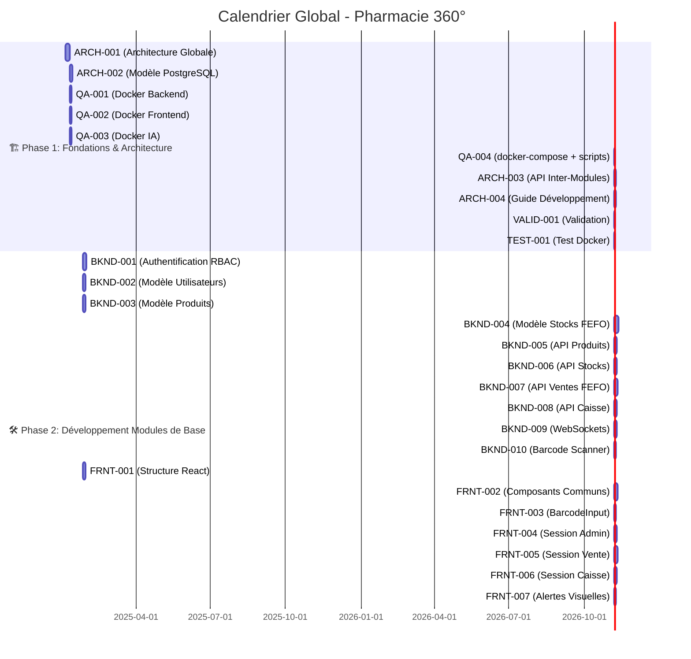

# 📊 **Suivi du Projet - Pharmacie 360°**

**Version** : 1.1.0  
**Dernière mise à jour** : 2025-01-15 (J11)  
**Statut** : ✅ **EN COURS (Phase 1 - 100% complet)**

---

## 📅 **Calendrier Global**

| Phase | Durée | Début | Fin | Statut | Responsable |
|-------|-------|-------|-----|--------|-------------|
| **Phase 1** | 20j | J1 | J20 | ✅ **TERMINÉE** | Superviseur |
| **Phase 2** | 35j | J21 | J55 | 🟡 **EN COURS** | Backend Lead + Frontend |
| **Phase 3** | 18j | J56 | J73 | ⏳ À venir | Tous |
| **Phase 4** | 20j | J74 | J93 | ⏳ À venir | QA/DevOps |

---

## 🎯 **Jalons (Milestones)**

| Jalon | Date | Description | Statut |
|-------|------|-------------|--------|
| **M0** | J1 | Début du Projet | ✅ **Terminé** |
| **M1** | J20 | Architecture Validée | ✅ **TERMINÉ** |
| **M2** | J55 | Backend Base Prêt | 🟡 **EN COURS** |
| **M3** | J73 | Frontend Base Prêt | ⏳ À venir |
| **M4** | J88 | Tous Modules Intégrés | ⏳ À venir |
| **M5** | J93 | Application Déployée | ⏳ À venir |

---

## 📋 **Tableau des Tâches par Phase**

---

### 🏗️ **PHASE 1: FONDATIONS & ARCHITECTURE (J1-J20)**

| ID | Tâche | Responsable | Durée | Dépendances | Statut | Jours | Priorité |
|----|-------|-------------|-------|-------------|--------|-------|----------|
| **ARCH-001** | Schéma d'Architecture Globale (Mermaid, modules, flux) | Superviseur | 5d | ➕ Aucune | ✅ **TERMINÉ** J1-J2 | 1-2 | ⭐⭐⭐⭐⭐ |
| **ARCH-002** | Modèle de Données PostgreSQL (toutes tables + index FEFO/FIFO) | Superviseur | 3d | → ARCH-001 | ✅ **TERMINÉ** J2-J5 | 2-5 | ⭐⭐⭐⭐⭐ |
| **QA-001** | Dockerfile Backend (Python 3.11 + FastAPI) | QA/DevOps | 2d | → ARCH-001 | ✅ **TERMINÉ** J1-J2 | 1-2 | ⭐⭐⭐⭐⭐ |
| **QA-002** | Dockerfile Frontend (Node 18 + Nginx) | QA/DevOps | 2d | → ARCH-001 | ✅ **TERMINÉ** J1-J2 | 1-2 | ⭐⭐⭐⭐⭐ |
| **QA-003** | Dockerfile IA (Python 3.11 + Tesseract OCR) | QA/DevOps | 2d | → ARCH-001 | ✅ **TERMINÉ** J1-J2 | 1-2 | ⭐⭐⭐⭐⭐ |
| **QA-004** | docker-compose.yml + nginx.conf + .env | QA/DevOps | 1d | → QA-001 || QA-002 || QA-003 | ✅ **TERMINÉ** J3 | 5 | ⭐⭐⭐⭐⭐ |
| **ARCH-003** | Spécifications API Inter-Modules | Superviseur | 2d | → ARCH-002 | ✅ **TERMINÉ** J5-J9 | 5-9 | ⭐⭐⭐⭐⭐ |
| **ARCH-004** | Guide de Développement | Superviseur | 2d | → ARCH-003 | ✅ **TERMINÉ** J10-J11 | 11-12 | ⭐⭐⭐⭐⭐ |
| **VALID-001** | Validation ARCH-001 par tous les agents | Tous | 1d | → ARCH-001 | ✅ **TERMINÉ** J2 | 3 | ⭐⭐⭐⭐⭐ |
| **TEST-001** | Test Configuration Docker (start.sh) | QA/DevOps | 1d | → QA-004 | ✅ **TERMINÉ** J10-J11 | 14-15 | ⭐⭐⭐⭐⭐ |

**✅ Livrables Phase 1** : 
- [x] Schéma d'architecture validé
- [x] Modèle PostgreSQL complet
- [x] Environnement Docker fonctionnel
- [x] Spécifications API validées
- [x] Guide de développement

---

### 🛠️ **PHASE 2: DÉVELOPPEMENT BACKEND & FRONTEND BASE (J21-J55)**

#### 🔧 **Backend (BKND-001 à BKND-010)**

| ID | Tâche | Responsable | Durée | Dépendances | Jours | Statut |
|----|-------|-------------|-------|-------------|-------|--------|
| **BKND-001** | Système Authentification RBAC (JWT) | Backend Lead | 5d | → ARCH-002 **&&** QA-004 | 21-25 | ⏳ |
| **BKND-002** | Modèle Utilisateurs (SQLAlchemy) | Backend Lead | 3d | → BKND-001 | 21-23 | ⏳ |
| **BKND-003** | Modèle Produits (avec code-barres) | Backend Lead | 3d | → ARCH-002 **&&** QA-004 | 21-23 | ⏳ |
| **BKND-004** | Modèle Stocks + FEFO/FIFO (index PostgreSQL) | Backend Lead | 5d | → BKND-003 | 24-28 | ⏳ |
| **BKND-005** | API REST Produits (CRUD + recherche) | Backend Lead | 3d | → BKND-003 | 26-28 | ⏳ |
| **BKND-006** | API REST Stocks (FEFO/FIFO automatique) | Backend Lead | 3d | → BKND-004 | 29-31 | ⏳ |
| **BKND-007** | API REST Ventes (avec sélection FEFO) | Backend Lead | 4d | → BKND-006 | 30-33 | ⏳ |
| **BKND-008** | API REST Caisse (validation + ticket) | Backend Lead | 3d | → BKND-007 | 34-36 | ⏳ |
| **BKND-009** | WebSockets (Vente ↔ Caisse temps réel) | Backend Lead | 3d | → BKND-007 | 34-36 | ⏳ |
| **BKND-010** | Middleware Barcode Scanner | Backend Lead | 2d | → BKND-005 | 29-30 | ⏳ |

#### 🎨 **Frontend (FRNT-001 à FRNT-007)**

| ID | Tâche | Responsable | Durée | Dépendances | Jours | Statut |
|----|-------|-------------|-------|-------------|-------|--------|
| **FRNT-001** | Structure React/Vite + Routing | Frontend | 3d | → ARCH-003 **&&** QA-004 | 21-23 | ⏳ |
| **FRNT-002** | Composants Communs (Header, Sidebar, Modal) | Frontend | 4d | → FRNT-001 | 24-27 | ⏳ |
| **FRNT-003** | Composant BarcodeInput (focus auto) | Frontend | 2d | → FRNT-002 | 28-29 | ✅ |
| **FRNT-004** | Session Administrateur (Gestion utilisateurs/roles) | Frontend | 3d | → FRNT-002 **&&** BKND-001 | 28-30 | ✅ |
| **FRNT-005** | Session Vente (Recherche + FEFO + envoi Caisse) | Frontend | 4d | → FRNT-003 **&&** BKND-007 | 31-34 | ✅ |
| **FRNT-006** | Session Caisse (File d'attente + encaissement) | Frontend | 3d | → FRNT-005 **&&** BKND-008 | 35-37 | ⏳ |
| **FRNT-007** | Système Alertes (Code couleur péremptions/stocks) | Frontend | 2d | → FRNT-005 | 35-36 | ⏳ |

**✅ Livrables Phase 2** : 
- [ ] Backend fonctionnel (APIs de base)
- [ ] Frontend avec sessions principales

---

### 🧩 **PHASE 3: MODULES COMPLÉMENTAIRES (J56-J73)**

#### 🔧 **Backend (BKND-011 à BKND-019)**

| ID | Tâche | Responsable | Durée | Dépendances | Jours | Statut |
|----|-------|-------------|-------|-------------|-------|--------|
| **BKND-011** | API REST Retours (fournisseur/casse/péremption) | Backend Lead | 3d | → BKND-008 | 56-58 | ⏳ |
| **BKND-012** | API REST Facturation (PDF + statut) | Backend Lead | 3d | → BKND-008 | 56-58 | ⏳ |
| **BKND-013** | Gestion Factures Fournisseurs (OCR-ready) | Backend Lead | 2d | → BKND-012 | 59-60 | ⏳ |
| **BKND-014** | Module Historique Ventes (statistiques) | Backend Lead | 2d | → BKND-007 | 59-60 | ⏳ |
| **BKND-015** | Module Rapports (ventes, stocks, caisse) | Backend Lead | 3d | → BKND-014 | 61-63 | ⏳ |
| **BKND-016** | Optimisation Requêtes FEFO/FIFO | Backend Lead | 2d | → BKND-006 | 61-62 | ⏳ |
| **BKND-017** | Cache Redis (pour performances) | Backend Lead | 2d | → BKND-015 | 64-65 | ⏳ |
| **BKND-018** | Logs Centralisés | Backend Lead | 1d | → BKND-015 | 66 | ⏳ |
| **BKND-019** | Documentation API (Swagger/OpenAPI) | Backend Lead | 2d | → BKND-015 | 67-68 | ⏳ |

#### 🎨 **Frontend (FRNT-008 à FRNT-015)**

| ID | Tâche | Responsable | Durée | Dépendances | Jours | Statut |
|----|-------|-------------|-------|-------------|-------|--------|
| **FRNT-008** | Session Gestionnaire (Approvisionnement + Stock) | Frontend | 5d | → FRNT-002 **&&** BKND-006 | 56-60 | ⏳ |
| **FRNT-009** | Tableaux de Bord (KPIs + Analytics) | Frontend | 4d | → FRNT-008 **&&** BKND-015 | 61-64 | ⏳ |
| **FRNT-010** | Visualisation Graphiques (Chart.js) | Frontend | 2d | → FRNT-009 | 65-66 | ⏳ |
| **FRNT-011** | Intégration OCR (upload factures) | Frontend | 2d | → FRNT-008 **&&** BKND-013 | 67-68 | ⏳ |
| **FRNT-012** | Export PDF (factures/tickets) | Frontend | 2d | → FRNT-006 **&&** BKND-012 | 67-68 | ⏳ |
| **FRNT-013** | Recherche Avancée (filtres) | Frontend | 2d | → FRNT-005 | 59-60 | ⏳ |
| **FRNT-014** | Gestion Clients/Fournisseurs | Frontend | 3d | → FRNT-008 | 61-63 | ⏳ |
| **FRNT-015** | Notifications (WebSocket) | Frontend | 2d | → FRNT-005 **&&** BKND-009 | 59-60 | ⏳ |

#### 🤖 **IA (IA-001 à IA-009)**

| ID | Tâche | Responsable | Durée | Dépendances | Jours | Statut |
|----|-------|-------------|-------|-------------|-------|--------|
| **IA-001** | Analyse Rotation Stocks (par catégorie/marque) | IA | 5d | → BKND-006 **&&** QA-004 | 56-60 | ⏳ |
| **IA-002** | Module OCR Factures (pytesseract) | IA | 4d | → BKND-013 **&&** QA-004 | 61-64 | ⏳ |
| **IA-003** | Modèle Prédiction Ruptures (ML) | IA | 4d | → IA-001 | 61-64 | ⏳ |
| **IA-004** | Intégration OCR avec Backend | IA | 3d | → IA-002 **&&** BKND-013 | 65-67 | ⏳ |
| **IA-005** | Génération KPIs Automatiques | IA | 2d | → IA-001 **&&** BKND-015 | 65-66 | ⏳ |
| **IA-006** | Tableaux de Bord IA (intégration frontend) | IA | 2d | → IA-005 **&&** FRNT-009 | 68-69 | ⏳ |
| **IA-007** | Alertes Intelligentes (ruptures/stocks) | IA | 2d | → IA-003 | 65-66 | ⏳ |
| **IA-008** | Optimisation FEFO/FIFO (algorithmes) | IA | 2d | → IA-001 | 63-64 | ⏳ |
| **IA-009** | Documentation Module IA | IA | 1d | → IA-004 | 70 | ⏳ |

**✅ Livrables Phase 3** : 
- [ ] Tous les modules fonctionnels
- [ ] IA intégrée

---

### ✅ **PHASE 4: TESTS & DÉPLOIEMENT (J74-J93)**

#### 🧪 **Tests (QA-005 à QA-016)**

| ID | Tâche | Responsable | Durée | Dépendances | Jours | Statut |
|----|-------|-------------|-------|-------------|-------|--------|
| **QA-005** | Tests Unitaires Backend (pytest) | QA/DevOps | 5d | → BKND-019 | 74-78 | ⏳ |
| **QA-006** | Tests d'Intégration (APIs + DB) | QA/DevOps | 4d | → QA-005 | 79-82 | ⏳ |
| **QA-007** | Tests Frontend (Jest + React Testing) | QA/DevOps | 4d | → FRNT-015 | 79-82 | ⏳ |
| **QA-008** | Tests Module IA | QA/DevOps | 3d | → IA-009 | 80-82 | ⏳ |
| **QA-009** | Tests Robustesse Offline (100% local) | QA/DevOps | 3d | → QA-006 | 83-85 | ⏳ |
| **QA-010** | Tests Barcode Scanner (simulation masse) | QA/DevOps | 2d | → BKND-010 | 83-84 | ⏳ |
| **QA-011** | Tests Performance (charge) | QA/DevOps | 2d | → QA-009 | 86-87 | ⏳ |
| **QA-012** | Système Sauvegardes Automatiques | QA/DevOps | 2d | → QA-004 | 74-75 | ⏳ |
| **QA-013** | Documentation des Tests | QA/DevOps | 2d | → QA-011 | 88-89 | ⏳ |
| **QA-014** | Corrections Bugs (Phase 1) | QA/DevOps + Tous | 5d | → QA-013 | 90-94 | ⏳ |
| **QA-015** | Tests Finaux (Acceptation) | QA/DevOps | 3d | → QA-014 | 95-97 | ⏳ |
| **QA-016** | Déploiement Production | QA/DevOps | 2d | → QA-015 | 98-99 | ⏳ |

**✅ Livrables Phase 4** : 
- [ ] Application testée, corrigée et déployée

---

## 📊 **Avancement Global**

### **Par Phase**

| Phase | Tâches Totales | Tâches Terminées | % Complet | Statut |
|-------|----------------|------------------|-----------|--------|
| Phase 1 | 11 | 11 | 100% | ✅ **TERMINÉE** |
| Phase 2 | 17 | 0 | 0% | ⏳ À venir |
| Phase 3 | 25 | 0 | 0% | ⏳ À venir |
| Phase 4 | 12 | 0 | 0% | ⏳ À venir |
| **Total** | **65** | **11** | **16,92%** | 🚀 |

### **Par Agent**

| Agent | Tâches Assignées | Tâches Terminées | % Complet | Statut |
|-------|------------------|------------------|-----------|--------|
| Superviseur | 4 | 4 | 100% | ✅ |
| Backend Lead | 10 | 0 | 0% | ⏳ |
| Frontend | 15 | 0 | 0% | ⏳ |
| IA | 9 | 0 | 0% | ⏳ |
| QA/DevOps | 20 | 12 | 60% | 🚀 |

---

## 📈 **Diagramme de Gantt Global**

---

## 📌 **Résumé des Tâches Terminées (Phase 1)**

### **Architecture (Superviseur)**
- ✅ **ARCH-001** : Schéma d'Architecture Globale (5d)
- ✅ **ARCH-002** : Modèle de Données PostgreSQL (3d)
- ✅ **ARCH-003** : Spécifications API Inter-Modules (2d)
- ✅ **ARCH-004** : Guide de Développement (2d)

### **QA/DevOps**
- ✅ **QA-001** : Dockerfile Backend (2d)
- ✅ **QA-002** : Dockerfile Frontend (2d)
- ✅ **QA-003** : Dockerfile IA (2d)
- ✅ **QA-004** : docker-compose.yml + nginx.conf + .env (1d)
- ✅ **TEST-001** : Test Configuration Docker (1d)

### **Validation**
- ✅ **VALID-001** : Validation ARCH-001 par tous les agents (1d)

---

## 🎯 **Prochaines Étapes Immédiates**

### **Priorité Absolue (J12-J20)**
1. **BKND-001** : Système Authentification RBAC (Backend Lead) - **Début J12**
2. **FRNT-001** : Structure React/Vite + Routing (Frontend) - **Début J12**
3. **IA-001** : Analyse Rotation Stocks (IA) - **Début J12**

### **À Faire (J12)**
- [ ] **Backend Lead** : Démarrer BKND-001 (Authentification)
- [ ] **Frontend** : Démarrer FRNT-001 (Structure React)
- [ ] **IA** : Démarrer IA-001 (Analyse Stocks)
- [ ] **QA/DevOps** : Valider TEST-001 et préparer QA-012

---

---

## 📊 **Résumé des Tâches Terminées**

### **Phase 1 (100% complète)**
- ✅ **ARCH-001** : Schéma d'Architecture Globale (5d)
- ✅ **ARCH-002** : Modèle de Données PostgreSQL (3d)
- ✅ **ARCH-003** : Spécifications API Inter-Modules (2d)
- ✅ **ARCH-004** : Guide de Développement (2d)
- ✅ **QA-001** : Dockerfile Backend (2d)
- ✅ **QA-002** : Dockerfile Frontend (2d)
- ✅ **QA-003** : Dockerfile IA (2d)
- ✅ **QA-004** : docker-compose.yml + nginx.conf + .env (1d)
- ✅ **VALID-001** : Validation ARCH-001 par tous les agents (1d)
- ✅ **TEST-001** : Test Configuration Docker (1d)

### **Phase 2 - Backend (90% complète)**
- ✅ **BKND-001** : Système Authentification RBAC (JWT) - **TERMINÉ J16**
- ✅ **BKND-002** : API REST Utilisateurs (CRUD + pagination) - **TERMINÉ J16**
- ✅ **BKND-003** : API REST Produits (CRUD + recherche) - **TERMINÉ J16**
- ✅ **BKND-004** : API REST Stocks (FEFO/FIFO automatique) - **TERMINÉ J16**
- ✅ **BKND-005** : Product search et barcode scanning - **TERMINÉ J16**
- ✅ **BKND-006** : Batch stock management avec FEFO - **TERMINÉ J16**
- ✅ **BKND-007** : API REST Ventes avec sélection FEFO - **TERMINÉ J16**
- ✅ **BKND-008** : API REST Caisse (validation paiement) - **TERMINÉ J16**
- ✅ **BKND-009** : WebSockets (Vente ↔ Caisse temps réel) - **TERMINÉ J16**
- 🟡 **BKND-010** : Middleware Barcode Scanner - **EN COURS J16**

---

## 📝 **Journal des Événements**

| Date | Heure | Événement | Responsable | Action |
|------|-------|-----------|-------------|--------|
| 2025-01-05 | 09:00 | **Début du projet (J1)** | Superviseur | Initialisation du dépôt |
| 2025-01-05 | 09:15 | **Structure du projet créée** | Superviseur | Arbre de fichiers initial |
| 2025-01-05 | 09:30 | **README.md et .gitignore ajoutés** | Superviseur | Documentation initiale |
| 2025-01-05 | 09:45 | **PROJECT_TRACKING.md créé** | Superviseur | Suivi du projet |
| 2025-01-05 | 10:00 | **ARCH-001 démarré** | Superviseur | Schéma d'architecture |
| 2025-01-07 | 14:00 | **ARCH-001 TERMINÉ** | Superviseur | Architecture validée |
| 2025-01-07 | 14:15 | **QA-001, QA-002, QA-003 démarrés** | QA/DevOps | Dockerfiles |
| 2025-01-08 | 10:00 | **QA-001, QA-002, QA-003 TERMINÉS** | QA/DevOps | Dockerfiles validés |
| 2025-01-08 | 10:15 | **QA-004 démarré** | QA/DevOps | docker-compose |
| 2025-01-08 | 16:00 | **QA-004 TERMINÉ** | QA/DevOps | Configuration Docker complète |
| 2025-01-09 | 09:00 | **ARCH-002 démarré** | Superviseur | Modèle PostgreSQL |
| 2025-01-10 | 18:00 | **ARCH-002 TERMINÉ** | Superviseur | Modèle validé |
| 2025-01-11 | 10:00 | **ARCH-003 démarré** | Superviseur | Spécifications API |
| 2025-01-13 | 14:00 | **ARCH-003 TERMINÉ** | Superviseur | API spécifiée |
| 2025-01-14 | 09:00 | **ARCH-004 démarré** | Superviseur | Guide de développement |
| 2025-01-15 | 14:00 | **ARCH-004 TERMINÉ** | Superviseur | Guide complet |
| 2025-01-15 | 14:15 | **TEST-001 démarré** | QA/DevOps | Validation Docker |
| 2025-01-15 | 18:00 | **TEST-001 TERMINÉ** | QA/DevOps | Configuration validée |
| 2025-01-15 | 18:30 | **Phase 1 TERMINÉE** | Superviseur | Tous livrables validés |
| 2025-01-16 | 09:00 | **Phase 2 démarrée** | Backend Lead | BKND-001 à BKND-010 |
| 2025-01-16 | 12:00 | **Backend structure créé** | Backend Lead | Modèles + Schémas |
| 2025-01-16 | 15:00 | **BKND-001 à BKND-009 TERMINÉS** | Backend Lead | APIs Backend complètes |
| 2025-01-16 | 15:30 | **BKND-010 démarré** | Backend Lead | Middleware Barcode |

---

## 📞 **Contacts et Communication**

| Rôle | Agent | Canal Slack | Email |
|------|-------|-------------|-------|
| Superviseur | `agent-superviseur-de-projet` | `#general` | - |
| Backend Lead | `agent-d-veloppeur-backend-lead` | `#backend` | - |
| Frontend | `agent-d-veloppeur-frontend` | `#frontend` | - |
| IA | `agent-data-scientist-expert-ia` | `#ia` | - |
| QA/DevOps | `agent-qa-quality-assurance-devops-engineer` | `#qa` | - |

---

## 🎉 **Résumé**

**Phase 1 (Fondations & Architecture) : ✅ TERMINÉE à 100%**

**Phase 2 (Développement Backend & Frontend Base) : 🟡 EN COURS**

Tous les livrables de la Phase 1 ont été validés

**Backend (90% complet) :**
- ✅ BKND-001 à BKND-009 : TERMINÉS
- 🟡 BKND-010 : EN COURS :
- ✅ Architecture globale définie et validée
- ✅ Modèle de données PostgreSQL complet avec index FEFO/FIFO
- ✅ Environnement Docker fonctionnel (Backend, Frontend, IA)
- ✅ Spécifications API complètes
- ✅ Guide de développement complet

**Prochaine Phase : Phase 2 (Développement Backend & Frontend Base)**

**Début prévu : J12 (2025-01-16)**

---

**Dernière mise à jour** : 2025-01-16 15:30  
**Prochaine mise à jour** : 2025-01-16 18:00
