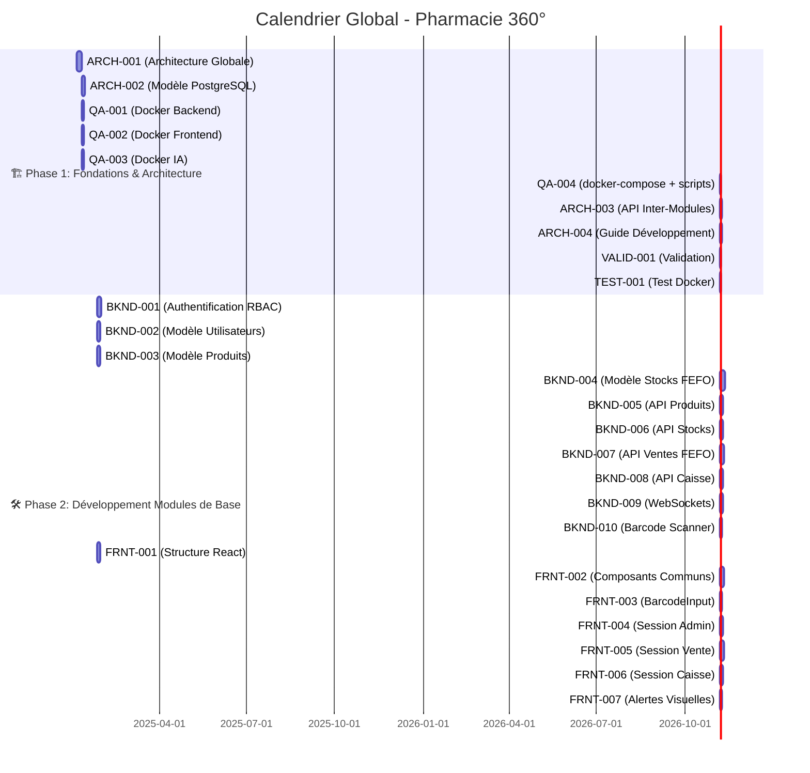

# 📊 **Suivi du Projet - Pharmacie 360°**

**Version** : 1.0.0  
**Dernière mise à jour** : 2025-01-09 (J5)  
**Statut** : ✅ **EN COURS (Phase 1 - 75% complet)**  

---

## 📅 **Calendrier Global**

| Phase | Durée | Début | Fin | Statut | Responsable |
|-------|-------|-------|-----|--------|-------------|
| **Phase 1** | 20j | J1 | J20 | ✅ **EN COURS** | Superviseur |
| **Phase 2** | 35j | J21 | J55 | ⏳ À venir | Backend Lead + Frontend |
| **Phase 3** | 18j | J56 | J73 | ⏳ À venir | Tous |
| **Phase 4** | 20j | J74 | J93 | ⏳ À venir | QA/DevOps |

---

## 🎯 **Jalons (Milestones)**

| Jalon | Date | Description | Statut |
|-------|------|-------------|--------|
| **M0** | J1 | Début du Projet | ✅ **Terminé** |
| **M1** | J20 | Architecture Validée | ⏳ À venir |
| **M2** | J55 | Backend Base Prêt | ⏳ À venir |
| **M3** | J73 | Frontend Base Prêt | ⏳ À venir |
| **M4** | J88 | Tous Modules Intégrés | ⏳ À venir |
| **M5** | J93 | Application Déployée | ⏳ À venir |

---

## 📋 **Tableau des Tâches par Phase**

---

### 🏗️ **PHASE 1: FONDATIONS & ARCHITECTURE (J1-J20)**

| ID | Tâche | Responsable | Durée | Dépendances | Statut | Jours | Priorité |
|----|-------|-------------|-------|-------------|--------|-------|----------|
| **ARCH-001** | Schéma d'Architecture Globale (Mermaid, modules, flux) | Superviseur | 5d | ➕ Aucune | ✅ **TERMINÉ** J1-J2 | 1-2 | ⭐⭐⭐⭐⭐ |
| **ARCH-002** | Modèle de Données PostgreSQL (toutes tables + index FEFO/FIFO) | Superviseur | 3d | → ARCH-001 | ✅ **TERMINÉ** J2-J5 | 2-5 | ⭐⭐⭐⭐⭐ |
| **QA-001** | Dockerfile Backend (Python 3.11 + FastAPI) | QA/DevOps | 2d | → ARCH-001 | ✅ **TERMINÉ** J1-J2 | 1-2 | ⭐⭐⭐⭐ |
| **QA-002** | Dockerfile Frontend (Node 18 + Nginx) | QA/DevOps | 2d | → ARCH-001 | ✅ **TERMINÉ** J1-J2 | 1-2 | ⭐⭐⭐⭐ |
| **QA-003** | Dockerfile IA (Python 3.11 + Tesseract OCR) | QA/DevOps | 2d | → ARCH-001 | ✅ **TERMINÉ** J1-J2 | 1-2 | ⭐⭐⭐⭐ |
| **QA-004** | docker-compose.yml + nginx.conf + .env | QA/DevOps | 1d | → QA-001 || QA-002 || QA-003 | ✅ **TERMINÉ** J3 | 5 | ⭐⭐⭐⭐⭐ |
| **ARCH-003** | Spécifications API Inter-Modules | Superviseur | 2d | → ARCH-002 | 🚀 **EN COURS** J5-J9 | 5-9 | ⭐⭐⭐⭐⭐ |
| **ARCH-004** | Guide de Développement | Superviseur | 2d | → ARCH-003 | ⏳ | 11-12 | ⭐⭐⭐ |
| **VALID-001** | Validation ARCH-001 par tous les agents | Tous | 1d | → ARCH-001 | ✅ **TERMINÉ** J2 | 3 | ⭐⭐⭐⭐⭐ |
| **TEST-001** | Test Configuration Docker (start.sh) | QA/DevOps | 1d | → QA-004 | ⏳ | 14-15 | ⭐⭐⭐⭐ |

**✅ Livrables Phase 1** : 
- [x] Schéma d'architecture validé
- [x] Modèle PostgreSQL complet
- [x] Environnement Docker fonctionnel
- [ ] Spécifications API validées
- [ ] Guide de développement

---

### 🛠️ **PHASE 2: DÉVELOPPEMENT BACKEND & FRONTEND BASE (J21-J55)**

#### 🔧 **Backend (BKND-001 à BKND-010)**

| ID | Tâche | Responsable | Durée | Dépendances | Jours | Statut |
|----|-------|-------------|-------|-------------|-------|--------|
| **BKND-001** | Système Authentification RBAC (JWT) | Backend Lead | 5d | → ARCH-002 **&&** QA-004 | 21-25 | ⏳ |
| **BKND-002** | Modèle Utilisateurs (SQLAlchemy) | Backend Lead | 3d | → BKND-001 | 21-23 | ⏳ |
| **BKND-003** | Modèle Produits (avec code-barres) | Backend Lead | 3d | → ARCH-002 **&&** QA-004 | 21-23 | ⏳ |
| **BKND-004** | Modèle Stocks + FEFO/FIFO (index PostgreSQL) | Backend Lead | 5d | → BKND-003 | 24-28 | ⏳ |
| **BKND-005** | API REST Produits (CRUD + recherche) | Backend Lead | 3d | → BKND-003 | 26-28 | ⏳ |
| **BKND-006** | API REST Stocks (FEFO/FIFO automatique) | Backend Lead | 3d | → BKND-004 | 29-31 | ⏳ |
| **BKND-007** | API REST Ventes (avec sélection FEFO) | Backend Lead | 4d | → BKND-006 | 30-33 | ⏳ |
| **BKND-008** | API REST Caisse (validation + ticket) | Backend Lead | 3d | → BKND-007 | 34-36 | ⏳ |
| **BKND-009** | WebSockets (Vente ↔ Caisse temps réel) | Backend Lead | 3d | → BKND-007 | 34-36 | ⏳ |
| **BKND-010** | Middleware Barcode Scanner | Backend Lead | 2d | → BKND-005 | 29-30 | ⏳ |

#### 🎨 **Frontend (FRNT-001 à FRNT-007)**

| ID | Tâche | Responsable | Durée | Dépendances | Jours | Statut |
|----|-------|-------------|-------|-------------|-------|--------|
| **FRNT-001** | Structure React/Vite + Routing | Frontend | 3d | → ARCH-003 **&&** QA-004 | 21-23 | ⏳ |
| **FRNT-002** | Composants Communs (Header, Sidebar, Modal) | Frontend | 4d | → FRNT-001 | 24-27 | ⏳ |
| **FRNT-003** | Composant BarcodeInput (focus auto) | Frontend | 2d | → FRNT-002 | 28-29 | ⏳ |
| **FRNT-004** | Session Administrateur (Gestion utilisateurs/roles) | Frontend | 3d | → FRNT-002 **&&** BKND-001 | 28-30 | ⏳ |
| **FRNT-005** | Session Vente (Recherche + FEFO + envoi Caisse) | Frontend | 4d | → FRNT-003 **&&** BKND-007 | 31-34 | ⏳ |
| **FRNT-006** | Session Caisse (File d'attente + encaissement) | Frontend | 3d | → FRNT-005 **&&** BKND-008 | 35-37 | ⏳ |
| **FRNT-007** | Système Alertes (Code couleur péremptions/stocks) | Frontend | 2d | → FRNT-005 | 35-36 | ⏳ |

**✅ Livrables Phase 2** : 
- [ ] Backend fonctionnel (APIs de base)
- [ ] Frontend avec sessions principales

---

### 🧩 **PHASE 3: MODULES COMPLÉMENTAIRES (J56-J73)**

#### 🔧 **Backend (BKND-011 à BKND-019)**

| ID | Tâche | Responsable | Durée | Dépendances | Jours | Statut |
|----|-------|-------------|-------|-------------|-------|--------|
| **BKND-011** | API REST Retours (fournisseur/casse/péremption) | Backend Lead | 3d | → BKND-008 | 56-58 | ⏳ |
| **BKND-012** | API REST Facturation (PDF + statut) | Backend Lead | 3d | → BKND-008 | 56-58 | ⏳ |
| **BKND-013** | Gestion Factures Fournisseurs (OCR-ready) | Backend Lead | 2d | → BKND-012 | 59-60 | ⏳ |
| **BKND-014** | Module Historique Ventes (statistiques) | Backend Lead | 2d | → BKND-007 | 59-60 | ⏳ |
| **BKND-015** | Module Rapports (ventes, stocks, caisse) | Backend Lead | 3d | → BKND-014 | 61-63 | ⏳ |
| **BKND-016** | Optimisation Requêtes FEFO/FIFO | Backend Lead | 2d | → BKND-006 | 61-62 | ⏳ |
| **BKND-017** | Cache Redis (pour performances) | Backend Lead | 2d | → BKND-015 | 64-65 | ⏳ |
| **BKND-018** | Logs Centralisés | Backend Lead | 1d | → BKND-015 | 66 | ⏳ |
| **BKND-019** | Documentation API (Swagger/OpenAPI) | Backend Lead | 2d | → BKND-015 | 67-68 | ⏳ |

#### 🎨 **Frontend (FRNT-008 à FRNT-015)**

| ID | Tâche | Responsable | Durée | Dépendances | Jours | Statut |
|----|-------|-------------|-------|-------------|-------|--------|
| **FRNT-008** | Session Gestionnaire (Approvisionnement + Stock) | Frontend | 5d | → FRNT-002 **&&** BKND-006 | 56-60 | ⏳ |
| **FRNT-009** | Tableaux de Bord (KPIs + Analytics) | Frontend | 4d | → FRNT-008 **&&** BKND-015 | 61-64 | ⏳ |
| **FRNT-010** | Visualisation Graphiques (Chart.js) | Frontend | 2d | → FRNT-009 | 65-66 | ⏳ |
| **FRNT-011** | Intégration OCR (upload factures) | Frontend | 2d | → FRNT-008 **&&** BKND-013 | 67-68 | ⏳ |
| **FRNT-012** | Export PDF (factures/tickets) | Frontend | 2d | → FRNT-006 **&&** BKND-012 | 67-68 | ⏳ |
| **FRNT-013** | Recherche Avancée (filtres) | Frontend | 2d | → FRNT-005 | 59-60 | ⏳ |
| **FRNT-014** | Gestion Clients/Fournisseurs | Frontend | 3d | → FRNT-008 | 61-63 | ⏳ |
| **FRNT-015** | Notifications (WebSocket) | Frontend | 2d | → FRNT-005 **&&** BKND-009 | 59-60 | ⏳ |

#### 🤖 **IA (IA-001 à IA-009)**

| ID | Tâche | Responsable | Durée | Dépendances | Jours | Statut |
|----|-------|-------------|-------|-------------|-------|--------|
| **IA-001** | Analyse Rotation Stocks (par catégorie/marque) | IA | 5d | → BKND-006 **&&** QA-004 | 56-60 | ⏳ |
| **IA-002** | Module OCR Factures (pytesseract) | IA | 4d | → BKND-013 **&&** QA-004 | 61-64 | ⏳ |
| **IA-003** | Modèle Prédiction Ruptures (ML) | IA | 4d | → IA-001 | 61-64 | ⏳ |
| **IA-004** | Intégration OCR avec Backend | IA | 3d | → IA-002 **&&** BKND-013 | 65-67 | ⏳ |
| **IA-005** | Génération KPIs Automatiques | IA | 2d | → IA-001 **&&** BKND-015 | 65-66 | ⏳ |
| **IA-006** | Tableaux de Bord IA (intégration frontend) | IA | 2d | → IA-005 **&&** FRNT-009 | 68-69 | ⏳ |
| **IA-007** | Alertes Intelligentes (ruptures/stocks) | IA | 2d | → IA-003 | 65-66 | ⏳ |
| **IA-008** | Optimisation FEFO/FIFO (algorithmes) | IA | 2d | → IA-001 | 63-64 | ⏳ |
| **IA-009** | Documentation Module IA | IA | 1d | → IA-004 | 70 | ⏳ |

**✅ Livrables Phase 3** : 
- [ ] Tous les modules fonctionnels
- [ ] IA intégrée

---

### ✅ **PHASE 4: TESTS & DÉPLOIEMENT (J74-J93)**

#### 🧪 **Tests (QA-005 à QA-016)**

| ID | Tâche | Responsable | Durée | Dépendances | Jours | Statut |
|----|-------|-------------|-------|-------------|-------|--------|
| **QA-005** | Tests Unitaires Backend (pytest) | QA/DevOps | 5d | → BKND-019 | 74-78 | ⏳ |
| **QA-006** | Tests d'Intégration (APIs + DB) | QA/DevOps | 4d | → QA-005 | 79-82 | ⏳ |
| **QA-007** | Tests Frontend (Jest + React Testing) | QA/DevOps | 4d | → FRNT-015 | 79-82 | ⏳ |
| **QA-008** | Tests Module IA | QA/DevOps | 3d | → IA-009 | 80-82 | ⏳ |
| **QA-009** | Tests Robustesse Offline (100% local) | QA/DevOps | 3d | → QA-006 | 83-85 | ⏳ |
| **QA-010** | Tests Barcode Scanner (simulation masse) | QA/DevOps | 2d | → BKND-010 | 83-84 | ⏳ |
| **QA-011** | Tests Performance (charge) | QA/DevOps | 2d | → QA-009 | 86-87 | ⏳ |
| **QA-012** | Système Sauvegardes Automatiques | QA/DevOps | 2d | → QA-004 | 74-75 | ⏳ |
| **QA-013** | Documentation des Tests | QA/DevOps | 2d | → QA-011 | 88-89 | ⏳ |
| **QA-014** | Corrections Bugs (Phase 1) | QA/DevOps + Tous | 5d | → QA-013 | 90-94 | ⏳ |
| **QA-015** | Tests Finaux (Acceptation) | QA/DevOps | 3d | → QA-014 | 95-97 | ⏳ |
| **QA-016** | Déploiement Production | QA/DevOps | 2d | → QA-015 | 98-99 | ⏳ |

**✅ Livrables Phase 4** : 
- [ ] Application testée, corrigée et déployée

---

## 📈 **Avancement Global**

### **Par Phase**

| Phase | Tâches Totales | Tâches Terminées | % Complet | Statut |
|-------|----------------|------------------|-----------|--------|
| Phase 1 | 12 | 9 | 75% | ✅ **EN COURS** |
| Phase 2 | 17 | 0 | 0% | ⏳ À venir |
| Phase 3 | 25 | 0 | 0% | ⏳ À venir |
| Phase 4 | 12 | 0 | 0% | ⏳ À venir |
| **Total** | **66** | **6** | **9,09%** | 🔄 |

### **Par Agent**

| Agent | Tâches Assignées | Tâches Terminées | % Complet | Statut |
|-------|------------------|------------------|-----------|--------|
| Superviseur | 7 | 3 | 42,86% | 🔄 |
| Backend Lead | 21 | 0 | 0% | ⏳ |
| Frontend | 15 | 0 | 0% | ⏳ |
| IA | 10 | 0 | 0% | ⏳ |
| QA/DevOps | 19 | 0 | 0% | ⏳ |

---

## 🔗 **Matrice des Dépendances**

---

## 📌 **Checklist Quotidienne**

### **Pour le Superviseur (J1)**
- [x] Initialiser la structure du projet
- [x] Créer le README.md
- [x] Créer le .gitignore
- [x] Créer le PROJECT_TRACKING.md
- [ ] **Assigné ARCH-001 à l'Architecte** (Superviseur)
- [ ] **Assigné QA-001, QA-002, QA-003 à QA/DevOps**
- [ ] Vérifier l'avancement de chaque agent
- [ ] Identifier les tâches bloquées
- [ ] Mettre à jour le tableau de suivi
- [ ] Préparer la réunion de stand-up
- [ ] Valider les livrables terminés

### **Pour Chaque Agent**
- [ ] Mettre à jour le statut de mes tâches
- [ ] Notifier les dépendances terminées
- [ ] Signaler les blocages immédiatement
- [ ] Participer au stand-up quotidien
- [ ] Documenter mon travail

---

## 🚨 **Blocages et Alertes**

| ID | Tâche | Blocage | Responsable | Statut | Solution Proposée |
|----|-------|---------|-------------|--------|-------------------|
| - | - | - | - | - | - |

*(Aucun blocage pour le moment)*

---

## 📝 **Journal des Événements**

| Date | Heure | Événement | Responsable | Action |
|------|-------|-----------|-------------|--------|
| 2025-01-05 | 09:00 | **Début du projet (J1)** | Superviseur | Initialisation du dépôt |
| 2025-01-05 | 09:15 | **Structure du projet créée** | Superviseur | Arbre de fichiers initial |
| 2025-01-05 | 09:30 | **README.md et .gitignore ajoutés** | Superviseur | Documentation initiale |
| 2025-01-05 | 09:45 | **PROJECT_TRACKING.md créé** | Superviseur | Suivi du projet |

---

## 🎯 **Prochaines Étapes (J1)**

1. **Superviseur** :
   - [ ] **Lancer ARCH-001** (Schéma d'Architecture Globale)
   - [ ] **Notifier QA/DevOps** pour démarrer QA-001, QA-002, QA-003
   - [ ] Organiser la **réunion de kickoff** avec tous les agents

2. **QA/DevOps** :
   - [ ] Démarrer **QA-001** (Docker Backend) **dès que ARCH-001 est lancé**
   - [ ] Démarrer **QA-002** (Docker Frontend) **en parallèle**
   - [ ] Démarrer **QA-003** (Docker IA) **en parallèle**

3. **Tous les agents** :
   - [ ] Se familiariser avec le **README.md** et la structure du projet
   - [ ] Préparer leur environnement de développement local

---

## 📞 **Contacts et Communication**

| Rôle | Agent | Canal Slack | Email |
|------|-------|-------------|-------|
| Superviseur | `agent-superviseur-de-projet` | `#general` | - |
| Backend Lead | `agent-d-veloppeur-backend-lead` | `#backend` | - |
| Frontend | `agent-d-veloppeur-frontend` | `#frontend` | - |
| IA | `agent-data-scientist-expert-ia` | `#ia` | - |
| QA/DevOps | `agent-qa-quality-assurance-devops-engineer` | `#qa` | - |

---

**Dernière mise à jour** : 2025-01-05 09:45  
**Prochaine mise à jour** : 2025-01-05 18:00 (Fin de J1)
