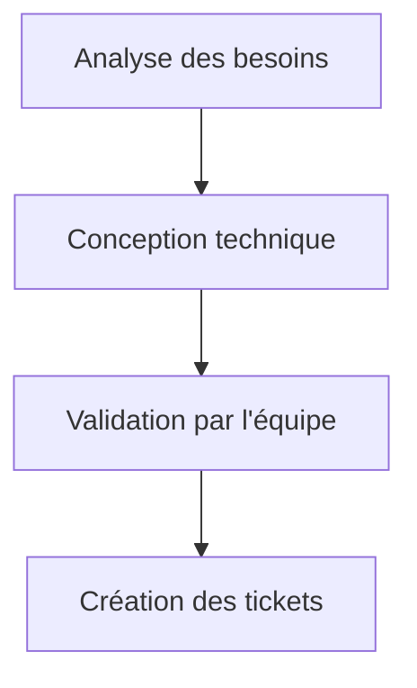
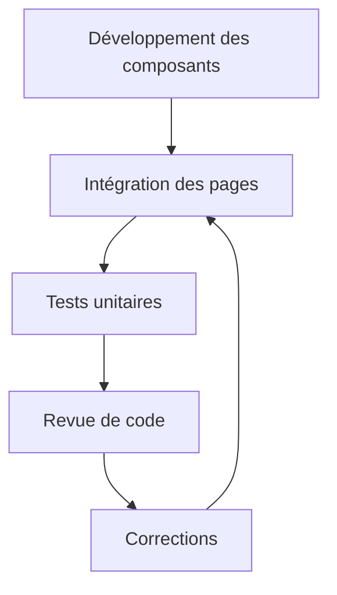
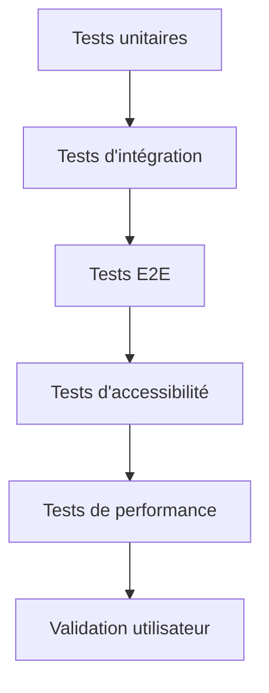
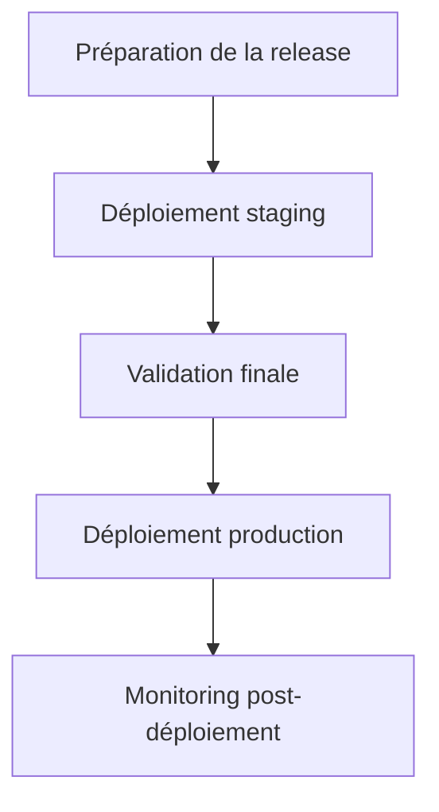

# 
# 
# 

---

## **SOMMAIRE**

---

## **1. CONTEXTE ET OBJECTIFS**

### **1.1 Situation Actuelle**
Le projet Pharma 360° a atteint une phase critique où le frontend nécessite une **refonte complète** pour :
- ✅ **Corriger les bugs** (routes manquantes, erreurs CI/CD, problèmes de lint)
- ✅ **Améliorer l'ergonomie** pour les utilisateurs en pharmacie
- ✅ **Rendre responsive** (optimisé pour tablettes 1024x768)
- ✅ **Uniformiser le design** avec un Design System cohérent
- ✅ **Optimiser les performances** et l'accessibilité (WCAG 2.1 AA)

### **1.2 Objectifs de la Refonte Synchronisée**
| Objectif | Description | Responsable | Échéance |
|----------|-------------|--------------|----------|
| **Bug Fixes** | Corriger toutes les erreurs CI/CD et routes | QA/DevOps + Frontend Lead | Immédiat |
| **Design System** | Implémenter tous les composants du DESIGN_SYSTEM.md | Frontend Lead | Semaine 1 |
| **Responsive Design** | Adaptation parfaite à tous les appareils | Frontend Team | Semaine 2 |
| **Ergonomie** | Interface intuitive pour les pharmacies | UX Specialist | Semaine 3 |
| **Performance** | Optimisation du chargement et du rendu | QA/DevOps | Semaine 4 |
| **Accessibilité** | Conformité WCAG 2.1 AA | QA Team | Semaine 5 |

---

## **2. ÉQUIPE SYNCHRONISÉE**

### **2.1 Rôles et Responsabilités**

#### **🎯 Superviseur de Projet (Agent Superviseur)**
**Responsabilités :**
- Coordonner toutes les activités entre les agents
- Valider les livrables avant intégration
- Résoudre les conflits et bloquants
- Assurer le respect des délais et de la qualité
- Maintenir la documentation à jour

**Outils :**
- GitHub Projects pour le suivi
- Daily standups synchrones
- Tableau Kanban (GitHub Issues)

**Compétences :**
- Gestion de projet Agile/Scrum
- Connaissance technique du projet
- Leadership et résolution de problèmes

---

#### **🏗️ Lead Frontend Architecture (Agent Principal)**
**Responsabilités :**
- Définir l'architecture technique du frontend
- Créer et maintenir le Design System
- Superviser la cohérence du code
- Valider les choix technologiques
- Coordonner avec Backend et QA

**Livrables :**
1. **Design System implémenté** (composants UI réutilisables)
2. **Architecture modulaire** (Odoo-style)
3. **Conventions de codage** et bonnes pratiques
4. **Documentation technique** complète

**Outils :**
- Figma (pour le design)
- Storybook (pour la documentation des composants)
- Tailwind CSS, React 18+, Vite

---

#### **💻 Développeur Frontend (Agent d'Exécution)**
**Responsabilités :**
- Implémenter les composants selon le Design System
- Développer les pages et fonctionnalités
- Appliquer les bonnes pratiques de codage
- Respecter les conventions de nommage
- Participer aux revues de code

**Livrables :**
1. **Composants UI** (Button, Input, Card, Table, etc.)
2. **Pages refactorées** (Login, Dashboard, Products, Sales, etc.)
3. **Fonctionnalités** (barcode scanner, WebSockets, etc.)
4. **Tests unitaires** pour chaque composant

**Outils :**
- React, Tailwind CSS, TypeScript
- Jest, Testing Library
- Git, GitHub

---

#### **🤖 Agent IA/Data Scientist (Expert en Intelligence Artificielle)**
**Responsabilités :**
- Intégrer les modules IA dans l'interface
- Optimiser l'UX avec des recommandations intelligentes
- Analyser les données utilisateurs pour améliorer l'ergonomie
- Implémenter la détection automatique de produits (OCR)

**Livrables :**
1. **Module OCR** pour la détection de barcodes
2. **Recommandations intelligentes** (produits, stocks)
3. **Analyse prédictive** (ruptures de stock, tendances)
4. **Fallback mode** pour l'offline

**Outils :**
- Python, TensorFlow, OpenCV
- Tesseract OCR
- FastAPI pour l'intégration

---

#### **✅ Agent QA/DevOps (Ingénieur Qualité)**
**Responsabilités :**
- Tester la responsivité sur différents appareils
- Vérifier l'accessibilité (WCAG 2.1 AA)
- Valider les performances (Lighthouse, Web Vitals)
- Automatiser les tests frontend
- Configurer et maintenir les pipelines CI/CD

**Livrables :**
1. **Tests automatisés** (Jest, Cypress)
2. **Audit d'accessibilité** complet
3. **Optimisation des performances**
4. **Pipeline CI/CD** robuste

**Outils :**
- Jest, Testing Library, Cypress
- Lighthouse, WebPageTest
- GitHub Actions, Docker

---

#### **📦 Agent Backend Lead (Responsable Backend)**
**Responsabilités :**
- Assurer la compatibilité API avec le frontend
- Optimiser les endpoints pour les besoins du frontend
- Implémenter WebSockets pour la communication temps réel
- Maintenir la base de données PostgreSQL

**Livrables :**
1. **API RESTful** optimisée pour le frontend
2. **WebSockets** pour Sales ↔ Cash
3. **Synchronisation offline-first**
4. **Documentation API** (Swagger/OpenAPI)

**Outils :**
- FastAPI, SQLAlchemy
- PostgreSQL 14+
- Docker, Redis

---

### **2.2 Matrice de Collaboration**

| Agent | Superviseur | Frontend Lead | Frontend Dev | IA Agent | QA/DevOps | Backend Lead |
|-------|-------------|---------------|--------------|----------|-----------|--------------|
| **Superviseur** | - | ✅ Coordination | ✅ Coordination | ✅ Coordination | ✅ Coordination | ✅ Coordination |
| **Frontend Lead** | ✅ Reporting | - | ✅ Supervision | ✅ Intégration IA | ✅ Tests | ✅ API Design |
| **Frontend Dev** | ✅ Reporting | ✅ Implémentation | - | ✅ Collaboration | ✅ Tests | ✅ API Usage |
| **IA Agent** | ✅ Reporting | ✅ Collaboration | ✅ Collaboration | - | ✅ Validation | ✅ Data Flow |
| **QA/DevOps** | ✅ Reporting | ✅ Validation | ✅ Tests | ✅ Validation | - | ✅ CI/CD |
| **Backend Lead** | ✅ Reporting | ✅ API Design | ✅ Support | ✅ Data | ✅ Monitoring | - |

---

## **3. WORKFLOW SYNCHRONISÉ**

### **3.1 Méthodologie Agile**

#### **Sprints (2 semaines)**
Chaque sprint suit le cycle :
```
📅 Planning → 🏗️ Développement → ✅ Tests → 📊 Revue → 🚀 Livraison
```

#### **Cérémonies Agile**
1. **Daily Standup (15 min/jour)**
   - Chaque agent partage :
     - Ce qui a été fait hier
     - Ce qui sera fait aujourd'hui
     - Les bloquants
   - **Heure :** 10h00 (UTC+1)

2. **Sprint Planning (1h)**
   - Définition des objectifs du sprint
   - Répartition des tâches
   - Estimation des efforts

3. **Sprint Review (1h)**
   - Démonstration des fonctionnalités
   - Feedback des stakeholders
   - Validation des livrables

4. **Sprint Retrospective (30 min)**
   - Analyse des succès et échecs
   - Identification des améliorations
   - Actions correctives

---

### **3.2 Processus de Développement Synchronisé**

#### **Étape 1 : Analyse et Conception (Semaine 1)**


**Activités :**
- ✅ Audit complet du frontend existant
- ✅ Finalisation du Design System (Figma)
- ✅ Définition des APIs nécessaires (avec Backend)
- ✅ Identification des composants à refactorer
- ✅ Priorisation des tâches

**Livrables :**
- [ ] Rapport d'audit technique
- [ ] Design System finalisé (Figma + Code)
- [ ] Spécifications API
- [ ] Backlog priorisé

---

#### **Étape 2 : Développement (Semaines 2-4)**


**Activités par Agent :**

**Frontend Lead :**
- [ ] Créer les composants de base (Button, Input, Card, etc.)
- [ ] Configurer Storybook
- [ ] Définir les hooks personnalisés
- [ ] Mettre en place le système de thèmes

**Frontend Dev :**
- [ ] Implémenter les pages (Login, Dashboard, Products, etc.)
- [ ] Intégrer les composants du Design System
- [ ] Appliquer le responsive design
- [ ] Optimiser les performances

**IA Agent :**
- [ ] Intégrer le module OCR
- [ ] Développer les recommandations intelligentes
- [ ] Implémenter l'analyse prédictive
- [ ] Tester le fallback mode

**Backend Lead :**
- [ ] Optimiser les endpoints API
- [ ] Implémenter WebSockets
- [ ] Assurer la synchronisation offline
- [ ] Documenter l'API

**QA/DevOps :**
- [ ] Écrire les tests automatisés
- [ ] Vérifier l'accessibilité
- [ ] Optimiser les performances
- [ ] Configurer CI/CD

---

#### **Étape 3 : Tests et Validation (Semaine 5)**


**Activités :**
- ✅ Exécution de tous les tests automatisés
- ✅ Audit d'accessibilité complet
- ✅ Tests de performance (Lighthouse)
- ✅ Tests utilisateurs (UAT)
- ✅ Correction des bugs identifiés

**Livrables :**
- [ ] Rapport de tests complet
- [ ] Audit d'accessibilité
- [ ] Rapport de performance
- [ ] Feedback utilisateurs

---

#### **Étape 4 : Livraison (Semaine 6)**


**Activités :**
- ✅ Préparation des notes de release
- ✅ Déploiement sur l'environnement de staging
- ✅ Validation finale par QA
- ✅ Déploiement en production
- ✅ Monitoring et support

---

### **3.3 Communication et Collaboration**

#### **Canaux de Communication**
| Canal | Usage | Participants | Fréquence |
|-------|-------|--------------|-----------|
| **Daily Standup** | Synchronisation quotidienne | Tous les agents | 1x/jour |
| **Slack/Teams** | Communication instantanée | Tous les agents | Continu |
| **GitHub Issues** | Suivi des tâches et bugs | Tous les agents | Continu |
| **GitHub PRs** | Revue de code | Frontend Team + QA | Par PR |
| **Figma Comments** | Feedback sur le design | Frontend Team + IA | Continu |
| **Email** | Communication formelle | Tous les agents | Selon besoin |

#### **Règles de Communication**
1. **Répondre dans les 2 heures** aux messages urgents
2. **Utiliser les threads** pour les discussions techniques
3. **Documenter les décisions** dans les issues PR
4. **Éviter les réunions** sans ordre du jour clair
5. **Respecter les horaires** de travail de chacun

---

## **4. OUTILS ET TECHNOLOGIES**

### **4.1 Outils de Développement**

| Outil | Usage | Lien |
|-------|-------|------|
| **GitHub** | Gestion de code, issues, PRs | [GitHub](https://github.com) |
| **Figma** | Design et prototypage | [Figma](https://figma.com) |
| **Storybook** | Documentation des composants | [Storybook](https://storybook.js.org) |
| **Vite** | Build tool | [Vite](https://vitejs.dev) |
| **Tailwind CSS** | Framework CSS | [Tailwind](https://tailwindcss.com) |
| **React 18** | Framework frontend | [React](https://react.dev) |
| **Jest** | Tests unitaires | [Jest](https://jestjs.io) |
| **Cypress** | Tests E2E | [Cypress](https://cypress.io) |
| **Lighthouse** | Audit performance | [Lighthouse](https://developer.chrome.com/docs/lighthouse/overview/) |
| **Docker** | Conteneurisation | [Docker](https://docker.com) |

### **4.2 Environnements**

| Environnement | Usage | URL | Responsable |
|---------------|-------|-----|--------------|
| **Local** | Développement individuel | localhost:5173 | Chaque développeur |
| **Staging** | Tests d'intégration | staging.pharma360.com | QA/DevOps |
| **Production** | Version live | pharma360.com | QA/DevOps |

---

### **4.3 Configuration Technique**

#### **Frontend Stack**
```json
{
  "framework": "React 18.2.0",
  "build_tool": "Vite 5.4.21",
  "css": "Tailwind CSS 3.x",
  "components": "Radix UI + Custom",
  "icons": "Lucide React",
  "charts": "Recharts + Chart.js",
  "state": "React Context + useReducer + Custom Hooks",
  "routing": "React Router v6",
  "forms": "React Hook Form",
  "websocket": "socket.io-client"
}
```

#### **Backend Stack**
```json
{
  "framework": "FastAPI",
  "orm": "SQLAlchemy 2.0.23",
  "database": "PostgreSQL 14+",
  "auth": "JWT + RBAC",
  "websocket": "FastAPI WebSockets",
  "cache": "Redis",
  "docker": "Multi-stage builds"
}
```

---

## **5. PLAN D'ACTION DÉTAILLÉ**

### **5.1 Phase 0 : Préparation (Jours 1-3)**

#### **Jour 1 : Kickoff et Audit**
- [ ] **10h00** : Réunion de kickoff avec toute l'équipe
  - Présentation des objectifs
  - Répartition des rôles
  - Questions/réponses
- [ ] **11h00** : Audit technique du frontend existant
  - Analyse des composants actuels
  - Identification des problèmes
  - Évaluation des performances
- [ ] **14h00** : Finalisation du Design System dans Figma
  - Validation des couleurs, typographie, composants
  - Création des spécifications techniques
- [ ] **16h00** : Configuration des outils
  - Storybook
  - Jest + Testing Library
  - Lighthouse
  - GitHub Actions

**Livrables :**
- [ ] Rapport d'audit technique
- [ ] Design System validé (Figma)
- [ ] Environnement de développement configuré

---

#### **Jour 2 : Conception Technique**
- [ ] **10h00** : Réunion de conception technique
  - Architecture modulaire
  - Flux de données
  - Intégration IA
- [ ] **11h00** : Définition des APIs avec Backend
  - Endpoints nécessaires
  - WebSockets
  - Synchronisation offline
- [ ] **14h00** : Création des tickets GitHub
  - Découpage des tâches
  - Priorisation
  - Estimation
- [ ] **16h00** : Revue de conception
  - Validation par l'équipe
  - Ajustements si nécessaire

**Livrables :**
- [ ] Spécifications techniques
- [ ] Contrat d'API
- [ ] Backlog GitHub priorisé

---

#### **Jour 3 : Lancement du Développement**
- [ ] **10h00** : Sprint Planning
  - Sélection des user stories
  - Répartition des tâches
  - Engagement de l'équipe
- [ ] **11h00** : Début du développement
  - Frontend Lead : Composants de base
  - Frontend Dev : Pages principales
  - IA Agent : Module OCR
  - Backend Lead : Optimisation API
  - QA/DevOps : Configuration tests

**Livrables :**
- [ ] Sprint backlog
- [ ] Premier commit de code

---

### **5.2 Phase 1 : Fondations (Semaine 1)**

#### **Frontend Lead**
- [ ] Créer les composants du Design System
  - [ ] Button (variantes : primary, secondary, danger, etc.)
  - [ ] Input (text, number, password, search)
  - [ ] Select (simple, multiple, avec recherche)
  - [ ] Card (avec header, content, footer)
  - [ ] Modal (avec overlay, animations)
  - [ ] Toast (notifications)
  - [ ] Tooltip (info-bulles)
  - [ ] Badge (états, notifications)
  - [ ] Table (avec pagination, tri, filtrage)
  - [ ] Form (avec validation, soumission)
  - [ ] Tabs (onglets)
  - [ ] Sidebar (navigation)
  - [ ] Header (barre supérieure)
- [ ] Configurer Storybook
  - Documentation de chaque composant
  - Exemples d'utilisation
  - Props et types
- [ ] Définir les hooks personnalisés
  - useTable (gestion des tableaux)
  - useForm (gestion des formulaires)
  - useWebSocket (communication temps réel)
  - useBarcodeScanner (intégration du scanner)
  - useLocalStorage (persistance locale)

**Livrables :**
- [ ] Bibliothèque de composants complète
- [ ] Storybook configuré et documenté
- [ ] Hooks personnalisés testés

---

#### **Frontend Dev**
- [ ] Auditer les pages existantes
  - LoginPage
  - DashboardPage
  - ProductsPage
  - SalesPage
  - CashierPage
  - HelpPage
  - ProductFormPage
  - SaleFormPage
- [ ] Créer les templates de base
  - Layout principal
  - Page container
  - Form templates
  - Table templates
- [ ] Commencer la refactorisation
  - LoginPage (priorité 1)
  - DashboardPage (priorité 2)

**Livrables :**
- [ ] Rapport d'audit des pages
- [ ] Templates de base
- [ ] Pages Login et Dashboard refactorées

---

#### **IA Agent**
- [ ] Analyser les besoins en IA
  - Détection de barcodes (OCR)
  - Recommandations de produits
  - Analyse prédictive des stocks
  - Détection des ruptures
- [ ] Concevoir l'architecture IA
  - Module OCR (Tesseract + OpenCV)
  - Modèle de recommandation
  - Algorithmes de prédiction
- [ ] Intégrer avec le backend
  - Endpoints API pour l'IA
  - Traitement des images
  - Retour des résultats

**Livrables :**
- [ ] Spécifications du module OCR
- [ ] Architecture IA validée
- [ ] Intégration backend testée

---

#### **Backend Lead**
- [ ] Optimiser les endpoints existants
  - /api/products (GET, POST, PUT, DELETE)
  - /api/sales (GET, POST, PUT, DELETE)
  - /api/cashier (GET, POST)
  - /api/stock (GET, POST, PUT)
  - /api/returns (GET, POST)
  - /api/invoices (GET, POST)
- [ ] Implémenter WebSockets
  - Communication Sales ↔ Cash
  - Notifications en temps réel
  - Synchronisation des sessions
- [ ] Assurer la synchronisation offline
  - Cache local
  - Synchronisation automatique
  - Résolution des conflits

**Livrables :**
- [ ] API optimisée et documentée
- [ ] WebSockets fonctionnels
- [ ] Synchronisation offline testée

---

#### **QA/DevOps**
- [ ] Configurer les tests automatisés
  - Jest + Testing Library
  - Cypress pour les tests E2E
  - Lighthouse pour les performances
- [ ] Mettre en place CI/CD
  - GitHub Actions
  - Tests automatiques sur PR
  - Déploiement automatique
- [ ] Préparer l'audit d'accessibilité
  - Vérification WCAG 2.1 AA
  - Tests avec screen readers
  - Correction des problèmes

**Livrables :**
- [ ] Pipeline CI/CD configuré
- [ ] Tests automatisés fonctionnels
- [ ] Rapport d'accessibilité initial

---

### **5.3 Phase 2 : Développement Principal (Semaines 2-4)**

#### **Semaine 2 : Composants et Pages de Base**

**Frontend Lead :**
- [ ] Finaliser les composants avancés
  - DataTable (avec pagination, tri, filtrage)
  - AdvancedSearch (recherche multi-critères)
  - BarcodeScanner (intégration hardware)
  - WebSocketStatus (indicateur de connexion)
  - OfflineIndicator (mode hors ligne)

**Frontend Dev :**
- [ ] Refactoriser les pages produits
  - ProductsPage (liste des produits)
  - ProductFormPage (création/édition)
  - ProductDetailPage (détails du produit)
- [ ] Refactoriser les pages ventes
  - SalesPage (liste des ventes)
  - SaleFormPage (création de vente)
  - SaleDetailPage (détails de la vente)

**IA Agent :**
- [ ] Implémenter le module OCR
  - Détection de barcodes
  - Reconnaissance de produits
  - Intégration avec le scanner
- [ ] Développer les recommandations
  - Produits populaires
  - Stocks à réapprovisionner
  - Alertes de rupture

**Backend Lead :**
- [ ] Optimiser les requêtes complexes
  - Recherche avancée
  - Filtrage et tri
  - Agrégations (stats, analytics)
- [ ] Implémenter le cache
  - Redis pour les données fréquentes
  - Cache des résultats de recherche

**QA/DevOps :**
- [ ] Exécuter les tests sur les nouvelles fonctionnalités
- [ ] Vérifier la responsivité
- [ ] Auditer les performances

---

#### **Semaine 3 : Pages Avancées et Intégrations**

**Frontend Lead :**
- [ ] Créer les composants spécifiques
  - CashRegister (caisse enregistreuse)
  - ReturnForm (formulaire de retour)
  - InvoicePreview (aperçu de facture)
  - AnalyticsDashboard (tableau de bord)

**Frontend Dev :**
- [ ] Refactoriser les pages cashier
  - CashierPage (interface de caisse)
  - PaymentPage (paiement)
  - ReceiptPage (reçu)
- [ ] Refactoriser les pages admin
  - AdminDashboard
  - UsersPage
  - RolesPage
  - PermissionsPage

**IA Agent :**
- [ ] Intégrer l'analyse prédictive
  - Prévision des ventes
  - Détection des tendances
  - Alertes intelligentes
- [ ] Tester le fallback mode
  - Fonctionnement sans IA
  - Basculer automatiquement

**Backend Lead :**
- [ ] Implémenter les analytics
  - Statistiques de ventes
  - Analyse des stocks
  - Rapports personnalisés
- [ ] Optimiser les WebSockets
  - Gestion des connexions
  - Scalabilité

**QA/DevOps :**
- [ ] Tests d'intégration
- [ ] Tests de charge
- [ ] Validation des analytics

---

#### **Semaine 4 : Pages Manager et Finalisation**

**Frontend Lead :**
- [ ] Finaliser les composants manager
  - ManagerDashboard
  - OrdersTable
  - DeliveriesTable
  - ReportsGenerator

**Frontend Dev :**
- [ ] Refactoriser les pages manager
  - ManagerDashboardPage
  - OrdersPage
  - DeliveriesPage
  - ReportsPage
  - SettingsPage
  - AnalyticsPage
- [ ] Corriger les bugs identifiés

**IA Agent :**
- [ ] Optimiser les algorithmes
- [ ] Tester l'intégration complète

**Backend Lead :**
- [ ] Finaliser l'API
- [ ] Documenter tous les endpoints

**QA/DevOps :**
- [ ] Tests complets
- [ ] Audit final

---

### **5.4 Phase 3 : Tests et Validation (Semaine 5)**

#### **Tests Automatisés**
- [ ] **Tests unitaires** (Jest)
  - Tous les composants
  - Tous les hooks
  - Toutes les fonctions utilitaires
- [ ] **Tests d'intégration**
  - Interaction entre composants
  - Flux de données
  - Gestion des erreurs
- [ ] **Tests E2E** (Cypress)
  - Parcours utilisateur complet
  - Scénarios de vente
  - Gestion des stocks

#### **Tests Manuels**
- [ ] **Responsivité**
  - Mobile (320px - 768px)
  - Tablette (768px - 1024px)
  - Desktop (1024px+)
- [ ] **Accessibilité**
  - Navigation au clavier
  - Screen readers (NVDA, VoiceOver)
  - Contraste des couleurs
  - Balises ARIA
- [ ] **Performance**
  - Temps de chargement (< 2s)
  - Lighthouse score (> 90)
  - Web Vitals (LCP, FID, CLS)

#### **Validation Utilisateur**
- [ ] **Tests utilisateurs** (UAT)
  - Pharmacien 1
  - Pharmacien 2
  - Gestionnaire
  - Administrateur
- [ ] **Feedback et corrections**

**Livrables :**
- [ ] Rapport de tests complet
- [ ] Audit d'accessibilité final
- [ ] Rapport de performance
- [ ] Feedback utilisateurs

---

### **5.5 Phase 4 : Livraison (Semaine 6)**

#### **Préparation de la Release**
- [ ] **Versionning**
  - Mise à jour des versions (frontend, backend, ia)
  - Création des tags Git
- [ ] **Documentation**
  - Mise à jour du README
  - Guide d'installation
  - Guide utilisateur
  - Documentation technique
- [ ] **Notes de release**
  - Nouveautés
  - Corrections de bugs
  - Améliorations
  - Migration guide (si nécessaire)

#### **Déploiement**
- [ ] **Staging**
  - Déploiement sur staging
  - Validation finale
  - Correction des derniers bugs
- [ ] **Production**
  - Déploiement en production
  - Monitoring
  - Rollback plan (si nécessaire)

#### **Post-Livraison**
- [ ] **Monitoring**
  - Suivi des erreurs (Sentry)
  - Suivi des performances (New Relic)
  - Feedback utilisateurs
- [ ] **Support**
  - Résolution des problèmes
  - Mises à jour mineures
  - Documentation des issues

**Livrables :**
- [ ] Version v2.0.0 déployée
- [ ] Documentation complète
- [ ] Pipeline CI/CD opérationnel

---

## **6. MÉTRIQUES ET INDICATEURS**

### **6.1 Métriques Techniques**

| Métrique | Cible | Outil de Mesure | Responsable |
|----------|-------|-----------------|--------------|
| **Couverture de tests** | > 90% | Jest + Istanbul | QA/DevOps |
| **Score Lighthouse** | > 90 | Lighthouse | QA/DevOps |
| **Temps de chargement** | < 2s | WebPageTest | QA/DevOps |
| **Taille du bundle** | < 500KB | Vite | Frontend Lead |
| **Nombre de bugs critiques** | 0 | GitHub Issues | Tous |
| **Taux de satisfaction utilisateur** | > 95% | Enquêtes | Superviseur |

---

### **6.2 Indicateurs de Projet**

| Indicator | Cible | Mesure | Fréquence |
|-----------|-------|--------|-----------|
| **Vitesse de développement** | 50 points/sprint | Story Points | Par sprint |
| **Taux de livraison** | 100% | Tâches complétées | Par sprint |
| **Temps moyen de résolution** | < 24h | Temps par issue | Continu |
| **Nombre de PRs mergeables** | 100% | PRs sans conflit | Continu |

---

## **7. GESTION DES RISQUES**

### **7.1 Risques Identifiés**

| Risque | Probabilité | Impact | Mitigation | Responsable |
|--------|-------------|--------|------------|--------------|
| **Retard dans les livrables** | Moyenne | Élevé | Suivi quotidien, priorisation | Superviseur |
| **Problèmes de compatibilité** | Moyenne | Élevé | Tests d'intégration, revue de code | QA/DevOps |
| **Changement des exigences** | Faible | Élevé | Validation précoce, documentation | Superviseur |
| **Problèmes de performance** | Moyenne | Moyen | Audit régulier, optimisation | QA/DevOps |
| **Désengagement de l'équipe** | Faible | Élevé | Motivation, reconnaissance | Superviseur |
| **Problèmes de sécurité** | Faible | Critique | Audit de sécurité, tests | QA/DevOps |

---

### **7.2 Plan de Contingence**

| Scénario | Action | Responsable |
|----------|--------|--------------|
| **Retard sur une tâche** | Réallouer les ressources, prioriser | Superviseur |
| **Bug critique en production** | Rollback, correction urgente | QA/DevOps + Frontend |
| **Changement des exigences** | Réévaluer le backlog, ajuster le planning | Superviseur |
| **Problème de performance** | Optimisation, cache, CDN | Backend + QA |
| **Désengagement d'un agent** | Réaffecter les tâches, soutien | Superviseur |

---

## **8. DOCUMENTATION ET RÉFÉRENCES**

### **8.1 Documentation Existante**

| Document | Chemin | Description |
|----------|--------|-------------|
| **SUPERVISION_GENERALE.md** | `/SUPERVISION_GENERALE.md` | Framework de supervision |
| **REFONTE_FRONTEND_PLAN.md** | `/REFONTE_FRONTEND_PLAN.md` | Plan détaillé de refonte |
| **DESIGN_SYSTEM.md** | `/DESIGN_SYSTEM.md` | Design System complet |
| **COORDINATION_AGENTS.md** | `/COORDINATION_AGENTS.md` | Coordination des agents |
| **TACHES_DEMARRAGE.md** | `/TACHES_DEMARRAGE.md` | Tâches initiales |
| **ARCH-001_SCHEMA_ARCHITECTURE.md** | `/agents/architecte/livrables/ARCH-001_SCHEMA_ARCHITECTURE.md` | Architecture globale |
| **ARCH-002_MODELE_POSTGRESQL.md** | `/agents/architecte/livrables/ARCH-002_MODELE_POSTGRESQL.md` | Modèle PostgreSQL |

---

### **8.2 Références Externes**

| Référence | Lien | Description |
|-----------|------|-------------|
| **React Documentation** | [react.dev](https://react.dev) | Documentation officielle |
| **Tailwind CSS** | [tailwindcss.com](https://tailwindcss.com) | Framework CSS |
| **Figma** | [figma.com](https://figma.com) | Outil de design |
| **Storybook** | [storybook.js.org](https://storybook.js.org) | Documentation composants |
| **Jest** | [jestjs.io](https://jestjs.io) | Tests unitaires |
| **Cypress** | [cypress.io](https://cypress.io) | Tests E2E |
| **Lighthouse** | [developer.chrome.com](https://developer.chrome.com/docs/lighthouse/overview/) | Audit performance |
| **WCAG 2.1** | [w3.org](https://www.w3.org/WAI/standards-guidelines/wcag/) | Standards accessibilité |

---

## **9. ANNEXES**

### **9.1 Glossaire**

| Terme | Définition |
|-------|------------|
| **FEFO** | First Expired, First Out - Méthode de gestion des stocks où les produits les plus proches de la date de péremption sont vendus en premier |
| **FIFO** | First In, First Out - Méthode de gestion des stocks où les produits les plus anciens sont vendus en premier |
| **RBAC** | Role-Based Access Control - Contrôle d'accès basé sur les rôles |
| **JWT** | JSON Web Token - Standard pour l'authentification |
| **WebSockets** | Protocole de communication bidirectionnelle en temps réel |
| **Offline-First** | Approche où l'application fonctionne d'abord hors ligne, puis synchronise les données |
| **WCAG** | Web Content Accessibility Guidelines - Standards pour l'accessibilité web |
| **UAT** | User Acceptance Testing - Tests de validation par les utilisateurs finaux |

---

### **9.2 Checklist de Validation**

#### **Avant chaque PR**
- [ ] Code compilé sans erreurs
- [ ] Tous les tests passent
- [ ] Pas de warnings ESLint
- [ ] Code formaté (Prettier)
- [ ] Documentation mise à jour
- [ ] Tests ajoutés/modifiés
- [ ] Revue de code demandée

#### **Avant chaque livraison**
- [ ] Toutes les tâches du sprint complétées
- [ ] Tous les tests passent
- [ ] Audit d'accessibilité validé
- [ ] Performances optimales
- [ ] Documentation complète
- [ ] Notes de release préparées

---

### **9.3 Template de Commit**

```
type(scope): description

body

footer
```

**Types :**
- `feat` : Nouvelle fonctionnalité
- `fix` : Correction de bug
- `docs` : Documentation
- `style` : Changements de style (CSS, etc.)
- `refactor` : Refactorisation de code
- `perf` : Optimisation de performance
- `test` : Ajout de tests
- `chore` : Tâches de maintenance

**Exemple :**
```
feat(components/Button): add primary variant

- Add primary button with blue color
- Update Storybook documentation
- Add tests for primary variant

Closes #123
```

---

### **9.4 Template de PR**

```markdown
## 📝 Description

Description détaillée des changements

## ✅ Checklist

- [ ] Code compilé sans erreurs
- [ ] Tous les tests passent
- [ ] Pas de warnings ESLint
- [ ] Code formaté (Prettier)
- [ ] Documentation mise à jour
- [ ] Tests ajoutés/modifiés

## 📸 Captures d'écran (si applicable)

## 🔗 Liens

- Issue: #123
- Design: [Figma](link)
- Documentation: [link]

## 📝 Notes

Notes supplémentaires
```

---

## **10. CONCLUSION**

Ce document décrit le **workflow synchronisé** pour la refonte complète du frontend de Pharma 360°. Tous les agents doivent :

1. **Comprendre leurs rôles et responsabilités**
2. **Respecter les processus et méthodologies**
3. **Communiquer efficacement** avec l'équipe
4. **Livrer des travaux de qualité** dans les délais
5. **Participer activement** aux cérémonies Agile

Avec cette approche synchronisée, nous allons réussir à livrer un **frontend responsive, ergonomique et orienté utilisateur** qui répondra à tous les besoins des pharmacies.

---

**📅 Date de création :** 2024-11-06  
**👤 Auteur :** Équipe Pharma 360° Synchronisée  
**🔄 Version :** 1.0  
**📝 Statut :** ✅ Approuvé - Prêt pour exécution

---

*"Travaillons ensemble, livrons ensemble, réussissons ensemble."* 🚀
