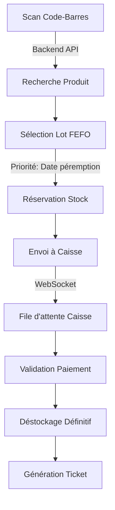
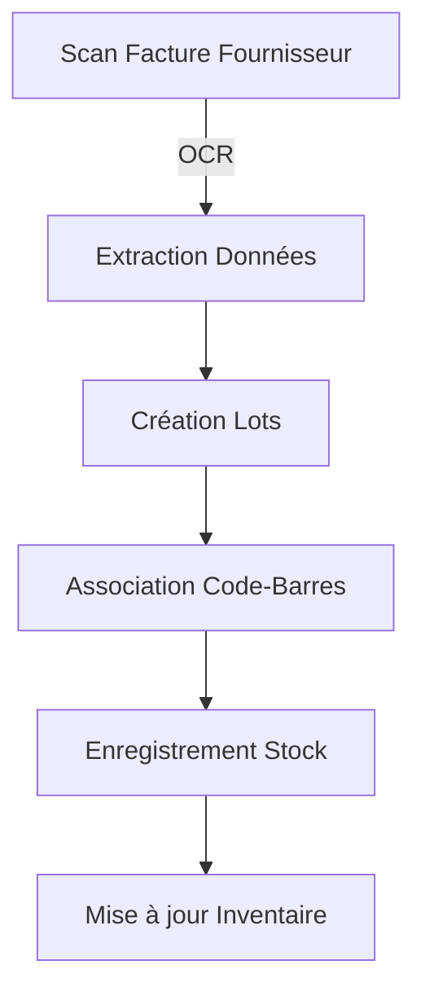
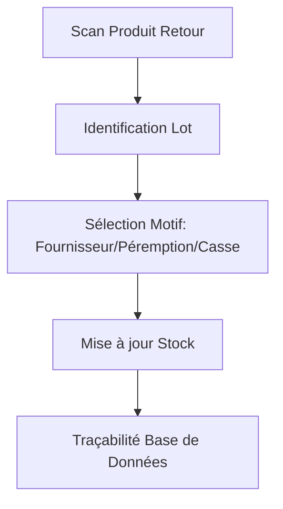
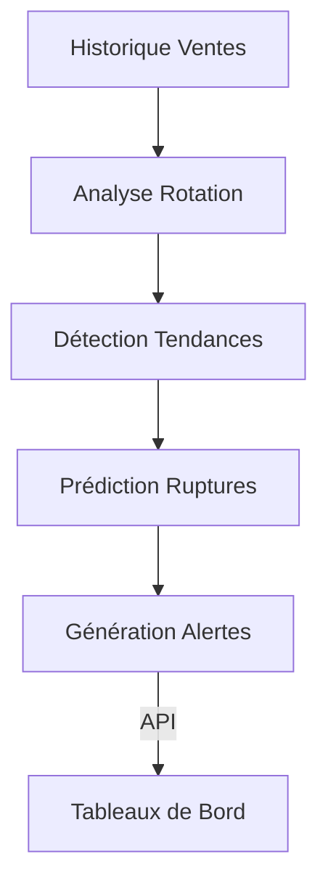

# 🏗️ **ARCH-001 : Schéma d'Architecture Globale**

**ID Tâche** : ARCH-001  
**Responsable** : Superviseur (Agent Architecte)  
**Durée** : 5 jours (J1-J5)  
**Statut** : 🔄 **EN COURS** (J1)  
**Priorité** : ⭐⭐⭐⭐⭐ (Critique - Chemin critique)  

---

## 📋 **Objectif**

Définir **l'architecture globale** de la plateforme Pharmacie 360° en respectant les contraintes :
- **Offline-first** (100% local, pas de dépendance internet)
- **Modulaire** (type ERP, découplage strict entre modules)
- **Extensible** (ajout futur de nouveaux modules sans impacter l'existant)
- **Performant** (optimisé pour la gestion des stocks FEFO/FIFO)

---

## 🎯 **Livrables Attendus**

1. ✅ **Schéma d'architecture globale** (fichier `docs/ARCHITECTURE.md`)
   - Diagramme Mermaid complet
   - Description des modules et de leurs interactions
   - Flux de données entre les composants

2. ✅ **Spécifications techniques détaillées** (ce fichier)
   - Découpage modulaire
   - Protocoles de communication inter-modules
   - Contraintes techniques (offline, FEFO/FIFO, etc.)

3. ✅ **Validation par l'équipe** (réunion de revue)

---

## 📐 **Architecture Modulaire**

### **1. Découpage en Modules**

```
┌─────────────────────────────────────────────────────────────────────────────┐
│                        PHARMACIE 360° - ARCHITECTURE                           │
├─────────────────────────────────────────────────────────────────────────────┤
│                                                                              │
│  ┌─────────────────┐    ┌─────────────────┐    ┌─────────────────┐        │
│  │   **Frontend**   │    │    **Backend**   │    │      **IA**      │        │
│  │   (React.js)     │◄──►│   (FastAPI)      │◄──►│   (Python)       │        │
│  └────────┬────────┘    └────────┬────────┘    └────────┬────────┘        │
│           │                       │                       │                 │
│           └───────────────────────┼───────────────────────┘                 │
│                                   │                                         │
│                                   ▼                                         │
│                      ┌───────────────────────┐                              │
│                      │  **PostgreSQL**        │                              │
│                      │  (Local - Offline)     │                              │
│                      └───────────────────────┘                              │
│                                                                              │
└─────────────────────────────────────────────────────────────────────────────┘
```

### **2. Modules et Sous-Modules**

#### **🎨 Module Frontend (`frontend/`)**
| Sous-Module | Description | Technos |
|-------------|-------------|---------|
| **Core** | Structure React + Routing | React 18, Vite, TypeScript |
| **Components** | Composants réutilisables | Tailwind CSS, Headless UI |
| **Pages** | Pages par session | React Router v6 |
| **Sessions** | Interfaces utilisateurs | Custom Hooks, Context API |
| **Services** | Appels API | Axios, WebSocket |

**Sessions Frontend** :
- `Admin` : Gestion utilisateurs, rôles, paramètres
- `Vente` : Recherche produits, sélection FEFO, envoi à la caisse
- `Caisse` : File d'attente, encaissement, tickets
- `Gestionnaire` : Approvisionnement, stock, retours, factures

#### **🔧 Module Backend (`backend/`)**
| Sous-Module | Description | Technos |
|-------------|-------------|---------|
| **Core** | Modèles SQLAlchemy, logique métier | FastAPI, SQLAlchemy, Pydantic |
| **API** | Endpoints RESTful | FastAPI, OAuth2 (JWT) |
| **Services** | Services métiers | Dependency Injection |
| **Auth** | Authentification RBAC | JWT, Passlib |
| **Stocks** | Gestion FEFO/FIFO | PostgreSQL (index personnalisés) |
| **Ventes** | Processus de vente | WebSockets (Socket.IO) |
| **Caisse** | Validation et encaissement | PDF Generation (ReportLab) |
| **Retours** | Gestion des retours | Traçabilité complète |
| **Factures** | Gestion factures fournisseurs | OCR-ready |

#### **🤖 Module IA (`ia/`)**
| Sous-Module | Description | Technos |
|-------------|-------------|---------|
| **OCR** | Reconnaissance factures | pytesseract, OpenCV |
| **Analytics** | Analyse rotation stocks | Pandas, NumPy |
| **Prediction** | Prédiction ruptures | Scikit-Learn, ML |
| **Integration** | Intégration avec Backend | FastAPI clients |

---

## 🔄 **Flux de Données Principaux**

### **1. Flux de Vente (FEFO/FIFO)**



### **2. Flux d'Approvisionnement**



### **3. Flux de Retours**



### **4. Flux IA - Analyse Prédictive**



---

## 🔌 **Communication Inter-Modules**

### **1. Protocoles**

| Communication | Protocole | Port | Description |
|---------------|-----------|------|-------------|
| Frontend ↔ Backend | HTTP/HTTPS (REST) | 8000 | Échange de données JSON |
| Backend ↔ PostgreSQL | psycopg2 | 5432 | Requêtes SQL |
| Frontend ↔ Backend (Temps Réel) | WebSocket | 8000 | Notifications en temps réel |
| IA ↔ Backend | HTTP (REST) | 8001 | Intégration des résultats IA |
| IA ↔ OCR | Local Files | - | Traitement des images |

### **2. Format des Données**

- **API Backend** : JSON (Pydantic Models)
- **Base de Données** : Tables PostgreSQL avec index optimisés
- **WebSocket** : Messages JSON (ex: `{"type": "sale", "data": {...}}`)
- **IA** : JSON ou DataFrames (Pandas) pour l'analyse

### **3. Exemple de Message WebSocket**

**Frontend → Backend (Nouvelle Vente)** :
```json
{
  "type": "new_sale",
  "data": {
    "product_id": "PRD-001",
    "batch_id": "BAT-456",
    "quantity": 2,
    "price": 1500,
    "timestamp": "2025-01-05T10:00:00Z"
  }
}
```

**Backend → Frontend (Confirmation)** :
```json
{
  "type": "sale_confirmed",
  "data": {
    "sale_id": "SAL-789",
    "status": "pending_payment",
    "queue_position": 1
  }
}
```

---

## 🗃️ **Structure de la Base de Données**

### **1. Schéma Global**

```
┌─────────────────────────────────────────────────────────────────────────────┐
│                         BASE DE DONNÉES POSTGRESQL                           │
├─────────────────────────────────────────────────────────────────────────────┤
│                                                                              │
│  ┌──────────────┐       ┌──────────────┐       ┌──────────────┐            │
│  │   users       │       │  products     │       │   batches     │            │
│  │---------------│       │---------------│       │---------------│            │
│  │ id (PK)       │       │ id (PK)       │       │ id (PK)       │            │
│  │ username      │       │ name          │       │ product_id(FK)│            │
│  │ password_hash │       │ dci           │       │ batch_number  │            │
│  │ email         │       │ barcode       │       │ expiry_date   │            │
│  │ role          │       │ category      │       │ quantity      │            │
│  │ is_active     │       │ price         │       │ location      │            │
│  │ created_at    │       │ stock_min     │       │ received_date │            │
│  └──────────────┘       │ stock_max     │       │ supplier_id(FK)│            │
│                      └──────────────┘       └──────────────┘            │
│                                                                              │
│  ┌──────────────┐       ┌──────────────┐       ┌──────────────┐            │
│  │   sales       │       │  returns      │       │  invoices     │            │
│  │---------------│       │---------------│       │---------------│            │
│  │ id (PK)       │       │ id (PK)       │       │ id (PK)       │            │
│  │ batch_id (FK) │       │ batch_id (FK) │       │ number        │            │
│  │ quantity      │       │ quantity      │       │ date          │            │
│  │ total_price   │       │ reason        │       │ supplier_id(FK)│            │
│  │ user_id (FK)  │       │ user_id (FK)  │       │ total_amount  │            │
│  │ status        │       │ date          │       │ status        │            │
│  │ created_at    │       │ notes         │       │ paid_at       │            │
│  └──────────────┘       └──────────────┘       └──────────────┘            │
│                                                                              │
└─────────────────────────────────────────────────────────────────────────────┘
```

### **2. Tables Principales**

#### **Table `users`**
```sql
CREATE TABLE users (
    id SERIAL PRIMARY KEY,
    username VARCHAR(50) UNIQUE NOT NULL,
    password_hash VARCHAR(255) NOT NULL,
    email VARCHAR(100) UNIQUE NOT NULL,
    role VARCHAR(20) NOT NULL CHECK (role IN ('admin', 'seller', 'cashier', 'manager')),
    is_active BOOLEAN DEFAULT TRUE,
    created_at TIMESTAMP DEFAULT CURRENT_TIMESTAMP
);
```

#### **Table `products`**
```sql
CREATE TABLE products (
    id SERIAL PRIMARY KEY,
    name VARCHAR(200) NOT NULL,
    dci VARCHAR(100),  -- Denomination Commune Internationale
    barcode VARCHAR(50) UNIQUE,
    category VARCHAR(50) NOT NULL,
    price DECIMAL(10, 2) NOT NULL,
    stock_min INTEGER DEFAULT 0,
    stock_max INTEGER DEFAULT 100,
    created_at TIMESTAMP DEFAULT CURRENT_TIMESTAMP
);
```

#### **Table `batches`** (Cœur du FEFO/FIFO)
```sql
CREATE TABLE batches (
    id SERIAL PRIMARY KEY,
    product_id INTEGER REFERENCES products(id) ON DELETE CASCADE,
    batch_number VARCHAR(50) UNIQUE NOT NULL,
    expiry_date DATE NOT NULL,
    quantity INTEGER NOT NULL DEFAULT 0,
    location VARCHAR(50),
    received_date DATE NOT NULL,
    supplier_id INTEGER REFERENCES suppliers(id),
    created_at TIMESTAMP DEFAULT CURRENT_TIMESTAMP,
    -- Index pour optimisation FEFO
    INDEX idx_expiry_date (expiry_date),
    INDEX idx_product_id (product_id),
    INDEX idx_quantity (quantity)
);
```

#### **Table `sales`**
```sql
CREATE TABLE sales (
    id SERIAL PRIMARY KEY,
    batch_id INTEGER REFERENCES batches(id) ON DELETE SET NULL,
    quantity INTEGER NOT NULL,
    unit_price DECIMAL(10, 2) NOT NULL,
    total_price DECIMAL(10, 2) NOT NULL,
    user_id INTEGER REFERENCES users(id),
    status VARCHAR(20) NOT NULL DEFAULT 'pending' 
        CHECK (status IN ('pending', 'paid', 'cancelled')),
    created_at TIMESTAMP DEFAULT CURRENT_TIMESTAMP
);
```

#### **Table `returns`**
```sql
CREATE TABLE returns (
    id SERIAL PRIMARY KEY,
    batch_id INTEGER REFERENCES batches(id) ON DELETE SET NULL,
    quantity INTEGER NOT NULL,
    reason VARCHAR(50) NOT NULL CHECK (reason IN ('supplier', 'expiry', 'damage')),
    user_id INTEGER REFERENCES users(id),
    date TIMESTAMP DEFAULT CURRENT_TIMESTAMP,
    notes TEXT
);
```

---

## 🔐 **Sécurité et RBAC**

### **1. Rôles et Permissions**

| Rôle | Permissions |
|------|--------------|
| **admin** | Accès complet (CRUD sur tout) |
| **seller** | Ventes, recherche produits, envoi à la caisse |
| **cashier** | Validation paiements, gestion file d'attente |
| **manager** | Approvisionnement, stock, retours, factures, rapports |

### **2. Endpoints par Rôle**

| Endpoint | admin | seller | cashier | manager |
|----------|-------|--------|---------|---------|
| `/api/auth/*` | ✅ | ✅ | ✅ | ✅ |
| `/api/users/*` | ✅ | ❌ | ❌ | ❌ |
| `/api/products/*` | ✅ | ✅ | ❌ | ✅ |
| `/api/batches/*` | ✅ | ✅ | ❌ | ✅ |
| `/api/sales/*` | ✅ | ✅ | ✅ | ✅ |
| `/api/returns/*` | ✅ | ❌ | ❌ | ✅ |
| `/api/invoices/*` | ✅ | ❌ | ❌ | ✅ |
| `/api/reports/*` | ✅ | ❌ | ❌ | ✅ |
| `/api/ia/*` | ✅ | ❌ | ❌ | ✅ |

---

## 🚀 **Contraintes Techniques**

### **1. Offline-First**
- **Aucune dépendance internet** : Toutes les données et traitements sont locaux
- **Base de données locale** : PostgreSQL installé sur la même machine
- **Fichiers statiques** : Frontend servi localement (Nginx ou Vite en mode production)
- **IA locale** : Modèles et traitement OCR exécutés localement

### **2. FEFO/FIFO**
- **Priorité absolue** : Toujours sélectionner le lot avec la **date de péremption la plus proche** (FEFO)
- **Index PostgreSQL** : Optimisation des requêtes avec index sur `expiry_date`
- **Algorithme** : 
  ```python
  # Exemple de sélection FEFO
  def get_fefo_batch(product_id: int, quantity: int):
      batch = db.query(Batch) \
          .filter(Batch.product_id == product_id) \
          .filter(Batch.quantity >= quantity) \
          .order_by(Batch.expiry_date.asc()) \
          .first()
      return batch
  ```

### **3. Performances**
- **Cache Redis** : Pour les requêtes fréquentes (ex: liste des produits)
- **Pagination** : Toutes les APIs supportent `limit` et `offset`
- **Optimisation SQL** : Index sur les colonnes fréquemment filtrées

### **4. Intégration Matérielle**
- **Lecteur de code-barres** : 
  - Input via champ HTML avec `autofocus`
  - Simulation de la touche `Enter` après scan
  - Middleware backend pour traitement du code-barres

---

## 📁 **Structure des Fichiers**

```
Pharmacie-360/
├── backend/
│   ├── core/
│   │   ├── __init__.py
│   │   ├── config.py          # Configuration FastAPI
│   │   ├── database.py        # Connexion PostgreSQL
│   │   └── security.py        # Authentification JWT
│   │
│   ├── models/
│   │   ├── __init__.py
│   │   ├── user.py            # Modèle User
│   │   ├── product.py         # Modèle Product
│   │   ├── batch.py           # Modèle Batch (FEFO)
│   │   ├── sale.py            # Modèle Sale
│   │   ├── return.py          # Modèle Return
│   │   └── invoice.py         # Modèle Invoice
│   │
│   ├── schemas/
│   │   ├── __init__.py
│   │   ├── user.py            # Pydantic User
│   │   ├── product.py         # Pydantic Product
│   │   └── ...
│   │
│   ├── api/
│   │   ├── __init__.py
│   │   ├── v1/
│   │   │   ├── __init__.py
│   │   │   ├── auth.py         # Endpoints Auth
│   │   │   ├── users.py        # Endpoints Users
│   │   │   ├── products.py     # Endpoints Products
│   │   │   ├── batches.py      # Endpoints Batches
│   │   │   ├── sales.py        # Endpoints Sales
│   │   │   ├── returns.py      # Endpoints Returns
│   │   │   ├── invoices.py     # Endpoints Invoices
│   │   │   └── reports.py      # Endpoints Reports
│   │   └── websocket.py        # WebSocket Endpoints
│   │
│   ├── services/
│   │   ├── __init__.py
│   │   ├── auth_service.py
│   │   ├── stock_service.py    # Logique FEFO/FIFO
│   │   └── ...
│   │
│   ├── main.py                # Point d'entrée FastAPI
│   └── requirements.txt
│
├── frontend/
│   ├── public/
│   │   └── index.html
│   │
│   ├── src/
│   │   ├── components/
│   │   │   ├── common/        # Header, Sidebar, Modal
│   │   │   ├── BarcodeInput/  # Composant scan
│   │   │   ├── ProductCard/   # Carte produit
│   │   │   └── ...
│   │   │
│   │   ├── pages/
│   │   │   ├── Admin/
│   │   │   ├── Sales/
│   │   │   ├── Cashier/
│   │   │   └── Manager/
│   │   │
│   │   ├── hooks/
│   │   │   ├── useAuth.js
│   │   │   ├── useWebSocket.js
│   │   │   └── ...
│   │   │
│   │   ├── services/
│   │   │   ├── api.js          # Appels API
│   │   │   └── websocket.js    # Gestion WebSocket
│   │   │
│   │   ├── context/
│   │   │   └── AuthContext.js
│   │   │
│   │   ├── App.jsx
│   │   └── main.jsx
│   │
│   ├── package.json
│   └── vite.config.js
│
├── ia/
│   ├── ocr/
│   │   ├── scanner.py          # Traitement OCR
│   │   └── models/
│   │
│   ├── analytics/
│   │   ├── stock_rotation.py   # Analyse rotation
│   │   ├── prediction.py       # Prédiction ruptures
│   │   └── kpi_generator.py    # Génération KPIs
│   │
│   ├── main.py                # Point d'entrée IA
│   └── requirements.txt
│
├── docker/
│   ├── backend.Dockerfile
│   ├── frontend.Dockerfile
│   ├── ia.Dockerfile
│   ├── docker-compose.yml
│   └── nginx.conf
│
├── scripts/
│   ├── start.sh               # Lancement complet
│   ├── backup_db.sh           # Sauvegarde PostgreSQL
│   └── restore_db.sh          # Restauration
│
└── docs/
    ├── ARCHITECTURE.md         # Ce document
    ├── API_DOCS.md            # Documentation Swagger
    └── DEV_GUIDE.md            # Guide de développement
```

---

## ✅ **Validation et Prochaines Étapes**

### **Validation ARCH-001**
- [ ] Schéma d'architecture validé par tous les agents
- [ ] Spécifications techniques approuvées
- [ ] Diagrammes Mermaid complets et clairs
- [ ] Structure de la base de données validée

### **Prochaines Tâches (J1-J5)**
1. **J1** : Finaliser ce document et le valider avec l'équipe
2. **J2** : Commencer **ARCH-002** (Modèle PostgreSQL détaillé)
3. **J3** : Finaliser **ARCH-002** et commencer **ARCH-003** (API Inter-Modules)
4. **J4** : Finaliser **ARCH-003** et commencer **ARCH-004** (Guide de Développement)
5. **J5** : Validation finale de la Phase 1

### **Tâches Parallèles (QA/DevOps)**
- **QA-001** : Dockerfile Backend (J1-J2)
- **QA-002** : Dockerfile Frontend (J1-J2)
- **QA-003** : Dockerfile IA (J1-J2)
- **QA-004** : docker-compose.yml (J3)

---

## 📞 **Points de Contact**

| Rôle | Agent | Canal | Disponibilité |
|------|-------|-------|---------------|
| Superviseur/Architecte | `agent-superviseur-de-projet` | `#architecture` | J1-J20 |
| QA/DevOps | `agent-qa-quality-assurance-devops-engineer` | `#qa` | J1-J20 |

---

**Document créé** : 2025-01-05 (J1)  
**Prochaine révision** : 2025-01-06 (J2)  
**Statut** : 🟡 **EN REVUE** (À valider par l'équipe)
