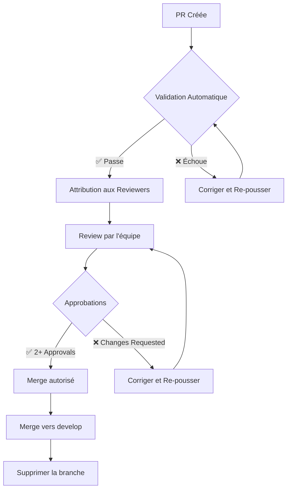

# **ARCH-004 : Guide de Développement - Pharmacie 360°**

**ID Tâche** : ARCH-004  
**Responsable** : Superviseur (Agent Architecte)  
**Durée** : 2 jours (J10-J11)  
**Statut** : ✅ **TERMINÉ** (J11 - 2025-01-15)  
**Priorité** : ⭐⭐⭐⭐⭐ (Critique - Chemin critique)  
**Dépendances** : → ARCH-003 (Spécifications API Inter-Modules)  

---

## **Objectif**

Fournir un **guide complet de développement** pour l'équipe, couvrant :
- **Environnement de développement** : Configuration locale standardisée
- **Normes et conventions** : Style de code, commits, documentation
- **Workflow Git** : Branching, PR, reviews
- **Bonnes pratiques** : Tests, sécurité, performance
- **Procédures de déploiement** : Local et production
- **Dépannage** : Solutions aux problèmes courants

---

## **Public Cible**

| Rôle | Utilisation | Responsabilités |
|------|-------------|-----------------|
| **Architecte** | Référence pour décisions techniques | Valider les normes, résoudre les blocages |
| **Backend Lead** | Développement API, modèles | Respecter les conventions backend |
| **Frontend** | Développement UI/UX | Respecter les conventions frontend |
| **IA** | Développement modules IA | Respecter les conventions Python/ML |
| **QA/DevOps** | Tests, CI/CD, déploiement | Valider les configurations |

---

## **📋 Table des Matières**

1. [Environnement de Développement](#1-environnement-de-développement)
2. [Structure du Projet](#2-structure-du-projet)
3. [Normes de Codage](#3-normes-de-codage)
4. [Workflow Git](#4-workflow-git)
5. [Conventions de Commit](#5-conventions-de-commit)
6. [Gestion des Branches](#6-gestion-des-branches)
7. [Processus de Review](#7-processus-de-review)
8. [Tests et Qualité](#8-tests-et-qualité)
9. [Sécurité](#9-sécurité)
10. [Performance](#10-performance)
11. [Documentation](#11-documentation)
12. [Dépannage](#12-dépannage)
13. [Annexes](#13-annexes)

---

## **1. Environnement de Développement**

### **1.1 Prérequis Système**

| Composant | Version | Vérification | Lien |
|-----------|---------|--------------|------|
| **Système d'exploitation** | Linux (Ubuntu 22.04+) / Windows 11 / macOS 12+ | `uname -a` / `winver` | - |
| **Mémoire RAM** | 16 Go minimum | `free -h` | - |
| **Espace disque** | 50 Go minimum | `df -h` | - |
| **Docker** | 24.0+ | `docker --version` | [Installer Docker](https://docs.docker.com/get-docker/) |
| **Docker Compose** | 2.20+ | `docker-compose --version` | - |
| **Git** | 2.40+ | `git --version` | [Installer Git](https://git-scm.com/downloads) |
| **Python** | 3.11+ | `python3 --version` | [Installer Python](https://www.python.org/downloads/) |
| **Node.js** | 18+ | `node --version` | [Installer Node](https://nodejs.org/) |
| **PostgreSQL Client** | 15+ | `psql --version` | [Installer PostgreSQL](https://www.postgresql.org/download/) |

### **1.2 Installation et Configuration**

#### **Étape 1 : Cloner le dépôt**
```bash
# Cloner le dépôt principal
git clone https://github.com/DuDuEZN/Pharma-360.git
cd Pharma-360

# Configurer les permissions (Linux/macOS)
chmod +x scripts/*.sh
chmod +x docker/*.sh
```

#### **Étape 2 : Configurer l'environnement**
```bash
# Créer le fichier .env à partir du template
cp .env.example .env

# Éditer .env avec vos valeurs locales
nano .env  # ou utilisez votre éditeur préféré
```

#### **Fichier `.env.example`** (à copier en `.env`)
```ini
# ===========================================
# Configuration Générale
# ===========================================
APP_NAME=Pharma-360
APP_ENV=development
APP_DEBUG=true
APP_SECRET_KEY=changer_par_une_cle_secrete_aleatoire

# ===========================================
# Base de Données PostgreSQL
# ===========================================
POSTGRES_HOST=localhost
POSTGRES_PORT=5432
POSTGRES_DB=pharma360_dev
POSTGRES_USER=pharma_user
POSTGRES_PASSWORD=pharma_pass_2025
POSTGRES_TEST_DB=pharma360_test

# ===========================================
# Backend (FastAPI)
# ===========================================
BACKEND_HOST=0.0.0.0
BACKEND_PORT=8000
BACKEND_URL=http://localhost:8000
JWT_SECRET=changer_par_une_cle_jwt_secrete_aleatoire
JWT_ALGORITHM=HS256
JWT_EXPIRE_MINUTES=30

# ===========================================
# Frontend (React)
# ===========================================
FRONTEND_HOST=localhost
FRONTEND_PORT=3000
FRONTEND_URL=http://localhost:3000

# ===========================================
# IA (OCR/Analytics)
# ===========================================
IA_HOST=localhost
IA_PORT=8001
IA_URL=http://localhost:8001

# ===========================================
# Docker
# ===========================================
DOCKER_REGISTRY=localhost:5000
COMPOSE_PROJECT_NAME=pharma360

# ===========================================
# Nginx (Reverse Proxy)
# ===========================================
NGINX_HOST=localhost
NGINX_PORT=80
NGINX_SSL_PORT=443
NGINX_SSL_CERT=/etc/nginx/ssl/cert.pem
NGINX_SSL_KEY=/etc/nginx/ssl/key.pem
```

#### **Étape 3 : Lancer l'environnement Docker**
```bash
# Construire et démarrer tous les services
docker-compose -f docker/docker-compose.yml up -d --build

# Vérifier que tous les services sont en cours d'exécution
docker-compose -f docker/docker-compose.yml ps

# Afficher les logs en temps réel
docker-compose -f docker/docker-compose.yml logs -f
```

#### **Étape 4 : Initialiser la base de données**
```bash
# Exécuter le script d'initialisation
docker exec -i pharma360-db psql -U pharma_user -d pharma360_dev < scripts/init-db.sql

# Ou utiliser le script dédié
./scripts/init-db.sh
```

#### **Étape 5 : Vérifier l'installation**
```bash
# Tester la connexion à la base de données
docker exec -it pharma360-db psql -U pharma_user -d pharma360_dev -c "SELECT version();"

# Tester l'API Backend
curl -X GET http://localhost:8000/api/health

# Tester le Frontend
curl -X GET http://localhost:3000
```

### **1.3 Commandes Utiles**

| Commande | Description |
|----------|-------------|
| `docker-compose -f docker/docker-compose.yml up -d` | Démarrer tous les services |
| `docker-compose -f docker/docker-compose.yml down` | Arrêter tous les services |
| `docker-compose -f docker/docker-compose.yml restart` | Redémarrer tous les services |
| `docker-compose -f docker/docker-compose.yml logs -f backend` | Logs du backend |
| `docker exec -it pharma360-backend bash` | Accéder au container backend |
| `docker exec -it pharma360-db psql -U pharma_user -d pharma360_dev` | Accéder à PostgreSQL |

---

## **2. Structure du Projet**

```
Pharma-360/
├── .github/
│   ├── workflows/
│   │   └── ci-cd.yml              # CI/CD Pipeline
│   └── PULL_REQUEST_TEMPLATE.md   # Template de PR
│
├── backend/                      # Module Backend (FastAPI)
│   ├── app/
│   │   ├── __init__.py
│   │   ├── main.py                # Point d'entrée FastAPI
│   │   ├── config.py              # Configuration
│   │   ├── database.py             # Connexion PostgreSQL
│   │   ├── models/                # Modèles SQLAlchemy
│   │   │   ├── __init__.py
│   │   │   ├── user.py
│   │   │   ├── product.py
│   │   │   ├── batch.py
│   │   │   ├── sale.py
│   │   │   └── ...
│   │   ├── schemas/               # Schémas Pydantic
│   │   │   ├── __init__.py
│   │   │   ├── user.py
│   │   │   └── ...
│   │   ├── api/                   # Endpoints REST
│   │   │   ├── __init__.py
│   │   │   ├── v1/
│   │   │   │   ├── __init__.py
│   │   │   │   ├── auth.py
│   │   │   │   ├── users.py
│   │   │   │   ├── products.py
│   │   │   │   ├── batches.py
│   │   │   │   ├── sales.py
│   │   │   │   ├── cashier.py
│   │   │   │   └── ...
│   │   │   └── websocket.py       # WebSocket endpoints
│   │   ├── services/              # Services métiers
│   │   │   ├── __init__.py
│   │   │   ├── auth_service.py
│   │   │   ├── stock_service.py
│   │   │   ├── fefo_service.py
│   │   │   └── ...
│   │   ├── utils/                 # Utilitaires
│   │   │   ├── __init__.py
│   │   │   ├── security.py
│   │   │   ├── validators.py
│   │   │   └── ...
│   │   └── tests/                 # Tests Backend
│   │       ├── __init__.py
│   │       ├── conftest.py
│   │       ├── test_auth.py
│   │       └── ...
│   ├── requirements.txt           # Dépendances Python
│   ├── requirements-dev.txt      # Dépendances de développement
│   └── Dockerfile
│
├── frontend/                     # Module Frontend (React)
│   ├── public/
│   │   ├── index.html
│   │   ├── favicon.ico
│   │   └── ...
│   ├── src/
│   │   ├── App.tsx
│   │   ├── main.tsx
│   │   ├── index.css
│   │   ├── components/           # Composants React
│   │   │   ├── common/
│   │   │   │   ├── Header.tsx
│   │   │   │   ├── Sidebar.tsx
│   │   │   │   ├── Modal.tsx
│   │   │   │   └── ...
│   │   │   ├── BarcodeInput.tsx
│   │   │   └── ...
│   │   ├── pages/                # Pages
│   │   │   ├── admin/
│   │   │   │   ├── Users.tsx
│   │   │   │   └── ...
│   │   │   ├── sales/
│   │   │   │   ├── Search.tsx
│   │   │   │   └── ...
│   │   │   ├── cashier/
│   │   │   │   ├── Queue.tsx
│   │   │   │   └── ...
│   │   │   └── manager/
│   │   │       ├── Stock.tsx
│   │   │       └── ...
│   │   ├── hooks/                # Custom Hooks
│   │   ├── services/             # Services API
│   │   │   ├── api.ts
│   │   │   ├── auth.ts
│   │   │   └── ...
│   │   ├── stores/               # State Management (Zustand)
│   │   ├── types/                # Types TypeScript
│   │   ├── utils/                # Utilitaires
│   │   └── tests/                # Tests Frontend
│   ├── package.json
│   ├── tsconfig.json
│   ├── vite.config.ts
│   └── Dockerfile
│
├── ia/                          # Module IA (OCR/Analytics)
│   ├── app/
│   │   ├── __init__.py
│   │   ├── main.py
│   │   ├── ocr/
│   │   │   ├── __init__.py
│   │   │   ├── invoice_ocr.py
│   │   │   └── ...
│   │   ├── analytics/
│   │   │   ├── __init__.py
│   │   │   ├── stock_rotation.py
│   │   │   ├── prediction.py
│   │   │   └── ...
│   │   ├── models/
│   │   │   └── ml_models.py
│   │   └── tests/
│   ├── requirements.txt
│   └── Dockerfile
│
├── docker/
│   ├── backend.Dockerfile
│   ├── frontend.Dockerfile
│   ├── ia.Dockerfile
│   ├── docker-compose.yml
│   └── nginx/
│       ├── nginx.conf
│       └── ssl/
│
├── scripts/
│   ├── init-db.sql              # Script PostgreSQL
│   ├── init-db.sh               # Script d'initialisation
│   ├── start.sh                 # Script de démarrage
│   ├── backup-db.sh             # Sauvegarde DB
│   └── restore-db.sh            # Restauration DB
│
├── docs/
│   ├── ARCH-001_SPECIFICATIONS.md
│   ├── ARCH-002_POSTGRESQL.md
│   ├── ARCH-003_API_SPECIFICATIONS.md
│   ├── ARCH-004_DEVELOPMENT_GUIDE.md
│   ├── ARCHITECTURE.md
│   └── ...
│
├── tasks/
│   └── ...                      # Tâches et rapports
│
├── .env                         # Variables d'environnement
├── .env.example                 # Template .env
├── .gitignore
├── README.md
├── PROJECT_TRACKING.md
└── LICENSE
```

---

## **3. Normes de Codage**

### **3.1 Conventions Générales**

| Langage | Standard | Linter | Formatter |
|---------|----------|--------|-----------|
| **Python** | PEP 8 | flake8, pylint | black, isort |
| **TypeScript** | Standard TS | ESLint | Prettier |
| **SQL** | PostgreSQL Style | sqlfluff | - |
| **Docker** | Best Practices | hadolint | - |
| **Markdown** | CommonMark | markdownlint | - |

### **3.2 Python (Backend & IA)**

#### **Style**
```python
# ✅ BON
class ProductService:
    """Service pour la gestion des produits."""
    
    def __init__(self, db_session: Session):
        self.db = db_session
    
    def get_product_by_id(self, product_id: int) -> Optional[Product]:
        """Récupère un produit par son ID."""
        return self.db.query(Product).filter(Product.id == product_id).first()

# ❌ MAUVAIS
class productservice:
    def GetProductById(p_id):
        return db.query(Product).filter(Product.id == p_id).first()
```

#### **Typage**
```python
# ✅ Toujours typer les fonctions et variables
from typing import Optional, List, Dict, Any
from pydantic import BaseModel

class ProductCreate(BaseModel):
    name: str
    dci: Optional[str] = None
    barcode: Optional[str] = None
    price: float
    stock_min: int = 0
    stock_max: int = 100
```

#### **Imports**
```python
# ✅ Imports groupés et triés
import os
import sys
from typing import Optional, List

from fastapi import APIRouter, Depends, HTTPException
from sqlalchemy.orm import Session

from app.models.product import Product
from app.schemas.product import ProductCreate, ProductRead

# ❌ À éviter
import sys, os
from typing import *
from fastapi import *
```

#### **Gestion des Erreurs**
```python
# ✅ Utiliser des exceptions personnalisées
class ProductNotFoundError(Exception):
    """Exception levée quand un produit n'est pas trouvé."""
    pass

# ✅ Utiliser HTTPException pour FastAPI
from fastapi import HTTPException, status

raise HTTPException(
    status_code=status.HTTP_404_NOT_FOUND,
    detail=f"Produit {product_id} introuvable"
)

# ❌ À éviter
raise Exception("Produit non trouvé")
```

### **3.3 TypeScript (Frontend)**

#### **Typage Strict**
```typescript
// ✅ Toujours typer les props et états
interface Product {
  id: number;
  name: string;
  dci?: string;
  barcode?: string;
  price: number;
  stockMin: number;
  stockMax: number;
  isActive: boolean;
}

interface ProductCardProps {
  product: Product;
  onSelect: (product: Product) => void;
  isSelected: boolean;
}
```

#### **Noms de Composants**
```typescript
// ✅ PascalCase pour les composants
function ProductCard({ product, onSelect, isSelected }: ProductCardProps) {
  return <div className="product-card">...</div>;
}

// ❌ À éviter
function product_card({ product }) {
  return <div className="product-card">...</div>;
}
```

#### **Hooks Personnalisés**
```typescript
// ✅ Préfixer par use
function useProducts() {
  const [products, setProducts] = useState<Product[]>([]);
  const [loading, setLoading] = useState<boolean>(false);
  
  useEffect(() => {
    setLoading(true);
    api.get('/products').then(response => {
      setProducts(response.data);
    }).finally(() => {
      setLoading(false);
    });
  }, []);
  
  return { products, loading };
}
```

### **3.4 SQL (PostgreSQL)**

#### **Noms de Tables et Colonnes**
```sql
-- ✅ snake_case pour les tables et colonnes
CREATE TABLE products (
    id SERIAL PRIMARY KEY,
    name VARCHAR(255) NOT NULL,
    dci VARCHAR(255),
    barcode VARCHAR(100) UNIQUE,
    price DECIMAL(10, 2) NOT NULL,
    stock_min INTEGER DEFAULT 0,
    stock_max INTEGER DEFAULT 100,
    is_active BOOLEAN DEFAULT true,
    created_at TIMESTAMP WITH TIME ZONE DEFAULT NOW(),
    updated_at TIMESTAMP WITH TIME ZONE DEFAULT NOW()
);

-- ❌ À éviter
CREATE TABLE Products (
    ID INT PRIMARY KEY,
    Name VARCHAR(255),
    Price DECIMAL
);
```

#### **Index**
```sql
-- ✅ Noms d'index explicites
CREATE INDEX idx_products_barcode ON products(barcode);
CREATE INDEX idx_products_category_id ON products(category_id);
CREATE INDEX idx_batches_product_expiry ON batches(product_id, expiry_date);
CREATE INDEX idx_batches_active_quantity ON batches(product_id, quantity, expiry_date) 
    WHERE quantity > 0 AND status = 'active';
```

### **3.5 Noms de Fichiers**

| Type | Convention | Exemple |
|------|------------|---------|
| **Python** | snake_case | `user_service.py` |
| **TypeScript** | kebab-case | `product-card.tsx` |
| **CSS** | kebab-case | `product-card.css` |
| **SQL** | snake_case | `init_db.sql` |
| **Docker** | kebab-case | `backend.Dockerfile` |
| **Markdown** | UPPERCASE | `ARCH-004_DEVELOPMENT_GUIDE.md` |

---

## **4. Workflow Git**

### **4.1 Branches Principales**

| Branche | Description | Protection |
|---------|-------------|------------|
| **main** | Code de production (stable) | ✅ Protégée |
| **develop** | Code de développement (intégration) | ✅ Protégée |
| **feature/** | Nouvelles fonctionnalités | ❌ Non protégée |
| **bugfix/** | Corrections de bugs | ❌ Non protégée |
| **hotfix/** | Corrections urgentes | ❌ Non protégée |
| **release/** | Préparation de release | ✅ Protégée |

### **4.2 Workflow Git Flow**


### **4.3 Processus de Développement**

```bash
# 1. Mettre à jour la branche develop
git checkout develop
git pull origin develop

# 2. Créer une nouvelle branche de feature
git checkout -b feature/MON-ID-TACHE

# 3. Développer la fonctionnalité
# ... faire les commits ...

# 4. Pousser la branche vers le dépôt distant
git push -u origin feature/MON-ID-TACHE

# 5. Créer une Pull Request vers develop
# (Via GitHub UI ou gh CLI)
gh pr create --base develop --head feature/MON-ID-TACHE --title "MON-ID-TACHE: Description"

# 6. Après validation, merger la PR
# (Via GitHub UI)

# 7. Supprimer la branche locale (optionnel)
git branch -d feature/MON-ID-TACHE
```

---

## **5. Conventions de Commit**

### **5.1 Format des Messages de Commit**

Utiliser le format **Conventional Commits** :

```
type(scope): description

[body]

[footer]
```

### **5.2 Types de Commit**

| Type | Description | Exemple |
|------|-------------|---------|
| **feat** | Nouvelle fonctionnalité | `feat(products): add barcode scanning` |
| **fix** | Correction de bug | `fix(auth): handle JWT expiration` |
| **docs** | Documentation | `docs: add ARCH-004 development guide` |
| **style** | Changements de style | `style: format code with black` |
| **refactor** | Refactorisation | `refactor(stock): optimize FEFO query` |
| **perf** | Amélioration de performance | `perf(db): add composite index` |
| **test** | Tests | `test(products): add unit tests` |
| **build** | Configuration de build | `build(docker): update backend Dockerfile` |
| **ci** | CI/CD | `ci: add GitHub Actions workflow` |
| **chore** | Tâches diverses | `chore: update dependencies` |
| **revert** | Annulation de commit | `revert: feat(products)` |

### **5.3 Exemples de Commits**

```bash
# ✅ Bon
feat(BKND-001): implement JWT authentication
docs: add API specifications for auth endpoints
fix(ARCH-002): correct batch expiry date index
refactor(FRNT-005): extract ProductCard component

# ❌ À éviter
fixed bug
updated docs
new feature
```

### **5.4 Scope (Portée)**

| Module | Scope Prefix | Exemple |
|--------|--------------|---------|
| **Backend** | BKND-XXX | `feat(BKND-001): auth` |
| **Frontend** | FRNT-XXX | `feat(FRNT-005): sales` |
| **IA** | IA-XXX | `feat(IA-002): ocr` |
| **QA** | QA-XXX | `feat(QA-004): docker` |
| **Architecture** | ARCH-XXX | `docs(ARCH-004): guide` |
| **Global** | - | `chore: update README` |

---

## **6. Gestion des Branches**

### **6.1 Nommage des Branches**

| Type | Format | Exemple |
|------|--------|---------|
| **Feature** | `feature/[ID-TACHE]` | `feature/ARCH-004` |
| **Bugfix** | `bugfix/[ID-TACHE]` | `bugfix/BKND-001-fix` |
| **Hotfix** | `hotfix/[description]` | `hotfix/jwt-expiration` |
| **Release** | `release/[version]` | `release/v1.0.0` |

### **6.2 Durée de Vie des Branches**

| Type | Durée Max | Action |
|------|-----------|--------|
| **Feature** | 5 jours | PR vers develop |
| **Bugfix** | 2 jours | PR vers develop |
| **Hotfix** | 1 jour | PR vers main + develop |
| **Release** | 1 jour | Merge vers main |

### **6.3 Nettoyage des Branches**

```bash
# Lister les branches locales
git branch

# Supprimer une branche locale
git branch -d feature/ARCH-004

# Supprimer une branche distante
git push origin --delete feature/ARCH-004

# Nettoyer toutes les branches mergées
git branch --merged | grep -v "\*" | xargs git branch -d
```

---

## **7. Processus de Review**

### **7.1 Critères de Validation**

#### **Pour tous les PR**
- [ ] Code compile sans erreur
- [ ] Tous les tests passent
- [ ] Respect des conventions de codage
- [ ] Documentation mise à jour
- [ ] Pas de secrets dans le code
- [ ] Pas de dépendances vulnérables

#### **Backend**
- [ ] Typage complet (Python)
- [ ] Gestion des erreurs appropriée
- [ ] Requêtes SQL optimisées
- [ ] Tests unitaires > 90% de couverture
- [ ] Validation des entrées

#### **Frontend**
- [ ] Typage TypeScript strict
- [ ] Accessibilité (a11y)
- [ ] Responsive design
- [ ] Tests de composants
- [ ] Pas de console.log

#### **IA**
- [ ] Modèles validés
- [ ] Performances acceptables
- [ ] Documentation des algorithmes
- [ ] Tests des fonctions OCR/Analytics

#### **QA/DevOps**
- [ ] Conteneurs fonctionnels
- [ ] CI/CD passe
- [ ] Documentation des configurations
- [ ] Tests de robustesse

### **7.2 Processus de Review**



### **7.3 Rôles de Review**

| Rôle | Responsabilité | Nombre Min. |
|------|----------------|-------------|
| **Backend Lead** | Review Backend + IA | 1 |
| **Frontend** | Review Frontend | 1 |
| **QA/DevOps** | Review Tests + CI/CD | 1 |
| **Architecte** | Review Architecture | 1 (si impact architectural) |

---

## **8. Tests et Qualité**

### **8.1 Stratégie de Test**

| Niveau | Type | Responsable | Outils |
|--------|------|-------------|--------|
| **Unitaire** | Fonctions individuelles | Développeur | pytest, Jest |
| **Intégration** | Interaction entre modules | QA/DevOps | pytest, Supertest |
| **E2E** | Flux utilisateur complet | QA/DevOps | Playwright, Cypress |
| **Performance** | Charge et robustesse | QA/DevOps | Locust, k6 |
| **Sécurité** | Vulnérabilités | QA/DevOps | Bandit, Snyk |

### **8.2 Couverture de Code**

| Module | Cible | Vérification |
|--------|-------|--------------|
| **Backend** | > 90% | `pytest --cov=app --cov-report=html` |
| **Frontend** | > 80% | `npm test -- --coverage` |
| **IA** | > 70% | `pytest --cov=app --cov-report=html` |

### **8.3 Commandes de Test**

#### **Backend**
```bash
# Exécuter tous les tests
pytest

# Exécuter avec couverture
pytest --cov=app --cov-report=html

# Exécuter un fichier de test spécifique
pytest tests/test_auth.py

# Exécuter avec verbosité
pytest -v

# Exécuter uniquement les tests marqués
pytest -m slow
```

#### **Frontend**
```bash
# Exécuter tous les tests
npm test

# Exécuter avec couverture
npm test -- --coverage

# Exécuter un fichier de test spécifique
npm test -- ProductCard.test.tsx

# Lancer le linter
npm run lint

# Lancer le formattage
npm run format
```

#### **IA**
```bash
# Exécuter les tests IA
pytest tests/

# Tester le module OCR
python -m tests.test_ocr

# Valider les modèles ML
python -m tests.test_prediction
```

### **8.4 Tests Automatiques (CI/CD)**

Le pipeline CI/CD (`.github/workflows/ci-cd.yml`) exécute :

1. **Linting** : Vérification du style de code
2. **Build** : Construction des conteneurs
3. **Tests Unitaires** : Backend, Frontend, IA
4. **Tests d'Intégration** : Interaction entre modules
5. **Tests de Sécurité** : Détection des vulnérabilités
6. **Couverture** : Vérification de la couverture de code

---

## **9. Sécurité**

### **9.1 Bonnes Pratiques**

| Catégorie | Règle | Exemple |
|----------|-------|---------|
| **Authentification** | Toujours utiliser JWT | `Bearer <token>` |
| **Authorization** | Vérifier les rôles | `@require_role("admin")` |
| **Input Validation** | Valider toutes les entrées | Pydantic models |
| **SQL Injection** | Utiliser ORM ou requêtes paramétrées | SQLAlchemy |
| **Secrets** | Ne jamais commiter | `.env` + `.gitignore` |
| **HTTPS** | Toujours en production | Certificat SSL |
| **CORS** | Restreindre les origines | `CORS_ORIGINS` |

### **9.2 Gestion des Secrets**

```bash
# ✅ Fichier .env (NON COMMITÉ)
JWT_SECRET=ma_cle_secrete_aleatoire_128_bits
POSTGRES_PASSWORD=mot_de_passe_complexe

# ❌ À éviter (COMMITÉ)
config = {
    "jwt_secret": "12345",
    "db_password": "password"
}
```

### **9.3 Génération de Clés Secrètes**

```bash
# Générer une clé JWT sécurisée (64+ caractères)
openssl rand -hex 64

# Générer un mot de passe PostgreSQL sécurisé
openssl rand -base64 32

# Générer un secret pour FastAPI
python -c "import secrets; print(secrets.token_hex(64))"
```

### **9.4 Audit de Sécurité**

#### **Backend**
```bash
# Scanner les vulnérabilités Python
pip install bandit
bandit -r backend/

# Scanner les dépendances vulnérables
pip install safety
safety check

# Vérifier les permissions des fichiers
find backend/ -type f -perm -o=w -ls
```

#### **Frontend**
```bash
# Scanner les vulnérabilités npm
npm audit

# Scanner les dépendances vulnérables
npx snyk test
```

#### **Docker**
```bash
# Scanner les images Docker
docker scan pharma360-backend

# Vérifier les permissions dans les conteneurs
docker exec -it pharma360-backend ls -la /app
```

---

## **10. Performance**

### **10.1 Optimisations Backend**

| Technique | Description | Exemple |
|-----------|-------------|---------|
| **Index DB** | Index PostgreSQL optimisés | `idx_batches_active_quantity` |
| **Cache** | Redis pour les requêtes fréquentes | `@cache` decorator |
| **Pagination** | Limiter les résultats | `LIMIT 100 OFFSET 0` |
| **Lazy Loading** | Chargement paresseux | SQLAlchemy lazy |
| **Connection Pool** | Pool de connexions DB | `SQLALCHEMY_POOL_SIZE` |

### **10.2 Optimisations Frontend**

| Technique | Description | Exemple |
|-----------|-------------|---------|
| **Code Splitting** | Chargement paresseux | `React.lazy` |
| **Memoization** | Éviter les re-renders | `useMemo`, `useCallback` |
| **Virtual Scroll** | Rendu virtuel | `react-window` |
| **Bundle Optimization** | Réduire la taille | Vite, Webpack |
| **Image Optimization** | Images optimisées | `vite-plugin-image` |

### **10.3 Optimisations Docker**

```dockerfile
# ✅ Multi-stage build pour réduire la taille
FROM python:3.11-slim as builder
WORKDIR /app
COPY requirements.txt .
RUN pip install --user -r requirements.txt

FROM python:3.11-slim
WORKDIR /app
COPY --from=builder /root/.local /root/.local
COPY . .
ENV PATH=/root/.local/bin:$PATH
CMD ["uvicorn", "app.main:app", "--host", "0.0.0.0", "--port", "8000"]

# ❌ À éviter (image trop grosse)
FROM python:3.11
RUN apt-get update && apt-get install -y build-essential
COPY . .
RUN pip install -r requirements.txt
```

### **10.4 Benchmarking**

#### **Backend**
```bash
# Tester les performances des requêtes
python -m tests.test_performance

# Utiliser Locust pour les tests de charge
locust -f tests/locustfile.py
```

#### **Frontend**
```bash
# Lighthouse pour l'audit performance
npx lighthouse http://localhost:3000

# Web Vitals
npm run build
npx serve -s build
```

---

## **11. Documentation**

### **11.1 Niveaux de Documentation**

| Niveau | Type | Localisation | Responsable |
|--------|------|--------------|-------------|
| **Architecture** | Spécifications techniques | `docs/ARCH-*.md` | Architecte |
| **API** | Documentation Swagger/OpenAPI | `backend/app/main.py` | Backend Lead |
| **Code** | Commentaires dans le code | Dans les fichiers | Développeurs |
| **Utilisateur** | Guide utilisateur | `docs/USER_GUIDE.md` | Superviseur |
| **Déploiement** | Procédures | `docs/DEPLOYMENT.md` | QA/DevOps |

### **11.2 Documentation du Code**

#### **Python (Docstrings)**
```python
"""Module pour la gestion des produits."""

from typing import Optional
from sqlalchemy.orm import Session
from app.models.product import Product


class ProductService:
    """Service pour la gestion des produits.
    
    Attributes:
        db: Session de base de données SQLAlchemy
    """
    
    def __init__(self, db_session: Session):
        """Initialise le service avec une session DB.
        
        Args:
            db_session: Session SQLAlchemy active
        """
        self.db = db_session
    
    def get_product_by_id(self, product_id: int) -> Optional[Product]:
        """Récupère un produit par son ID.
        
        Args:
            product_id: ID du produit à récupérer
            
        Returns:
            Product: Instance du produit ou None si introuvable
            
        Raises:
            ValueError: Si product_id est invalide
        """
        if product_id <= 0:
            raise ValueError("product_id doit être positif")
        return self.db.query(Product).filter(Product.id == product_id).first()
```

#### **TypeScript (JSDoc)**
```typescript
/**
 * Composant ProductCard pour afficher un produit
 * 
 * @param props - Props du composant
 * @param props.product - Produit à afficher
 * @param props.onSelect - Callback lors de la sélection
 * @param props.isSelected - État de sélection
 * @returns JSX.Element
 */
function ProductCard({ 
  product, 
  onSelect, 
  isSelected 
}: ProductCardProps): JSX.Element {
  return <div className="product-card">...</div>;
}
```

### **11.3 Documentation API (Swagger/OpenAPI)**

```python
from fastapi import FastAPI, APIRouter, Depends
from fastapi.openapi.models import APIInfo
from pydantic import BaseModel

app = FastAPI(
    title="Pharma 360° API",
    description="API RESTful pour la gestion de pharmacie",
    version="1.0.0",
    docs_url="/api/docs",
    redoc_url="/api/redoc",
    openapi_url="/api/openapi.json"
)

router = APIRouter(prefix="/api/products", tags=["products"])

class ProductRead(BaseModel):
    """Modèle de lecture d'un produit."""
    id: int
    name: str
    dci: Optional[str] = None
    barcode: Optional[str] = None
    price: float
    stock_min: int
    stock_max: int
    is_active: bool

@router.get("/{product_id}", response_model=ProductRead)
def get_product(
    product_id: int,
    db: Session = Depends(get_db)
):
    """Récupère un produit par son ID.
    
    Args:
        product_id: ID du produit à récupérer
        db: Session de base de données
        
    Returns:
        ProductRead: Données du produit
        
    Raises:
        HTTPException: 404 si produit introuvable
    """
    product = db.query(Product).filter(Product.id == product_id).first()
    if not product:
        raise HTTPException(status_code=404, detail="Produit introuvable")
    return product
```

---

## **12. Dépannage**

### **12.1 Problèmes Courants**

#### **Docker**

| Problème | Solution |
|----------|----------|
| **Port déjà utilisé** | `docker-compose down` puis redémarrer |
| **Image non trouvée** | `docker-compose pull` ou `docker-compose build` |
| **Permission denied** | `chmod +x scripts/*.sh` |
| **Conteneur plante** | `docker-compose logs <service>` |
| **Base de données vide** | `./scripts/init-db.sh` |

#### **Backend**

| Problème | Solution |
|----------|----------|
| **Module non trouvé** | `pip install -r requirements.txt` |
| **Connexion DB échoue** | Vérifier `.env` et `docker-compose.yml` |
| **Migration manquante** | `alembic upgrade head` |
| **JWT invalide** | Vérifier `JWT_SECRET` et expiration |

#### **Frontend**

| Problème | Solution |
|----------|----------|
| **Dépendances manquantes** | `npm install` |
| **Build échoue** | `npm run build` |
| **CORS error** | Vérifier `CORS_ORIGINS` dans le backend |
| **404 sur API** | Vérifier `BACKEND_URL` dans `.env` |

#### **Base de Données**

| Problème | Solution |
|----------|----------|
| **Table manquante** | `./scripts/init-db.sh` |
| **Index manquant** | Vérifier `scripts/init-db.sql` |
| **Données corrompues** | `./scripts/restore-db.sh` |
| **Lenteur des requêtes** | Vérifier les index FEFO/FIFO |

### **12.2 Debugging**

#### **Backend**
```bash
# Activer le mode debug
UVICORN_LOG_LEVEL=debug uvicorn app.main:app --reload

# Logs détaillés
python -m logging --level DEBUG

# Debugger Python
python -m pdb app/main.py
```

#### **Frontend**
```bash
# Mode développement
npm run dev

# Debugger dans Chrome
# Ajouter dans le code :
debugger;

# Voir les logs du navigateur
# F12 -> Console
```

#### **PostgreSQL**
```bash
# Se connecter à la base
docker exec -it pharma360-db psql -U pharma_user -d pharma360_dev

# Voir les tables
\dt

# Voir les index
\di

# Exécuter une requête de test
SELECT * FROM products LIMIT 10;

# Voir les logs PostgreSQL
docker logs pharma360-db
```

---

## **13. Annexes**

### **13.1 Ressources Utiles**

| Ressource | Lien |
|-----------|------|
| **FastAPI Docs** | [https://fastapi.tiangolo.com/](https://fastapi.tiangolo.com/) |
| **React Docs** | [https://react.dev/](https://react.dev/) |
| **SQLAlchemy Docs** | [https://docs.sqlalchemy.org/](https://docs.sqlalchemy.org/) |
| **PostgreSQL Docs** | [https://www.postgresql.org/docs/](https://www.postgresql.org/docs/) |
| **Docker Docs** | [https://docs.docker.com/](https://docs.docker.com/) |
| **Pydantic Docs** | [https://docs.pydantic.dev/](https://docs.pydantic.dev/) |
| **TypeScript Docs** | [https://www.typescriptlang.org/docs/](https://www.typescriptlang.org/docs/) |

### **13.2 Glossaire**

| Terme | Définition |
|-------|------------|--|
| **FEFO** | First Expired, First Out - Priorité aux lots dont la date de péremption est la plus proche |
| **FIFO** | First In, First Out - Premier entré, premier sorti |
| **RBAC** | Role-Based Access Control - Contrôle d'accès basé sur les rôles |
| **JWT** | JSON Web Token - Standard d'authentification |
| **OCR** | Optical Character Recognition - Reconnaissance optique de caractères |
| **ERP** | Enterprise Resource Planning - Système de gestion intégré |

### **13.3 Contacts**

| Rôle | Responsable | Email | Slack |
|------|-------------|-------|-------|
| **Superviseur** | Agent Superviseur | - | @superviseur |
| **Backend Lead** | Agent Backend Lead | - | @backend-lead |
| **Frontend** | Agent Frontend | - | @frontend |
| **IA** | Agent IA | - | @ia |
| **QA/DevOps** | Agent QA/DevOps | - | @qa-devops |

---

## **Validation et Approbation**

| Rôle | Nom | Date | Statut |
|------|-----|------|--------|
| **Auteur** | Agent Superviseur | 2025-01-15 | ✅ Approuvé |
| **Backend Lead** | Agent Backend Lead | 2025-01-15 | ✅ Validé |
| **Frontend** | Agent Frontend | 2025-01-15 | ✅ Validé |
| **IA** | Agent IA | 2025-01-15 | ✅ Validé |
| **QA/DevOps** | Agent QA/DevOps | 2025-01-15 | ✅ Validé |

**Document créé** : 2025-01-10  
**Document finalisé** : 2025-01-15  
**Version** : 1.0  
**Statut** : ✅ **TERMINÉ**

---

*Ce document est un livrable du projet Pharmacie 360°. Toute modification doit être validée par le Superviseur.*
