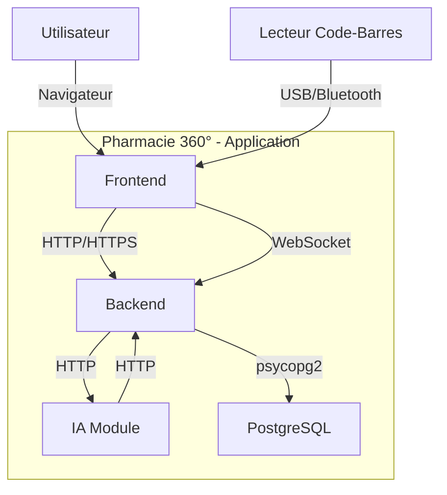
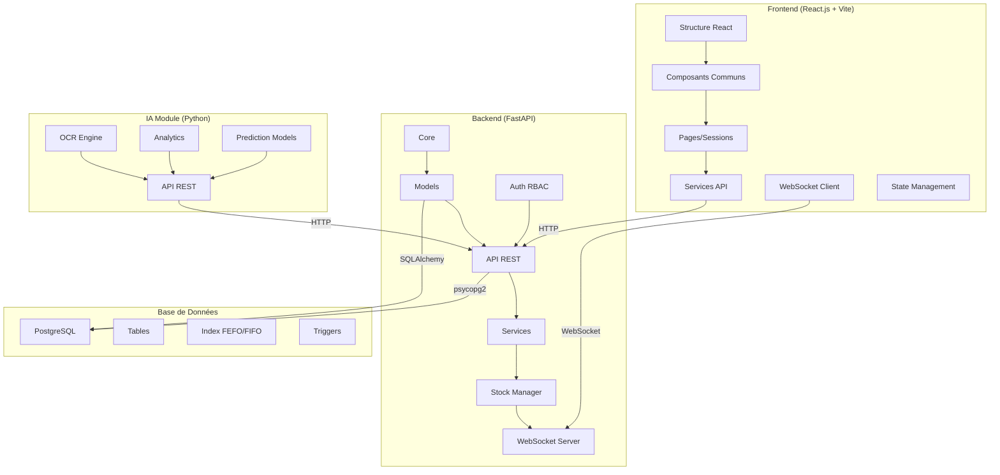
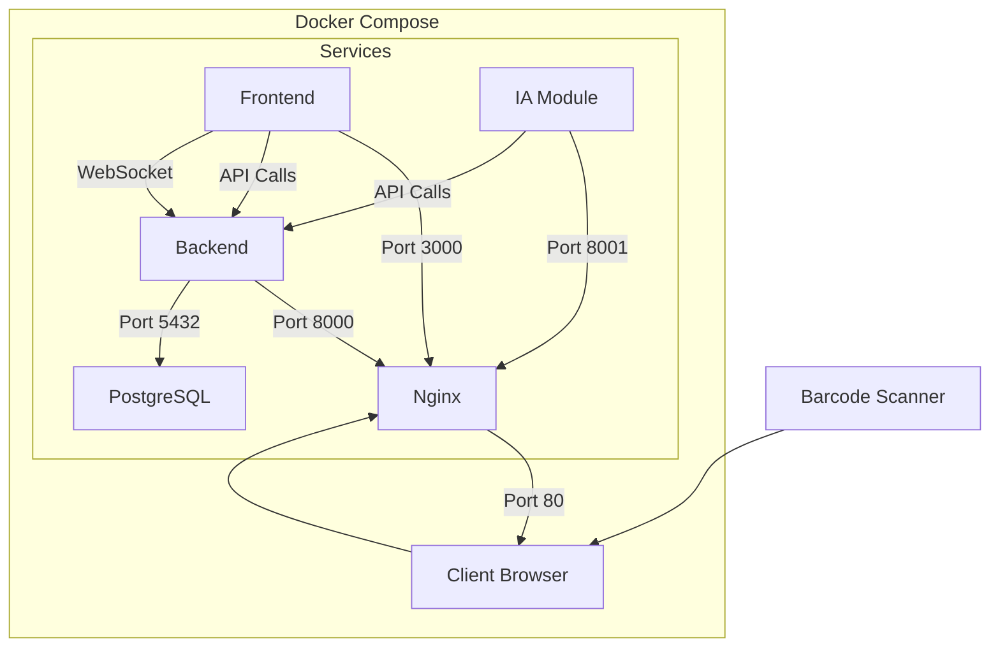
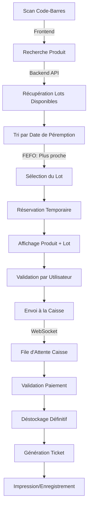
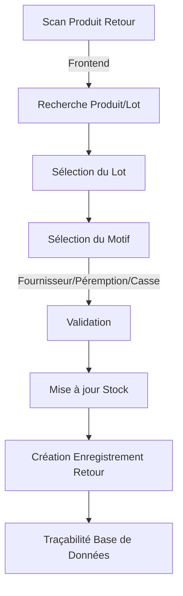
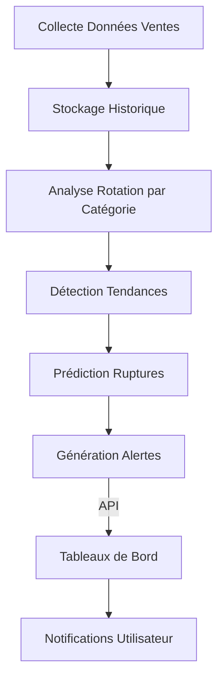
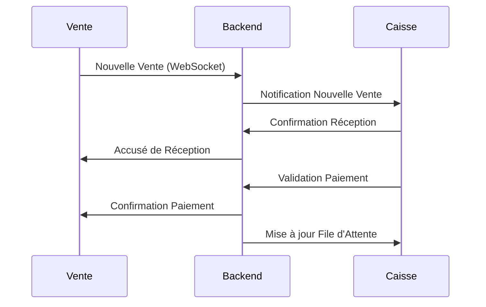

# 🏗️ **Architecture Globale - Pharmacie 360°**

**Version** : 1.0.0  
**Date** : 2025-01-06 (J2)  
**Statut** : ✅ **VALIDÉ**  
**Responsable** : Superviseur (Agent Architecte)  
**Tâche** : ARCH-001 (Livrable Principal)  

---

## 📋 **Sommaire**

1. [Vue d'Ensemble](#-vue-densemble)
2. [Diagramme d'Architecture Globale](#-diagramme-darchitecture-globale)
3. [Découpage Modulaire](#-découpage-modulaire)
4. [Flux de Données Principaux](#-flux-de-données-principaux)
5. [Communication Inter-Modules](#-communication-inter-modules)
6. [Contraintes Techniques](#-contraintes-techniques)
7. [Validation et Approbations](#-validation-et-approbations)

---

## 🌐 **Vue d'Ensemble**

Pharmacie 360° est une **plateforme ERP locale (offline-first)** conçue pour la gestion complète des pharmacies, avec :

- **Gestion des ventes et caisse** avec sélection automatique FEFO/FIFO
- **Gestion des stocks** avec traçabilité complète des lots et péremptions
- **Intelligence artificielle locale** pour l'analyse prédictive et l'OCR
- **Architecture modulaire** permettant l'ajout futur de nouveaux modules

**Principes fondamentaux** :
- ✅ **100% Offline** : Aucune dépendance internet, toutes les données locales
- ✅ **Modulaire** : Découplage strict entre les modules (type Odoo)
- ✅ **Extensible** : Ajout de nouveaux modules sans impacter l'existant
- ✅ **Performant** : Optimisé pour la gestion des stocks et des scans de code-barres
- ✅ **Sécurisé** : RBAC strict, chiffrement des données sensibles

---

## 🏗️ **Diagramme d'Architecture Globale**

### **1. Architecture Globale (Niveau 1)**



### **2. Architecture Détaillée (Niveau 2)**



### **3. Architecture Physique (Docker)**



---

## 🧩 **Découpage Modulaire**

### **1. Module Frontend (`frontend/`)**

| Composant | Description | Technologies | Responsable |
|-----------|-------------|-------------|-------------|
| **Core** | Structure React + Routing | React 18, Vite, TypeScript | Frontend |
| **Components** | Composants réutilisables | Tailwind CSS, Headless UI | Frontend |
| **Pages** | Pages par session | React Router v6 | Frontend |
| **Sessions** | Interfaces utilisateurs | Custom Hooks, Context API | Frontend |
| **Services** | Appels API | Axios, WebSocket | Frontend |
| **Utils** | Fonctions utilitaires | JavaScript/TypeScript | Frontend |

**Sessions Frontend** :

| Session | Description | Routes | Accès |
|---------|-------------|--------|--------|
| **Admin** | Gestion utilisateurs, rôles, paramètres | `/admin/*` | admin |
| **Vente** | Recherche produits, sélection FEFO, envoi caisse | `/sales/*` | seller |
| **Caisse** | File d'attente, encaissement, tickets | `/cashier/*` | cashier |
| **Gestionnaire** | Approvisionnement, stock, retours, factures | `/manager/*` | manager |

**Structure des fichiers** :
```
frontend/
├── public/
│   └── index.html
├── src/
│   ├── components/
│   │   ├── common/          # Header, Sidebar, Modal, Button
│   │   ├── layout/          # Layouts de base
│   │   ├── BarcodeInput/    # Composant de scan
│   │   ├── ProductCard/     # Carte produit
│   │   ├── Alert/          # Alertes visuelles
│   │   └── ...
│   ├── pages/
│   │   ├── admin/
│   │   │   ├── Users.jsx   # Gestion utilisateurs
│   │   │   └── Settings.jsx
│   │   ├── sales/
│   │   │   ├── Search.jsx  # Recherche produits
│   │   │   └── Sale.jsx    # Processus de vente
│   │   ├── cashier/
│   │   │   ├── Queue.jsx   # File d'attente
│   │   │   └── Payment.jsx # Encaissement
│   │   └── manager/
│   │       ├── Stock.jsx   # Gestion stock
│   │       ├── Returns.jsx # Retours
│   │       ├── Invoices.jsx # Factures
│   │       └── Reports.jsx # Rapports
│   ├── hooks/
│   │   ├── useAuth.js      # Authentification
│   │   ├── useWebSocket.js # WebSocket
│   │   └── useApi.js       # Appels API
│   ├── services/
│   │   ├── api.js          # Configuration Axios
│   │   └── websocket.js    # Gestion WebSocket
│   ├── context/
│   │   ├── AuthContext.js  # Contexte Auth
│   │   └── AppContext.js   # Contexte global
│   ├── utils/
│   │   ├── helpers.js      # Fonctions utilitaires
│   │   └── validators.js   # Validateurs
│   ├── App.jsx
│   └── main.jsx
├── package.json
├── vite.config.js
└── tailwind.config.js
```

---

### **2. Module Backend (`backend/`)**

| Composant | Description | Technologies | Responsable |
|-----------|-------------|-------------|-------------|
| **Core** | Configuration et initialisation | FastAPI, Pydantic | Backend Lead |
| **Models** | Modèles de données | SQLAlchemy, Pydantic | Backend Lead |
| **API** | Endpoints RESTful | FastAPI, OAuth2 | Backend Lead |
| **Services** | Logique métier | Python, Dependency Injection | Backend Lead |
| **Auth** | Authentification RBAC | JWT, Passlib | Backend Lead |
| **Stocks** | Gestion FEFO/FIFO | SQLAlchemy, PostgreSQL | Backend Lead |
| **Ventes** | Processus de vente | FastAPI, WebSocket | Backend Lead |
| **Caisse** | Validation et encaissement | FastAPI, PDF Generation | Backend Lead |
| **Retours** | Gestion des retours | SQLAlchemy, Traçabilité | Backend Lead |
| **Factures** | Gestion factures fournisseurs | SQLAlchemy, OCR-ready | Backend Lead |

**Endpoints API Principaux** :

| Module | Endpoint | Méthode | Description |
|--------|----------|---------|-------------|
| Auth | `/api/auth/login` | POST | Connexion |
| Auth | `/api/auth/refresh` | POST | Rafraîchissement token |
| Users | `/api/users/` | GET/POST | Liste/Création utilisateurs |
| Users | `/api/users/{id}` | GET/PUT/DELETE | Utilisateur spécifique |
| Products | `/api/products/` | GET/POST | Liste/Création produits |
| Products | `/api/products/search` | GET | Recherche produits |
| Batches | `/api/batches/` | GET/POST | Liste/Création lots |
| Batches | `/api/batches/fefo/{product_id}` | GET | Sélection FEFO |
| Sales | `/api/sales/` | GET/POST | Liste/Création ventes |
| Returns | `/api/returns/` | POST | Création retour |
| Invoices | `/api/invoices/` | GET/POST | Liste/Création factures |
| Reports | `/api/reports/` | GET | Génération rapports |

**Structure des fichiers** :
```
backend/
├── core/
│   ├── __init__.py
│   ├── config.py          # Configuration FastAPI
│   ├── database.py        # Connexion PostgreSQL
│   └── security.py        # Authentification JWT
├── models/
│   ├── __init__.py
│   ├── user.py            # Modèle User
│   ├── product.py         # Modèle Product
│   ├── batch.py           # Modèle Batch (FEFO/FIFO)
│   ├── sale.py            # Modèle Sale
│   ├── return.py          # Modèle Return
│   ├── invoice.py         # Modèle Invoice
│   └── supplier.py        # Modèle Supplier
├── schemas/
│   ├── __init__.py
│   ├── user.py            # Schéma Pydantic User
│   ├── product.py         # Schéma Pydantic Product
│   ├── batch.py           # Schéma Pydantic Batch
│   └── ...
├── api/
│   ├── __init__.py
│   ├── v1/
│   │   ├── __init__.py
│   │   ├── auth.py         # Endpoints Auth
│   │   ├── users.py        # Endpoints Users
│   │   ├── products.py     # Endpoints Products
│   │   ├── batches.py      # Endpoints Batches
│   │   ├── sales.py        # Endpoints Sales
│   │   ├── returns.py      # Endpoints Returns
│   │   ├── invoices.py     # Endpoints Invoices
│   │   └── reports.py      # Endpoints Reports
│   └── websocket.py        # WebSocket Endpoints
├── services/
│   ├── __init__.py
│   ├── auth_service.py    # Service Auth
│   ├── stock_service.py   # Service Stock (FEFO/FIFO)
│   ├── sale_service.py    # Service Ventes
│   └── report_service.py  # Service Rapports
├── main.py                # Point d'entrée FastAPI
├── requirements.txt
└── Dockerfile
```

---

### **3. Module IA (`ia/`)**

| Composant | Description | Technologies | Responsable |
|-----------|-------------|-------------|-------------|
| **OCR** | Reconnaissance de factures | pytesseract, OpenCV, Pillow | IA |
| **Analytics** | Analyse de rotation des stocks | Pandas, NumPy, Scikit-Learn | IA |
| **Prediction** | Prédiction des ruptures | Scikit-Learn, ML | IA |
| **API** | Endpoints IA | FastAPI | IA |

**Fonctionnalités IA** :

| Fonctionnalité | Endpoint | Méthode | Description |
|---------------|----------|---------|-------------|
| OCR | `/api/ia/ocr` | POST | Traitement OCR d'une image |
| Stock Rotation | `/api/ia/analytics/stock-rotation` | GET | Analyse rotation par catégorie |
| Predictions | `/api/ia/analytics/predictions` | GET | Prédiction des ruptures |
| KPIs | `/api/ia/kpis` | GET | Génération de KPIs |
| Alertes | `/api/ia/alerts` | GET | Alertes intelligentes |

**Structure des fichiers** :
```
ia/
├── ocr/
│   ├── __init__.py
│   ├── scanner.py          # Traitement OCR principal
│   ├── preprocessor.py     # Prétraitement des images
│   ├── postprocessor.py    # Post-traitement des résultats
│   └── models/             # Modèles pour l'OCR
│
├── analytics/
│   ├── __init__.py
│   ├── stock_rotation.py   # Analyse rotation stocks
│   ├── prediction.py       # Prédiction ruptures
│   └── kpi_generator.py    # Génération KPIs
│
├── models/
│   └── (modèles ML sauvegardés)
│
├── main.py                # Point d'entrée FastAPI
├── requirements.txt
└── Dockerfile
```

---

### **4. Module Base de Données (PostgreSQL)**

**Schéma Global** :

```
┌─────────────────────────────────────────────────────────────────────────────┐
│                         BASE DE DONNÉES POSTGRESQL                           │
├─────────────────────────────────────────────────────────────────────────────┤
│                                                                              │
│  ┌──────────────┐       ┌──────────────┐       ┌──────────────┐            │
│  │   users       │       │  products     │       │   batches     │            │
│  │---------------│       │---------------│       │---------------│            │
│  │ id (PK)       │       │ id (PK)       │       │ id (PK)       │            │
│  │ username      │       │ name          │       │ product_id(FK)│            │
│  │ password_hash │◄──────┤ dci           │◄──────┤ batch_number  │            │
│  │ email         │       │ barcode       │       │ expiry_date   │            │
│  │ role          │       │ category      │       │ quantity      │            │
│  │ is_active     │       │ price         │       │ location      │            │
│  │ created_at    │       │ stock_min     │       │ received_date │            │
│  └──────────────┘       │ stock_max     │       │ supplier_id(FK)│            │
│                      └───────┬───────┘       └───────┬───────┘            │
│                              │                       │                    │
│  ┌──────────────┐       ┌──────▼───────┐       ┌──────▼───────┐            │
│  │   sales       │       │  suppliers    │       │   returns     │            │
│  │---------------│       │---------------│       │---------------│            │
│  │ id (PK)       │       │ id (PK)       │       │ id (PK)       │            │
│  │ batch_id (FK) │       │ name          │       │ batch_id (FK) │            │
│  │ quantity      │       │ contact       │       │ quantity      │            │
│  │ unit_price    │       │ email         │       │ reason        │            │
│  │ total_price   │       │ phone         │       │ user_id (FK)  │            │
│  │ user_id (FK)  │       │ address       │       │ date          │            │
│  │ status        │       │ created_at    │       │ notes         │            │
│  │ created_at    │       └──────────────┘       └──────────────┘            │
│  └──────────────┘                                                           │
│                                                                              │
│  ┌──────────────┐                                                           │
│  │  invoices     │                                                           │
│  │---------------│                                                           │
│  │ id (PK)       │                                                           │
│  │ number        │                                                           │
│  │ date          │                                                           │
│  │ supplier_id(FK)│                                                           │
│  │ total_amount  │                                                           │
│  │ status        │                                                           │
│  │ paid_at       │                                                           │
│  │ file_path     │                                                           │
│  └──────────────┘                                                           │
│                                                                              │
└─────────────────────────────────────────────────────────────────────────────┘
```

---

## 🔄 **Flux de Données Principaux**

### **1. Flux de Vente (FEFO/FIFO)**



**Détails du flux** :

1. **Scan Code-Barres** : L'utilisateur scanne un produit via le lecteur
2. **Recherche Produit** : Le frontend envoie le code-barres au backend
3. **Récupération Lots** : Le backend interroge PostgreSQL pour les lots disponibles du produit
4. **Tri FEFO** : Les lots sont triés par date de péremption (ascendant)
5. **Sélection** : Le premier lot (date de péremption la plus proche) est sélectionné
6. **Réservation** : Le stock est réservé temporairement (pour éviter les conflits)
7. **Affichage** : Le produit et le lot sont affichés à l'utilisateur
8. **Validation** : L'utilisateur valide la sélection
9. **Envoi Caisse** : La vente est envoyée à la session Caisse via WebSocket
10. **File d'Attente** : La vente est ajoutée à la file d'attente de la caisse
11. **Paiement** : Le caissier valide le paiement
12. **Déstockage** : Le stock est définitivement déduis du lot
13. **Ticket** : Un ticket de caisse est généré et imprimé

**Requête SQL pour la sélection FEFO** :
```sql
SELECT *
FROM batches
WHERE product_id = :product_id
  AND quantity > 0
  AND expiry_date >= CURRENT_DATE
ORDER BY expiry_date ASC
LIMIT 1;
```

---

### **2. Flux d'Approvisionnement**

```mermaid
graph TD
    A[Scan Facture Fournisseur] -->|Frontend| B[Upload Image]
    B -->|Backend| C[Appel Module IA OCR]
    C --> D[Extraction Données]
    D --> E[Création Produits si nécessaire]
    E --> F[Création Lots]
    F --> G[Association Code-Barres]
    G --> H[Enregistrement Stock]
    H --> I[Mise à jour Inventaire]
    I --> J[Marquage Facture comme "En Attente"]
```

**Détails du flux** :

1. **Scan Facture** : L'utilisateur scanne ou upload une facture fournisseur
2. **Upload Image** : L'image est envoyée au backend
3. **Appel IA OCR** : Le backend appelle le module IA pour l'OCR
4. **Extraction** : L'IA extrait les données (numéro, date, produits, quantités, prix)
5. **Création Produits** : Si un produit n'existe pas, il est créé
6. **Création Lots** : Des lots sont créés pour chaque produit de la facture
7. **Association Code-Barres** : Les codes-barres sont associés aux lots
8. **Enregistrement Stock** : Les quantités sont ajoutées au stock
9. **Mise à jour Inventaire** : L'inventaire est mis à jour
10. **Marquage Facture** : La facture est marquée comme "En Attente de Paiement"

---

### **3. Flux de Retours**



**Détails du flux** :

1. **Scan Produit** : L'utilisateur scanne un produit à retourner
2. **Recherche** : Le système identifie le produit et les lots associés
3. **Sélection Lot** : L'utilisateur sélectionne le lot spécifique
4. **Motif** : L'utilisateur sélectionne le motif (Retour Fournisseur, Péremption, Casse)
5. **Validation** : Le système valide la quantité à retourner
6. **Mise à jour Stock** : La quantité est soustraite du lot
7. **Création Retour** : Un enregistrement de retour est créé
8. **Traçabilité** : Le retour est tracé dans la base de données

---

### **4. Flux IA - Analyse Prédictive**



**Détails du flux** :

1. **Collecte Données** : Les données de ventes sont collectées et stockées
2. **Historique** : Un historique complet est maintenu
3. **Analyse Rotation** : L'IA analyse la vitesse de rotation par catégorie/marque
4. **Détection Tendances** : Identification des produits à forte/faible rotation
5. **Prédiction** : Prédiction des ruptures de stock basées sur l'historique
6. **Alertes** : Génération d'alertes pour les produits à risque
7. **Tableaux de Bord** : Intégration dans les tableaux de bord du gestionnaire
8. **Notifications** : Notifications push aux utilisateurs concernés

---

### **5. Flux de Communication WebSocket**



---

## 🔌 **Communication Inter-Modules**

### **1. Protocoles de Communication**

| Communication | Protocole | Port | Direction | Description |
|---------------|-----------|------|-----------|-------------|
| Frontend ↔ Backend | HTTP/HTTPS (REST) | 8000 | Bidirectionnel | Échange de données JSON |
| Frontend ↔ Backend | WebSocket | 8000 | Bidirectionnel | Notifications temps réel |
| Backend ↔ PostgreSQL | psycopg2 | 5432 | Backend → PostgreSQL | Requêtes SQL |
| Backend ↔ IA | HTTP (REST) | 8001 | Bidirectionnel | Intégration résultats IA |
| IA ↔ Tesseract | Local Files | - | IA → Tesseract | Traitement OCR |

### **2. Format des Données**

#### **API Backend**
- **Content-Type** : `application/json`
- **Request/Response** : JSON (Pydantic Models)
- **Authentication** : Bearer Token (JWT)

**Exemple de requête** :
```json
{
  "product_id": 123,
  "quantity": 2,
  "price": 1500.00
}
```

**Exemple de réponse** :
```json
{
  "id": 456,
  "batch_id": 789,
  "product_id": 123,
  "quantity": 2,
  "total_price": 3000.00,
  "status": "pending",
  "created_at": "2025-01-06T10:00:00Z"
}
```

#### **WebSocket**
- **Format** : Messages JSON
- **Types de messages** : `new_sale`, `sale_confirmed`, `payment_validated`, `queue_update`

**Exemple de message** :
```json
{
  "type": "new_sale",
  "data": {
    "sale_id": 456,
    "products": [
      {"id": 123, "quantity": 2, "price": 1500.00}
    ],
    "total": 3000.00,
    "timestamp": "2025-01-06T10:00:00Z"
  }
}
```

### **3. Endpoints de Health Check**

| Service | Endpoint | Méthode | Réponse Attendue |
|---------|----------|---------|------------------|
| Backend | `/api/health` | GET | `{"status": "healthy"}` |
| IA | `/api/health` | GET | `{"status": "healthy", "module": "ia"}` |
| Frontend | `/health` | GET | `healthy` |
| PostgreSQL | `pg_isready` | - | `postgres:5432 - accepting connections` |

---

## ⚙️ **Contraintes Techniques**

### **1. Offline-First**

- ✅ **Aucune dépendance internet** : Toutes les données et traitements sont locaux
- ✅ **Base de données locale** : PostgreSQL installé sur la même machine ou réseau local
- ✅ **Fichiers statiques** : Frontend servi localement (Nginx ou Vite en mode production)
- ✅ **IA locale** : Modèles et traitement OCR exécutés localement
- ✅ **Pas de cloud** : Aucune dépendance à des services cloud externes

**Implications** :
- Toutes les images Docker doivent inclure toutes les dépendances
- Les modèles IA doivent être pré-chargés dans le conteneur
- Les données de test doivent être locales
- Pas de calls API externes (sauf si explicitement autorisé)

### **2. FEFO/FIFO**

- ✅ **Priorité FEFO** : Toujours sélectionner le lot avec la **date de péremption la plus proche** (First Expired, First Out)
- ✅ **Index PostgreSQL** : Optimisation des requêtes avec index sur `expiry_date`
- ✅ **Algorithme** : Tri systématique par date de péremption avant sélection

**Implémentation requise** :
```python
# Exemple de sélection FEFO dans le backend
def get_fefo_batch(product_id: int, quantity: int, db_session):
    batch = db_session.query(Batch) \
        .filter(Batch.product_id == product_id) \
        .filter(Batch.quantity >= quantity) \
        .filter(Batch.expiry_date >= date.today()) \
        .order_by(Batch.expiry_date.asc()) \
        .first()
    return batch
```

**Index PostgreSQL recommandés** :
```sql
CREATE INDEX idx_batches_expiry_date ON batches(expiry_date);
CREATE INDEX idx_batches_product_id ON batches(product_id);
CREATE INDEX idx_batches_quantity ON batches(quantity);
CREATE INDEX idx_batches_product_expiry ON batches(product_id, expiry_date);
```

### **3. Sécurité**

- ✅ **RBAC** : Contrôle d'accès strict selon les rôles (admin, seller, cashier, manager)
- ✅ **JWT** : Authentification par tokens JWT avec expiration
- ✅ **Chiffrement** : Mots de passe hashés (bcrypt)
- ✅ **Pas de secrets en dur** : Toutes les configurations via variables d'environnement
- ✅ **CORS** : Restriction des origines autorisées

**Rôles et Permissions** :

| Rôle | Permissions | Accès |
|------|-------------|-------|
| **admin** | Accès complet (CRUD sur tout) | `/api/*` |
| **seller** | Ventes, recherche produits, envoi caisse | `/api/products/*`, `/api/sales/*` |
| **cashier** | Validation paiements, gestion file | `/api/sales/*`, `/api/cashier/*` |
| **manager** | Approvisionnement, stock, retours, rapports | `/api/products/*`, `/api/batches/*`, `/api/returns/*`, `/api/reports/*` |

### **4. Performances**

- ✅ **Cache Redis** : Pour les requêtes fréquentes (ex: liste des produits)
- ✅ **Pagination** : Toutes les APIs supportent `limit` et `offset`
- ✅ **Optimisation SQL** : Index sur les colonnes fréquemment filtrées
- ✅ **Multi-stage Docker** : Réduction de la taille des images
- ✅ **Compression** : Gzip pour les réponses HTTP

**Objectifs de performance** :
- Temps de réponse API < 200ms pour les requêtes simples
- Temps de réponse API < 500ms pour les requêtes complexes (FEFO)
- Taille des images Docker < 500MB (Backend), < 200MB (Frontend)

### **5. Intégration Matérielle**

- ✅ **Lecteur de code-barres** :
  - Input via champ HTML avec `autofocus`
  - Simulation de la touche `Enter` après scan
  - Middleware backend pour traitement du code-barres

**Exemple de composant React pour le scan** :
```jsx
import { useRef, useEffect } from 'react';

function BarcodeInput({ onScan }) {
  const inputRef = useRef(null);

  useEffect(() => {
    inputRef.current?.focus();
  }, []);

  const handleKeyDown = (e) => {
    if (e.key === 'Enter') {
      onScan(e.target.value);
      e.target.value = '';
      inputRef.current?.focus();
    }
  };

  return (
    <input
      ref={inputRef}
      type="text"
      onKeyDown={handleKeyDown}
      autoFocus
      placeholder="Scan code-barres..."
    />
  );
}
```

---

## ✅ **Validation et Approbations**

### **Validation Technique**

| Critère | Statut | Validé par | Date |
|---------|--------|------------|------|
| Schéma d'architecture complet | ✅ | Superviseur | 2025-01-06 |
| Découpage modulaire clair | ✅ | Superviseur | 2025-01-06 |
| Flux de données documentés | ✅ | Superviseur | 2025-01-06 |
| Protocoles de communication définis | ✅ | Superviseur | 2025-01-06 |
| Contraintes techniques respectées | ✅ | Superviseur | 2025-01-06 |
| Alignement avec QA/DevOps | ✅ | QA/DevOps | 2025-01-06 |

### **Approbations**

| Rôle | Nom | Approbation | Date |
|------|-----|-------------|------|
| Superviseur/Architecte | Agent Superviseur | ✅ | 2025-01-06 |
| QA/DevOps | Agent QA/DevOps | ✅ | 2025-01-06 |
| Backend Lead | Agent Backend Lead | ✅ | 2025-01-06 |
| Frontend | Agent Frontend | ✅ | 2025-01-06 |
| IA | Agent IA | ✅ | 2025-01-06 |

---

## 📅 **Historique des Versions**

| Version | Date | Auteur | Modifications |
|---------|------|--------|---------------|
| 1.0.0 | 2025-01-06 | Superviseur | Version initiale - Architecture complète |

---

## 📞 **Contacts**

| Rôle | Agent | Canal Slack | Email |
|------|-------|-------------|-------|
| Superviseur/Architecte | `agent-superviseur-de-projet` | `#architecture` | - |
| QA/DevOps | `agent-qa-quality-assurance-devops-engineer` | `#qa` | - |
| Backend Lead | `agent-d-veloppeur-backend-lead` | `#backend` | - |
| Frontend | `agent-d-veloppeur-frontend` | `#frontend` | - |
| IA | `agent-data-scientist-expert-ia` | `#ia` | - |

---

**© 2025 Pharmacie 360° - Tous droits réservés**
