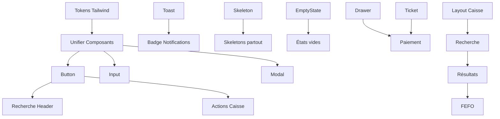

# 🚀 Refactoring Frontend - Pharma 360

> **Version** : 1.0  
> **Date** : Novembre 2026  
> **Statut** : ⏳ En cours  
> **Responsable** : [À assigner]  
> **Dépôt** : [DuDuEZN/Pharma-360](https://github.com/DuDuEZN/Pharma-360)

---

## 📋 **TABLE DES MATIÈRES**

1. [🎯 Contexte et Objectifs](#-contexte-et-objectifs)
2. [📊 Analyse Préalable](#-analyse-préalable)
3. [🗂️ Structure des Tâches](#-structure-des-tâches)
4. [🎨 Phase 1 : Fondations](#-phase-1-fondations)
5. [⚡ Phase 2 : Quick Wins](#-phase-2-quick-wins)
6. [💼 Phase 3 : Cœur Métier](#-phase-3-cœur-métier)
7. [👥 Phase 4 : Admin & Mobile](#-phase-4-admin--mobile)
8. [🤖 Phase 5 : IA & Extensions](#-phase-5-ia--extensions)
9. [🧪 Tâches Transversales](#-tâches-transversales)
10. [📊 Suivi et Affectations](#-suivi-et-affectations)
11. [⚠️ Dépendances Critiques](#-dépendances-critiques)
12. [✅ Livrables Attendus](#-livrables-attendus)
13. [📅 Roadmap](#-roadmap)

---

## 🎯 **CONTEXTE ET OBJECTIFS**

### 🔍 **Pourquoi ce refactoring ?**

Le projet **Pharma 360** nécessite une refonte complète de son frontend pour résoudre les problèmes identifiés dans l'audit UX et améliorer l'expérience utilisateur, particulièrement pour les **caissiers** et **gestionnaires** en environnement comptoir.

**Problèmes critiques identifiés (A1-A10) :**
- ❌ **A1** : 7 cartes KPI sur une seule rangée → Illisible
- ❌ **A2** : Double système de composants (`common/` + `ui/`) → Incohérence visuelle
- ❌ **A3** : Recherche du header non câblée → Frustration utilisateur
- ❌ **A4** : Sidebar mobile cassée → Navigation impossible sur mobile
- ⚠️ **A5** : Badge de notification statique → Fausse alerte
- ⚠️ **A6** : Pas de mode sombre → Fatigue visuelle
- ❌ **A7** : Rôles incohérents frontend/backend → Menus vides
- ⚠️ **A8** : Page 404 brute → Mauvaise expérience
- ⚠️ **A9** : Pas d'états vides/squelettes standardisés → Écrans blancs
- 🟡 **A10** : Pas de palette de commandes clavier → Productivité limitée

### 🎯 **Objectifs Principaux**

| Objectif | Indicateur de Succès | Priorité |
|----------|----------------------|----------|
| **Unifier le design system** | 1 seul kit de composants (Radix + Tailwind) | 🔴 |
| **Corriger les bugs critiques** | A1-A4 résolus en Phase 2 | 🔴 |
| **Optimiser l'expérience caisse** | Encaissement en < 30 secondes | 🔴 |
| **Améliorer l'accessibilité** | WCAG 2.1 AA sur tous les écrans | 🔴 |
| **Rendre responsive** | Fonctionnel sur 1440px / 834px / 390px | 🟠 |
| **Ajouter le mode sombre** | Basculable via UI | 🟠 |
| **Intégrer FEFO** | Priorisation automatique des lots par péremption | 🔴 |

### 📌 **Principes Directeurs**

1. **Fonction prime sur décoration** – Chaque pixel sert le parcours métier
2. **Un seul CTA primaire par zone visuelle** (ex: caisse → « Encaisser »)
3. **Cohérence** – Un seul kit de composants (Radix + Tailwind, style shadcn-like)
4. **Vitesse comptoir** – La caisse est conçue **clavier-d'abord** (F2, F3, F4, ⏎, ⎋)
5. **Contexte béninois** – Devise **FCFA (XOF)**, formats `fr-FR`, offline-friendly, contrastes forts

---

## 📊 **ANALYSE PRÉALABLE**

### 🏗️ **Architecture Actuelle**

```
frontend/
├── src/
│   ├── components/
│   │   ├── common/          # ❌ À supprimer (doublons)
│   │   │   ├── Button.jsx
│   │   │   ├── Input.jsx
│   │   │   ├── Modal.jsx
│   │   │   ├── Toast.jsx
│   │   │   ├── ...
│   │   ├── ui/              # ✅ À conserver et enrichir (Radix)
│   │   │   ├── button.jsx
│   │   │   ├── input.jsx
│   │   │   ├── dialog.jsx
│   │   │   ├── ...
│   │   └── layout/          # ✅ Layout global
│   │       ├── Sidebar.jsx
│   │       ├── Header.jsx
│   │       └── Layout.jsx
│   ├── pages/              # 16 pages principales
│   │   ├── LoginPage.jsx
│   │   ├── DashboardPage.jsx
│   │   ├── CashierPage.jsx
│   │   ├── ProductsPage.jsx
│   │   ├── SalesPage.jsx
│   │   ├── admin/
│   │   │   ├── AdminPage.jsx
│   │   │   ├── UsersPage.jsx
│   │   │   ├── RolesPage.jsx
│   │   │   ├── PermissionsPage.jsx
│   │   │   └── ...
│   │   └── manager/
│   │       ├── DashboardPage.jsx
│   │       ├── InventoryPage.jsx
│   │       └── ...
│   ├── hooks/              # Hooks personnalisés
│   ├── services/           # Appels API
│   ├── styles/
│   │   └── index.css       # Styles globaux
│   └── App.jsx             # Routing principal
└── tailwind.config.js      # Configuration Tailwind
```

### 🎨 **Stack Technique**

| Technologie | Version | Rôle |
|-------------|---------|------|
| **React** | 18 | Framework principal |
| **Vite** | Latest | Bundler |
| **Tailwind CSS** | 3 | Styling |
| **Radix UI** | Latest | Composants accessibles |
| **lucide-react** | Latest | Icônes |
| **Chart.js / Recharts** | Latest | Graphiques |
| **sonner** | Latest | Toasts |
| **socket.io-client** | Latest | Temps réel |
| **jspdf** | Latest | Génération PDF |

### 👥 **Rôles Utilisateurs (RBAC)**

| Rôle Frontend | Rôle Backend | Permissions |
|---------------|--------------|-------------|
| `admin` | `admin` | Tous les accès |
| `gestionnaire` | `manager` | Dashboard, Produits, Ventes, Inventaire, Rapports |
| `vendeur` | `seller` | Produits, Ventes, Caisse (lecture) |
| `caissier` | `cashier` | Caisse, Ventes (lecture) |

---

## 🗂️ **STRUCTURE DES TÂCHES**

### 📌 **Légende**

| Symbole | Signification |
|---------|---------------|
| 🔴 | Priorité **Haute** (Bloquant / Impact critique) |
| 🟠 | Priorité **Moyenne** (Amélioration importante) |
| 🟡 | Priorité **Basse** (Optimisation / Nice-to-have) |
| ⬜ | Non commencé |
| 🟡 | En cours |
| ✅ | Terminé |
| 🚫 | Bloqué |

| Effort | Durée Estimée |
|--------|----------------|
| S | 1-2 jours |
| M | 3-5 jours |
| L | 1-2 semaines |
| XL | 2+ semaines |

---

## 🎨 **PHASE 1 : FONDATIONS**
> **Objectif** : Établir le design system unifié et corriger les problèmes structurels  
> **Effort Total** : ~3-4 semaines  
> **Priorité** : 🔴🔴🔴 **BLOQUANTE** pour toutes les autres phases

### 📁 **Groupe 1.1 : Design System & Tokens**

| ID | Tâche | Description | Priorité | Effort | Dépendances | Statut | Assigné |
|----|-------|-------------|----------|--------|-------------|--------|---------|
| T1.1.1 | Créer les tokens sémantiques dans Tailwind | Migrer les couleurs existantes vers des tokens sémantiques (`bg/surface`, `text/primary`, `brand/primary`, etc.) dans `tailwind.config.js` | 🔴 | S | Aucune | ⬜ | - |
| T1.1.2 | Configurer le mode sombre | Ajouter `darkMode: 'class'` dans Tailwind et définir les tokens dark | 🟠 | S | T1.1.1 | ⬜ | - |
| T1.1.3 | Définir la typographie | Configurer `fontFamily` avec Inter (déjà présent) et `tabular-nums` pour les montants | 🟡 | S | Aucune | ⬜ | - |
| T1.1.4 | Créer les utilitaires CSS globaux | Définir espacements (4-8-12-16-24-32-48), rayons (8/12/16), ombres (sm/md/lg) dans `index.css` | 🔴 | S | T1.1.1 | ⬜ | - |

### 📁 **Groupe 1.2 : Unification des Composants**

| ID | Tâche | Description | Priorité | Effort | Dépendances | Statut | Assigné |
|----|-------|-------------|----------|--------|-------------|--------|---------|
| T1.2.1 | **Audit des composants doublons** | Lister tous les composants dans `common/` et `ui/`, identifier les doublons | 🔴 | S | Aucune | ⬜ | - |
| T1.2.2 | **Unifier Button** | Fusionner `common/Button.jsx` et `ui/button.jsx` en un seul composant Radix-based avec tous les variants (primary/secondary/ghost/danger/success) et états (default/hover/focus/pressed/loading/disabled) | 🔴 | M | T1.1.1, T1.2.1 | ⬜ | - |
| T1.2.3 | **Unifier Input** | Fusionner `common/Input.jsx` et `ui/input.jsx` avec variants (default/focus/error/disabled/read-only) + label/helper text/icon | 🔴 | M | T1.1.1, T1.2.1 | ⬜ | - |
| T1.2.4 | **Unifier Modal** | Fusionner `common/Modal.jsx` et `ui/dialog.jsx` (Radix Dialog) avec focus-trap et variantes de taille (480px/720px) | 🔴 | M | T1.1.1, T1.2.1 | ⬜ | - |
| T1.2.5 | **Unifier Toast** | Remplacer `common/Toast.jsx` par `sonner` (déjà dans les dépendances) avec configuration globale | 🔴 | S | T1.1.1 | ⬜ | - |
| T1.2.6 | **Unifier Badge** | Fusionner avec `ui/badge.jsx` (Radix) et ajouter les variants sémantiques (success/warning/danger/info) | 🟠 | S | T1.1.1, T1.2.1 | ⬜ | - |
| T1.2.7 | **Unifier Select** | Utiliser `ui/select.jsx` (Radix) partout, ajouter recherche pour >8 options | 🟠 | S | T1.1.1 | ⬜ | - |
| T1.2.8 | **Unifier Card** | Standardiser `ui/card.jsx` avec padding 24px, radius 12px, shadow sm | 🟠 | S | T1.1.1 | ⬜ | - |
| T1.2.9 | **Unifier Table** | Standardiser `ui/table.jsx` avec header sticky, tri, hover, bordures | 🟠 | M | T1.1.1 | ⬜ | - |
| T1.2.10 | **Créer Skeleton** | Nouveau composant `ui/skeleton.jsx` avec pulse 1.5s, géométrie adaptée | 🟡 | S | T1.1.1 | ⬜ | - |
| T1.2.11 | **Créer EmptyState** | Nouveau composant `ui/empty-state.jsx` avec icône 48px, titre, description, CTA contextuel | 🟡 | S | T1.1.1 | ⬜ | - |
| T1.2.12 | **Créer Drawer** | Nouveau composant `ui/drawer.jsx` (400px droite) avec Radix Dialog | 🟡 | S | T1.1.1 | ⬜ | - |
| T1.2.13 | **Supprimer common/** | Supprimer le dossier `components/common/` après migration complète | 🔴 | S | T1.2.2-T1.2.12 | ⬜ | - |

### 📁 **Groupe 1.3 : Composants de Feedback & Navigation**

| ID | Tâche | Description | Priorité | Effort | Dépendances | Statut | Assigné |
|----|-------|-------------|----------|--------|-------------|--------|---------|
| T1.3.1 | **Créer Alert** | Composant `ui/alert.jsx` pour messages inline (erreur/succès/avertissement) | 🟠 | S | T1.1.1 | ⬜ | - |
| T1.3.2 | **Créer BarcodeInput** | Composant dédié avec icône scanner, animation succès, mono font | 🟡 | S | T1.1.1 | ⬜ | - |
| T1.3.3 | **Améliorer Header** | Intégrer la recherche fonctionnelle (voir T2.2), badge notifications réel (voir T2.3) | 🔴 | M | T1.2.2, T1.2.5 | ⬜ | - |
| T1.3.4 | **Corriger Sidebar Mobile** | Fixer le bouton hamburger (`isMenuOpen` → contrôle `-translate-x-full`) | 🔴 | S | Aucune | ⬜ | - |
| T1.3.5 | **Améliorer Sidebar Desktop** | Ajouter groupes de sections ("Pilotage", "Opérations", "Administration"), badge de compte sur "Inventaire" | 🟠 | S | T1.1.1 | ⬜ | - |

---

## ⚡ **PHASE 2 : QUICK WINS**
> **Objectif** : Corrections rapides avec impact utilisateur immédiat  
> **Effort Total** : ~1-2 semaines  
> **Priorité** : 🔴🔴

| ID | Tâche | Description | Priorité | Effort | Dépendances | Statut | Assigné |
|----|-------|-------------|----------|--------|-------------|--------|---------|
| T2.1 | **Câbler la recherche du Header** | Implémenter la recherche plein texte (produits/ventes/fournisseurs) avec résultats groupés, navigation clavier ↑↓, raccourci ⌘K | 🔴 | M | T1.2.2, T1.2.5 | ⬜ | - |
| T2.2 | **Badge notifications réel** | Remplacer le point rouge statique par un compteur dynamique (ruptures + péremptions non lues) | 🔴 | S | T1.2.5, T1.3.3 | ⬜ | - |
| T2.3 | **Créer page 404 propre** | Remplacer `<div>404 - Page non trouvée</div>` par un écran de marque avec logo, message, boutons "Retour" et "Aide" | 🟠 | S | T1.1.1 | ⬜ | - |
| T2.4 | **Standardiser états vides** | Remplacer tous les "Aucune vente récente" / "0 produits" par `EmptyState` avec CTA contextuel | 🟠 | S | T1.2.11 | ⬜ | - |
| T2.5 | **Standardiser Skeletons** | Remplacer tous les chargements bruts par `Skeleton` avec géométrie adaptée | 🟠 | S | T1.2.10 | ⬜ | - |
| T2.6 | **Harmoniser rôles frontend/backend** | Mapper les rôles : `gestionnaire`→`manager`, `vendeur`→`seller`, `caissier`→`cashier` dans tout le code | 🔴 | S | Aucune | ⬜ | - |
| T2.7 | **Ajouter focus visible partout** | Généraliser `focus:ring-2 focus:ring-primary-500` sur tous les éléments interactifs | 🟠 | S | T1.1.1 | ⬜ | - |

---

## 💼 **PHASE 3 : CŒUR MÉTIER**
> **Objectif** : Refondre les écrans critiques pour l'expérience utilisateur  
> **Effort Total** : ~4-5 semaines  
> **Priorité** : 🔴🔴🔴

### 📁 **Groupe 3.1 : Dashboard**

| ID | Tâche | Description | Priorité | Effort | Dépendances | Statut | Assigné |
|----|-------|-------------|----------|--------|-------------|--------|---------|
| T3.1.1 | **Refondre Dashboard - KPI** | Remplacer les 7 KPI par 4 KPI principaux (CA, Ventes, Marge/panier, Stock) avec tendance vs période précédente | 🔴 | M | T1.2.8, T1.2.11 | ⬜ | - |
| T3.1.2 | **Ajouter bannière alertes** | Bannière en haut avec "3 ruptures · 5 lots expirent < 90j" + lien "Voir inventaire →" | 🔴 | S | T2.2 | ⬜ | - |
| T3.1.3 | **Refondre graphiques** | Remplacer camembert "Top produits" par bar chart horizontal (noms longs), ajouter tooltips | 🟠 | M | T1.2.8 | ⬜ | - |
| T3.1.4 | **Ajouter bloc alertes prioritaires** | Liste des 5 alertes les plus critiques (ruptures + péremptions), triées, chaque ligne ouvre un Drawer | 🔴 | M | T1.2.12, T2.2 | ⬜ | - |
| T3.1.5 | **Gérer états Dashboard** | Ajouter skeleton/vide/erreur pour chaque bloc (ne pas écrouler la page) | 🟠 | S | T1.2.10, T1.2.11 | ⬜ | - |

### 📁 **Groupe 3.2 : Caisse (Écran Critique ⚡)**

| ID | Tâche | Description | Priorité | Effort | Dépendances | Statut | Assigné |
|----|-------|-------------|----------|--------|-------------|--------|---------|
| T3.2.1 | **Refondre layout Caisse** | 2 panes : gauche (recherche + résultats) / droite (ticket sticky 400px) | 🔴 | L | T1.2.2, T1.2.5, T1.2.8 | ⬜ | - |
| T3.2.2 | **Recherche/Scan optimisée** | Champ autofocus, mode mono pour code-barres, icône scanner, animation succès | 🔴 | M | T1.3.2, T2.1 | ⬜ | - |
| T3.2.3 | **Résultats produits** | Cards compactes avec nom+DCI, prix, stock badge (🟢>50/🟠<50/🔴0), raccourcis ⌘1-9 | 🔴 | M | T1.2.6, T1.2.8 | ⬜ | - |
| T3.2.4 | **Intégrer FEFO** | Afficher lot FEFO suggéré ("lot A23 expire le 12/02") à l'ajout d'un produit | 🔴 | L | T3.2.3 | ⬜ | - |
| T3.2.5 | **Ticket sticky** | Liste des articles, sous-total, remise (F3), TOTAL large tabular-nums | 🔴 | M | T1.1.3, T1.2.8 | ⬜ | - |
| T3.2.6 | **Modale de paiement** | Total à payer, boutons tactiles 56px (1000/2000/5000/10000 FCFA), calcul rendu de monnaie par dénomination | 🔴 | L | T1.2.12, T3.2.5 | ⬜ | - |
| T3.2.7 | **Raccourcis clavier** | ⏎=encaisser, F3=remise, F4=mettre en attente, ⎋=annuler, ⌘1-9=ajout rapide | 🔴 | M | T3.2.1 | ⬜ | - |
| T3.2.8 | **Rendu de monnaie** | Calcul automatique, détail par billets/pièces (10000/5000/2000/1000/500 FCFA) | 🔴 | M | T3.2.6 | ⬜ | - |
| T3.2.9 | **Actions rapides** | Boutons "Encaisser ⏎" (primary 48px), "Mettre en attente F4", "Vider" | 🔴 | S | T1.2.2 | ⬜ | - |
| T3.2.10 | **Impression reçu** | Générer PDF avec jspdf (déjà disponible), QR code du reçu | 🟠 | S | T3.2.6 | ⬜ | - |

### 📁 **Groupe 3.3 : Produits**

| ID | Tâche | Description | Priorité | Effort | Dépendances | Statut | Assigné |
|----|-------|-------------|----------|--------|-------------|--------|---------|
| T3.3.1 | **Refondre tableau Produits** | Colonnes : Image, Nom (DCI), Catégorie, Prix, Stock, Lots, État, Actions | 🔴 | M | T1.2.9 | ⬜ | - |
| T3.3.2 | **Ajouter filtres** | Filtres : catégorie ▾, statut ▾, fournisseur ▾, compteur de résultats | 🔴 | M | T1.2.7 | ⬜ | - |
| T3.3.3 | **Drawer détail produit** | 4 onglets : Infos / Lots / Mouvements / Historique ventes | 🔴 | M | T1.2.12 | ⬜ | - |
| T3.3.4 | **Formulaire produit** | 2 colonnes (desktop), sections logiques, validation à la perte de champ | 🟠 | L | T1.2.2, T1.2.3 | ⬜ | - |
| T3.3.5 | **Barre collante** | Barre en bas : "← Annuler" | "Enregistrer" (désactivé si invalide) | 🟠 | S | T1.2.2 | ⬜ | - |
| T3.3.6 | **Export produits** | Bouton "⤓ Exporter" (CSV/Excel) | 🟡 | S | T3.3.1 | ⬜ | - |

### 📁 **Groupe 3.4 : Ventes**

| ID | Tâche | Description | Priorité | Effort | Dépendances | Statut | Assigné |
|----|-------|-------------|----------|--------|-------------|--------|---------|
| T3.4.1 | **Refondre tableau Ventes** | Colonnes : #, Date, Caissier, Montant, Articles, Mode paiement, Actions | 🔴 | M | T1.2.9 | ⬜ | - |
| T3.4.2 | **Ajouter filtres** | Période (7j/30j/90j/1an), caissier ▾, statut ▾ | 🔴 | M | T1.2.7 | ⬜ | - |
| T3.4.3 | **Drawer détail vente** | Articles, montants, mode de paiement, caissier, lien "Réimprimer le reçu" | 🔴 | M | T1.2.12 | ⬜ | - |
| T3.4.4 | **Onglets temporels** | Aujourd'hui / 7 jours / 30 jours / Tout | 🟠 | S | T3.4.1 | ⬜ | - |
| T3.4.5 | **Export ventes** | Bouton "⤓ Exporter" (CSV/Excel) | 🟡 | S | T3.4.1 | ⬜ | - |

### 📁 **Groupe 3.5 : Inventaire (Gestionnaire)**

| ID | Tâche | Description | Priorité | Effort | Dépendances | Statut | Assigné |
|----|-------|-------------|----------|--------|-------------|--------|---------|
| T3.5.1 | **Refondre Inventaire** | Vue par produit (défaut) / Vue par lot (FEFO) avec onglets | 🔴 | M | T1.2.9 | ⬜ | - |
| T3.5.2 | **Ajouter filtres rapides** | Badges cliquables : 🔴 Ruptures(3), 🟠 Péremption <90j(5) | 🔴 | S | T1.2.6 | ⬜ | - |
| T3.5.3 | **Tableau FEFO** | Colonnes : Produit, Qté, Lots, Plus proche péremption, État | 🔴 | M | T3.5.1 | ⬜ | - |
| T3.5.4 | **Action "Commander"** | Bouton rapide "Commander" (pré-remplit demande fournisseur) | 🟠 | S | T3.5.1 | ⬜ | - |

---

## 👥 **PHASE 4 : ADMIN & MOBILE**
> **Objectif** : Finaliser l'expérience admin et responsive  
> **Effort Total** : ~2-3 semaines  
> **Priorité** : 🟠🟠

### 📁 **Groupe 4.1 : Administration**

| ID | Tâche | Description | Priorité | Effort | Dépendances | Statut | Assigné |
|----|-------|-------------|----------|--------|-------------|--------|---------|
| T4.1.1 | **Refondre tableau Utilisateurs** | Colonnes : Avatar (initiales colorées), Nom, Rôle (badge), Email, Statut, Actions | 🔴 | M | T1.2.6, T1.2.9 | ⬜ | - |
| T4.1.2 | **Actions utilisateurs** | Modifier / Réinitialiser mot de passe (confirmation) / Désactiver (switch réversible) | 🔴 | M | T4.1.1 | ⬜ | - |
| T4.1.3 | **Matrice permissions** | Tableau rôles × fonctionnalités avec toggles, mode lecture seule pour non-admin | 🔴 | L | T1.2.2, T2.6 | ⬜ | - |
| T4.1.4 | **Journal des changements** | Afficher les modifications de permissions avec toast de confirmation | 🟠 | S | T4.1.3 | ⬜ | - |

### 📁 **Groupe 4.2 : Responsive**

| ID | Tâche | Description | Priorité | Effort | Dépendances | Statut | Assigné |
|----|-------|-------------|----------|--------|-------------|--------|---------|
| T4.2.1 | **Tablette - Caisse** | 2 colonnes résultats, ticket en drawer coulissant (834px) | 🔴 | M | T3.2.1 | ⬜ | - |
| T4.2.2 | **Tablette - Dashboard** | Grille adaptée, KPI empilés verticalement si nécessaire | 🟠 | M | T3.1.1 | ⬜ | - |
| T4.2.3 | **Tablette - Produits** | Tableau responsive, filtres en drawer | 🟠 | M | T3.3.1 | ⬜ | - |
| T4.2.4 | **Mobile - Login** | Layout vertical, champs empilés (390px) | 🟠 | S | T1.1.1 | ⬜ | - |
| T4.2.5 | **Mobile - Caisse simplifiée** | Recherche en haut, résultats en liste, ticket en bas | 🟠 | L | T3.2.1 | ⬜ | - |
| T4.2.6 | **Mobile - Alertes** | Liste verticale des alertes prioritaires | 🟡 | S | T3.1.4 | ⬜ | - |
| T4.2.7 | **Test tactile** | Vérifier cibles ≥44×44px sur tous les écrans | 🔴 | S | T4.2.1-T4.2.6 | ⬜ | - |

### 📁 **Groupe 4.3 : Mode Sombre & Finalisation**

| ID | Tâche | Description | Priorité | Effort | Dépendances | Statut | Assigné |
|----|-------|-------------|----------|--------|-------------|--------|---------|
| T4.3.1 | **Tester mode sombre** | Vérifier tous les composants et écrans en dark mode | 🟠 | M | T1.1.2 | ⬜ | - |
| T4.3.2 | **Corriger contrastes WCAG** | Vérifier ratios ≥4.5:1 sur tous les textes | 🔴 | S | T4.3.1 | ⬜ | - |
| T4.3.3 | **Optimiser performances** | Lazy loading, memoization, réduire re-renders | 🟡 | M | Toutes | ⬜ | - |

---

## 🤖 **PHASE 5 : IA & EXTENSIONS**
> **Objectif** : Ajouter les fonctionnalités avancées  
> **Effort Total** : ~2-3 semaines  
> **Priorité** : 🟡

| ID | Tâche | Description | Priorité | Effort | Dépendances | Statut | Assigné |
|----|-------|-------------|----------|--------|-------------|--------|---------|
| T5.1 | **Écran OCR Factures** | Upload + aperçu, extraction automatique des données fournisseur | 🟡 | L | Toutes Phase 1-4 | ⬜ | - |
| T5.2 | **Intégration OCR** | Connecter avec lib OCR (Tesseract.js ou API locale) | 🟡 | L | T5.1 | ⬜ | - |
| T5.3 | **Analytics prédictives** | Écran avec graphiques de rotation stock, alertes anticipées | 🟡 | L | Toutes Phase 1-4 | ⬜ | - |
| T5.4 | **Commandes fournisseurs** | Remplacer `ComingSoonPage` par vrai design : liste + brouillons + OCR | 🟡 | L | T5.2 | ⬜ | - |

---

## 🧪 **TÂCHES TRANSVERSALES**
> **À faire en parallèle de toutes les phases**

| ID | Tâche | Description | Priorité | Effort | Compétences | Statut | Assigné |
|----|-------|-------------|----------|--------|-------------|--------|---------|
| TT.1 | **Tests unitaires** | Écrire tests pour tous les nouveaux composants (Jest + React Testing Library) | 🟠 | XL | FE, TEST | ⬜ | - |
| TT.2 | **Tests E2E** | Cypress : Login → Dashboard → Caisse → Encaissement | 🟡 | L | TEST | ⬜ | - |
| TT.3 | **Documentation** | Documenter composants (Storybook ou Markdown), architecture, API frontend | 🟡 | M | FE | ⬜ | - |
| TT.4 | **Vérification accessibilité** | Audit complet WCAG 2.1 AA avec axe-core | 🔴 | M | FE, UX | ⬜ | - |
| TT.5 | **Optimisation SEO** | Meta tags, semantic HTML, sitemap (même si offline) | 🟡 | S | FE | ⬜ | - |

---

## 📊 **SUIVI ET AFFECTATIONS**

### 🎯 **Récapitulatif par Phase**

| Phase | Tâches | Total | Complétées | En Cours | Restantes | % Avancement |
|-------|--------|-------|-------------|----------|-----------|---------------|
| **1. Fondations** | 25 | 25 | 0 | 0 | 25 | 0% |
| **2. Quick Wins** | 7 | 7 | 0 | 0 | 7 | 0% |
| **3. Cœur Métier** | 25 | 25 | 0 | 0 | 25 | 0% |
| **4. Admin & Mobile** | 13 | 13 | 0 | 0 | 13 | 0% |
| **5. IA & Extensions** | 4 | 4 | 0 | 0 | 4 | 0% |
| **Transversales** | 5 | 5 | 0 | 0 | 5 | 0% |
| **TOTAL** | **79** | **79** | **0** | **0** | **79** | **0%** |

### 👥 **Affectations Recommandées**

#### **Équipe Idéale (4 agents)**

| Agent | Rôle | Tâches Prioritaires | Charge Estimée |
|-------|------|---------------------|-----------------|
| **@lead-dev** | Lead Frontend / Architecture | T1.1.1-T1.1.4, T1.2.1-T1.2.13, T2.6, T2.7, TT.3, TT.4 | 60% |
| **@ui-ux-dev** | UI/UX / Design System | T1.2.2-T1.2.12, T1.3.1-T1.3.5, T4.3.1-T4.3.3 | 50% |
| **@core-dev** | Cœur Métier (Caisse/Produits) | T3.2.1-T3.2.10, T3.3.1-T3.3.6, T3.4.1-T3.4.5 | 70% |
| **@admin-mobile-dev** | Admin/Responsive/Test | T4.1.1-T4.1.4, T4.2.1-T4.2.7, TT.1, TT.2, TT.5 | 60% |

#### **Affectation par Phase**

**Phase 1 (Fondations) - 4 semaines**
- **@lead-dev** : T1.1.1, T1.1.2, T1.1.3, T1.1.4, T1.2.1, T1.2.13
- **@ui-ux-dev** : T1.2.2, T1.2.3, T1.2.4, T1.2.5, T1.2.6, T1.2.7, T1.2.8, T1.2.9, T1.2.10, T1.2.11, T1.2.12, T1.3.1, T1.3.2, T1.3.3, T1.3.4, T1.3.5

**Phase 2 (Quick Wins) - 2 semaines**
- **@lead-dev** : T2.6, T2.7
- **@ui-ux-dev** : T2.1, T2.2
- **@core-dev** : T2.3, T2.4, T2.5

**Phase 3 (Cœur Métier) - 5 semaines**
- **@core-dev** : T3.2.1-T3.2.10 (Caisse - 2 semaines), T3.3.1-T3.3.6 (Produits - 1.5 semaines), T3.4.1-T3.4.5 (Ventes - 1 semaine), T3.5.1-T3.5.4 (Inventaire - 0.5 semaine)
- **@ui-ux-dev** : T3.1.1-T3.1.5 (Dashboard - 1 semaine)

**Phase 4 (Admin & Mobile) - 3 semaines**
- **@admin-mobile-dev** : Toutes les tâches
- **@ui-ux-dev** : Support sur T4.3.1-T4.3.3

**Phase 5 (IA & Extensions) - 3 semaines**
- **@core-dev** : T5.1, T5.2, T5.3, T5.4

---

## ⚠️ **DÉPENDANCES CRITIQUES**

### 🔗 **Graphique des Dépendances**



### 📋 **Règles de Dépendances**

1. **❌ Aucune tâche de Phase 2 ne peut commencer avant la fin de la Phase 1**
   - La Phase 1 établit les fondations (design system, composants unifiés)
   - Toutes les autres phases dépendent de ces fondations

2. **❌ La Caisse (T3.2.x) doit être priorisée dans le Cœur Métier**
   - C'est l'écran le plus critique pour l'expérience utilisateur
   - Impact business direct (productivité caissier)

3. **⚠️ Le mode sombre (T1.1.2) doit être testé tôt**
   - Doit être validé dès la Phase 1
   - Impact sur tous les écrans

4. **⚠️ Le responsive doit être testé progressivement**
   - Commencer par les écrans critiques (Login, Caisse)
   - Valider sur 1440px, 834px, 390px

---

## ✅ **LIVRABLES ATTENDUS**

### 🎯 **Livrables par Phase**

#### **Phase 1 : Fondations**
- [ ] `tailwind.config.js` avec tokens sémantiques (light + dark)
- [ ] `index.css` avec utilitaires globaux
- [ ] Dossier `components/ui/` complet et unifié
- [ ] Dossier `components/common/` supprimé
- [ ] Composants : Button, Input, Modal, Toast, Badge, Select, Card, Table, Skeleton, EmptyState, Drawer, Alert, BarcodeInput
- [ ] Sidebar mobile fonctionnelle
- [ ] Header avec recherche et notifications

#### **Phase 2 : Quick Wins**
- [ ] Recherche du header fonctionnelle (⌘K)
- [ ] Badge notifications avec compteur réel
- [ ] Page 404 propre
- [ ] États vides et skeletons standardisés partout
- [ ] Rôles frontend/backend harmonisés
- [ ] Focus visible sur tous les éléments interactifs

#### **Phase 3 : Cœur Métier**
- [ ] Dashboard avec 4 KPI + tendance + alertes
- [ ] Écran Caisse complet (recherche, résultats, ticket, paiement, raccourcis clavier)
- [ ] Logique FEFO intégrée
- [ ] Rendu de monnaie calculé et détaillé
- [ ] Écran Produits avec filtres et tableau
- [ ] Drawer détail produit (4 onglets)
- [ ] Écran Ventes avec filtres et export
- [ ] Écran Inventaire avec vue FEFO

#### **Phase 4 : Admin & Mobile**
- [ ] Écran Utilisateurs avec matrice permissions
- [ ] Actions utilisateurs (modifier, réinitialiser, désactiver)
- [ ] Journal des changements
- [ ] Responsive complet (1440px / 834px / 390px)
- [ ] Mode sombre validé
- [ ] Contrastes WCAG 2.1 AA vérifiés

#### **Phase 5 : IA & Extensions**
- [ ] Écran OCR Factures (upload + aperçu)
- [ ] Intégration OCR (extraction automatique)
- [ ] Écran Analytics prédictives
- [ ] Module Commandes fournisseurs

#### **Tâches Transversales**
- [ ] Tests unitaires (couverture >80%)
- [ ] Tests E2E (scénarios critiques)
- [ ] Documentation complète
- [ ] Vérification accessibilité
- [ ] Optimisation performances

### 📁 **Structure des Fichiers Livrés**

```
frontend/
├── src/
│   ├── components/
│   │   └── ui/              # ✅ Composants unifiés
│   │       ├── button.jsx
│   │       ├── input.jsx
│   │       ├── dialog.jsx
│   │       ├── toast.jsx
│   │       ├── badge.jsx
│   │       ├── select.jsx
│   │       ├── card.jsx
│   │       ├── table.jsx
│   │       ├── skeleton.jsx
│   │       ├── empty-state.jsx
│   │       ├── drawer.jsx
│   │       ├── alert.jsx
│   │       └── barcode-input.jsx
│   ├── pages/
│   │   ├── LoginPage.jsx
│   │   ├── DashboardPage.jsx
│   │   ├── CashierPage.jsx
│   │   ├── ProductsPage.jsx
│   │   ├── SalesPage.jsx
│   │   ├── NotFoundPage.jsx
│   │   └── ...
│   ├── styles/
│   │   └── index.css       # ✅ Styles globaux mis à jour
│   └── tailwind.config.js  # ✅ Tokens sémantiques
└── refactoring-frontend.md # ✅ Ce document
```

---

## 📅 **ROADMAP**

### 🗓️ **Calendrier Prévisionnel** (pour 4 développeurs)

| Période | Phase | Objectif |
|---------|-------|----------|
| **Semaine 1-4** | Phase 1 | Fondations + Design System |
| **Semaine 5-6** | Phase 2 | Quick Wins + Corrections |
| **Semaine 7-11** | Phase 3 | Cœur Métier (Caisse, Produits, Ventes) |
| **Semaine 12-14** | Phase 4 | Admin + Responsive + Mode Sombre |
| **Semaine 15-17** | Phase 5 | IA + Extensions |
| **Semaine 18** | Finalisation | Tests, Documentation, Revue |

### 🎯 **Jalons (Milestones)**

| Jalon | Date | Critères |
|-------|------|----------|
| **M1 : Fondations Prêtes** | Semaine 4 | Phase 1 terminée, design system validé |
| **M2 : Quick Wins Livrés** | Semaine 6 | Phase 2 terminée, corrections visibles |
| **M3 : Caisse Fonctionnelle** | Semaine 9 | Écran Caisse complet et testé |
| **M4 : Cœur Métier Complet** | Semaine 11 | Phases 3 terminée |
| **M5 : Responsive Validé** | Semaine 14 | Phase 4 terminée, tous écrans responsive |
| **M6 : Projet Terminé** | Semaine 18 | Toutes phases terminées, tests validés |

---

## 🛠️ **CONFIGURATION TECHNIQUE**

### 📦 **Branches Git**

| Phase | Branche | Description |
|-------|---------|-------------|
| Phase 1 | `feature/refonte-phase1-fondations` | Design System + Composants |
| Phase 2 | `feature/refonte-phase2-quick-wins` | Corrections rapides |
| Phase 3 | `feature/refonte-phase3-coeur-metier` | Dashboard, Caisse, Produits, Ventes |
| Phase 4 | `feature/refonte-phase4-admin-mobile` | Admin, Responsive, Mode Sombre |
| Phase 5 | `feature/refonte-phase5-ia-extensions` | OCR, Analytics, Approvisionnement |

### 🔧 **Configuration Recommandée**

#### **tailwind.config.js**
```javascript
/** @type {import('tailwindcss').Config} */
export default {
  darkMode: 'class',
  content: [
    "./index.html",
    "./src/**/*.{js,ts,jsx,tsx}",
  ],
  theme: {
    extend: {
      colors: {
        // Tokens sémantiques
        'bg': {
          'surface': '#FFFFFF',
          'canvas': '#F9FAFB',
          'subtle': '#F3F4F6',
        },
        'text': {
          'primary': '#111827',
          'secondary': '#6B7280',
          'disabled': '#9CA3AF',
        },
        'brand': {
          'primary': '#2563EB',
          'primary-hover': '#1D4ED8',
          'surface': '#EFF6FF',
        },
        'success': {
          DEFAULT: '#16A34A',
          'surface': '#DCFCE7',
        },
        'warning': {
          DEFAULT: '#D97706',
          'surface': '#FEF3C7',
        },
        'danger': {
          DEFAULT: '#DC2626',
          'surface': '#FEE2E2',
        },
        'border': {
          'default': '#E5E7EB',
        },
        'focus': {
          'ring': '#3B82F6',
        },
      },
      fontFamily: {
        sans: ['Inter', 'system-ui', '-apple-system', 'sans-serif'],
      },
      spacing: {
        '4': '4px',
        '8': '8px',
        '12': '12px',
        '16': '16px',
        '24': '24px',
        '32': '32px',
        '48': '48px',
      },
      borderRadius: {
        'sm': '8px',
        'md': '12px',
        'lg': '16px',
        'full': '9999px',
      },
      boxShadow: {
        'sm': '0 1px 2px rgba(0,0,0,.05)',
        'md': '0 4px 6px -1px rgba(0,0,0,.1), 0 2px 4px -2px rgba(0,0,0,.1)',
        'lg': '0 10px 15px -3px rgba(0,0,0,.1), 0 4px 6px -4px rgba(0,0,0,.1)',
      },
      maxWidth: {
        'content': '1280px',
      },
      height: {
        'sidebar': '256px',
        'header': '64px',
      },
    },
  },
  plugins: [],
}
```

#### **index.css**
```css
@tailwind base;
@tailwind components;
@tailwind utilities;

@layer base {
  html {
    @apply scroll-smooth;
  }
  
  body {
    @apply bg-gray-50 text-gray-900 font-sans;
  }
  
  * {
    @apply border-gray-200;
  }
  
  /* Tabular nums pour les montants */
  .tabular-nums {
    font-variant-numeric: tabular-nums;
  }
}

@layer components {
  /* Focus visible sur tous les éléments interactifs */
  .focus-visible {
    @apply outline-none ring-2 ring-primary-500 ring-offset-2;
  }
  
  /* Animation pour skeleton */
  @keyframes pulse {
    0%, 100% {
      opacity: 1;
    }
    50% {
      opacity: 0.5;
    }
  }
  
  .animate-pulse {
    animation: pulse 1.5s cubic-bezier(0.4, 0, 0.6, 1) infinite;
  }
}
```

---

## 📝 **PROCÉDURES ET CONVENTIONS**

### 🔄 **Workflow Git**

1. **Créer une branche par phase**
   ```bash
   git checkout -b feature/refonte-phase1-fondations
   ```

2. **Commits atomiques**
   - Un commit = une tâche ou une sous-tâche
   - Message clair : `feat(ui): unify Button component with Radix`
   - Utiliser [Conventional Commits](https://www.conventionalcommits.org/)

3. **Pull Requests**
   - PR par phase ou par groupe de tâches cohérentes
   - Template de PR obligatoire (voir ci-dessous)
   - Revue par au moins 1 autre développeur
   - Tests CI doivent passer

4. **Merge**
   - Merge dans `main` uniquement après validation complète
   - Utiliser `Squash and Merge` pour les PR de phase

### 📄 **Template de Pull Request**

```markdown
## 📌 Description

[Description claire de la PR et des tâches incluses]

## ✅ Tâches Complétées
- [ ] T1.1.1 - Créer les tokens sémantiques dans Tailwind
- [ ] T1.2.2 - Unifier Button
- [ ] ...

## 🔗 Dépendances
- Dépend de : [lien vers PR/issue]
- Bloque : [lien vers PR/issue]

## 🧪 Tests
- [ ] Tests unitaires passés
- [ ] Tests E2E passés
- [ ] Vérification manuelle effectuée

## 📸 Captures d'écran / Vidéos
[Ajouter captures si applicable]

## 📝 Notes
[Notes supplémentaires, décisions prises, etc.]
```

### 🎨 **Conventions de Code**

1. **Nommage des composants**
   - PascalCase pour les composants : `Button.jsx`, `Input.jsx`
   - kebab-case pour les props : `variant`, `size`, `isLoading`

2. **Structure des composants**
   ```jsx
   // ui/button.jsx
   import React from 'react'
   import { Slot } from '@radix-ui/react-slot'
   import { cva } from 'class-variance-authority'
   
   const buttonVariants = cva(
     'inline-flex items-center justify-center px-4 py-2 text-sm font-medium rounded-lg transition-colors duration-200 focus:outline-none focus:ring-2 focus:ring-primary-500 focus:ring-offset-2 disabled:opacity-50 disabled:cursor-not-allowed',
     {
       variants: {
         variant: {
           primary: 'bg-primary-600 text-white hover:bg-primary-700',
           secondary: 'bg-gray-100 text-gray-900 hover:bg-gray-200',
           ghost: 'hover:bg-gray-100',
           danger: 'bg-danger-600 text-white hover:bg-danger-700',
           success: 'bg-success-600 text-white hover:bg-success-700',
         },
         size: {
           sm: 'px-3 py-1.5 text-sm',
           md: 'px-4 py-2 text-sm',
           lg: 'px-6 py-3 text-base',
         },
       },
       defaultVariants: {
         variant: 'primary',
         size: 'md',
       },
     }
   )
   
   const Button = React.forwardRef(({ className, variant, size, ...props }, ref) => (
     <Slot
       ref={ref}
       className={buttonVariants({ variant, size, className })}
       {...props}
     />
   ))
   
   Button.displayName = 'Button'
   
   export { Button, buttonVariants }
   ```

3. **Gestion des états**
   - Toujours gérer : loading, error, empty, success
   - Utiliser `Skeleton` pour le loading
   - Utiliser `EmptyState` pour les états vides
   - Afficher les erreurs de manière visible

4. **Accessibilité**
   - Toujours ajouter `aria-label` aux icônes seules
   - Toujours lier `<input>` à `<label>`
   - Toujours gérer le focus visible
   - Toujours respecter les contrastes WCAG

---

## 🚨 **RISQUES ET MITIGATION**

| Risque | Impact | Probabilité | Mitigation |
|--------|--------|-------------|------------|
| **Délai Phase 1 trop long** | Retard sur tout le projet | Moyenne | Prioriser les tâches critiques, paralléliser |
| **Incohérence design** | Mauvaise expérience utilisateur | Moyenne | Revues design régulières, validation par UI/UX |
| **Problèmes de performance** | Application lente | Faible | Optimisation progressive, tests de performance |
| **Bugs en production** | Impact business | Moyenne | Tests complets (unitaires + E2E), revue de code |
| **Manque de ressources** | Retard | Moyenne | Prioriser les tâches, externaliser si nécessaire |

---

## 📞 **CONTACTS ET RESSOURCES**

| Rôle | Contact | Responsabilités |
|------|---------|-----------------|
| **Product Owner** | [À définir] | Validation fonctionnelle, priorisation |
| **Lead Dev** | [À définir] | Architecture technique, revue de code |
| **UI/UX Designer** | [À définir] | Design, validation visuelle |
| **QA Engineer** | [À définir] | Tests, qualité |

### 🔗 **Ressources Utiles**

- [Documentation Tailwind CSS](https://tailwindcss.com/docs)
- [Radix UI](https://www.radix-ui.com/)
- [WCAG 2.1 Guidelines](https://www.w3.org/WAI/WCAG21/quickref/)
- [Conventional Commits](https://www.conventionalcommits.org/)
- [Storybook](https://storybook.js.org/) (pour documentation composants)

---

## 🎉 **VALIDATION FINALE**

### ✅ **Checklist de Validation**

- [ ] Toutes les tâches marquées comme ✅
- [ ] Tous les tests passent (unitaires + E2E)
- [ ] Accessibilité WCAG 2.1 AA validée
- [ ] Responsive validé sur 1440px / 834px / 390px
- [ ] Mode sombre fonctionnel et testé
- [ ] Documentation complète
- [ ] Revue de code effectuée
- [ ] Tests utilisateurs (caissier, gestionnaire) effectués
- [ ] Performances optimisées

### 📝 **Signatures**

| Rôle | Nom | Date | Signature |
|------|-----|------|-----------|
| Product Owner | | | |
| Lead Dev | | | |
| UI/UX Designer | | | |
| QA Engineer | | | |

---

## 📜 **HISTORIQUE DES MODIFICATIONS**

| Version | Date | Auteur | Modifications |
|---------|------|--------|---------------|
| 1.0 | Novembre 2026 | [Vibe Code] | Création initiale |

---

> **⚠️ IMPORTANT** : Ce document doit être mis à jour régulièrement pour refléter l'état réel du projet. Toutes les modifications doivent être commitées dans le dépôt.

---

*Document généré pour le projet **Pharma 360** - Refonte Frontend*