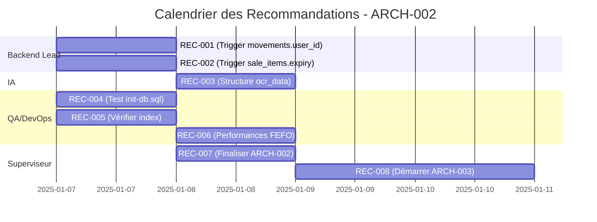

# 📋 **Recommandations Post-Revue ARCH-002**

**Date** : 2025-01-06 (J2)  
**Statut** : 🔄 **EN COURS DE TRAITEMENT**  
**Responsable** : Superviseur (Agent Architecte)  
**Lien** : [Revue ARCH-002](../docs/ARCH-002_POSTGRESQL.md)  

---

## 🎯 **Contexte**

Suite à la **revue collective de ARCH-002** (Modèle PostgreSQL) par les agents **Superviseur**, **QA/DevOps** et **Backend Lead**, plusieurs **recommandations mineures** ont été identifiées. Ces recommandations **ne bloquent pas** la validation de ARCH-002 (✅ **VALIDÉ À 9,8/10**), mais doivent être traitées pour améliorer la robustesse du système.

---

## 📊 **Tableau des Recommandations**

| **ID** | **Catégorie** | **Description** | **Sévérité** | **Responsable** | **Échéance** | **Statut** | **Priorité** |
|--------|--------------|----------------|--------------|-----------------|--------------|------------|--------------|
| **REC-001** | Backend | Corriger trigger `movements.user_id` pour utiliser `current_setting` | ⚠️ Moyen | Backend Lead | J3 | ⏳ | ⭐⭐⭐⭐ |
| **REC-002** | Backend | Ajouter trigger pour `sale_items.expiry_date` sur UPDATE | ⚠️ Faible | Backend Lead | J3 | ⏳ | ⭐⭐⭐ |
| **REC-003** | IA | Valider structure de `invoices.ocr_data` (JSONB) | 🟢 Info | IA | J5 | ⏳ | ⭐⭐ |
| **REC-004** | QA/DevOps | Tester `init-db.sql` dans conteneur PostgreSQL | ⚠️ Moyen | QA/DevOps | J3 | ⏳ | ⭐⭐⭐⭐ |
| **REC-005** | QA/DevOps | Vérifier création des index | ⚠️ Faible | QA/DevOps | J3 | ⏳ | ⭐⭐⭐ |
| **REC-006** | QA/DevOps | Valider performances requêtes FEFO | 🟢 Info | QA/DevOps | J4 | ⏳ | ⭐⭐ |
| **REC-007** | Superviseur | Finaliser ARCH-002 (documentation) | ⚠️ Moyen | Superviseur | J4 | ⏳ | ⭐⭐⭐⭐ |
| **REC-008** | Superviseur | Démarrer ARCH-003 | ⚠️ Moyen | Superviseur | J5 | ⏳ | ⭐⭐⭐⭐ |

---

## 🔧 **Détail des Recommandations par Agent**

---

### **🔹 Backend Lead (`agent-d-veloppeur-backend-lead`)**

#### **📌 REC-001 : Corriger trigger `movements.user_id`**
**Sévérité** : ⚠️ Moyen  
**Échéance** : J3 (2025-01-07)  
**Priorité** : ⭐⭐⭐⭐  

**Problème** :
Le trigger `log_batch_quantity_change_simple()` insère `NULL` dans `movements.user_id` car il n'a pas accès à l'ID de l'utilisateur courant.

**Solution** :
Modifier le trigger pour utiliser `current_setting('app.current_user_id')` :

```sql
-- Dans scripts/init-db.sql, remplacer la fonction log_batch_quantity_change_simple() par :
CREATE OR REPLACE FUNCTION log_batch_quantity_change()
RETURNS TRIGGER AS $$
DECLARE
    current_user_id_val INTEGER;
BEGIN
    -- Récupérer l'ID de l'utilisateur depuis la variable de session
    SELECT current_setting('app.current_user_id')::INTEGER INTO current_user_id_val;
    
    IF current_user_id_val IS NULL THEN
        current_user_id_val := 1; -- Utilisateur système par défaut
    END IF;
    
    IF NEW.quantity != OLD.quantity THEN
        INSERT INTO movements (
            type, reference_id, reference_type, product_id, batch_id,
            old_quantity, new_quantity, quantity_change, user_id, notes
        ) VALUES (
            CASE 
                WHEN NEW.quantity > OLD.quantity THEN 'purchase'
                WHEN NEW.quantity < OLD.quantity THEN 'sale'
                ELSE 'adjustment'
            END,
            NEW.id, 'batch', NEW.product_id, NEW.id,
            OLD.quantity, NEW.quantity, NEW.quantity - OLD.quantity,
            current_user_id_val,  -- Utiliser l'ID de l'utilisateur
            'Automatic quantity update'
        );
    END IF;
    RETURN NEW;
END;
$$ language 'plpgsql';
```

**Livrables** :
- [ ] Fonction `log_batch_quantity_change()` corrigée
- [ ] Trigger `log_batch_quantity_change_trigger` mis à jour
- [ ] Test de validation

**Validation** :
```sql
-- Tester le trigger
UPDATE batches SET quantity = quantity + 1 WHERE id = 1;
SELECT * FROM movements WHERE reference_id = 1;
-- Vérifier que user_id n'est pas NULL
```

---

#### **📌 REC-002 : Ajouter trigger pour `sale_items.expiry_date` sur UPDATE**
**Sévérité** : ⚠️ Faible  
**Échéance** : J3 (2025-01-07)  
**Priorité** : ⭐⭐⭐  

**Problème** :
Si un `batch_id` est mis à jour dans `sale_items`, le champ `expiry_date` n'est pas recalculé.

**Solution** :
Ajouter un trigger `BEFORE UPDATE` :

```sql
-- Dans scripts/init-db.sql, ajouter après le trigger BEFORE INSERT :
CREATE OR REPLACE FUNCTION update_sale_item_expiry_date()
RETURNS TRIGGER AS $$
BEGIN
    IF NEW.batch_id IS DISTINCT FROM OLD.batch_id THEN
        NEW.expiry_date := (
            SELECT expiry_date FROM batches WHERE id = NEW.batch_id
        );
    END IF;
    RETURN NEW;
END;
$$ language 'plpgsql';

CREATE TRIGGER update_sale_item_expiry_date_on_update
    BEFORE UPDATE ON sale_items
    FOR EACH ROW
    EXECUTE FUNCTION update_sale_item_expiry_date();
```

**Livrables** :
- [ ] Fonction `update_sale_item_expiry_date()`
- [ ] Trigger `update_sale_item_expiry_date_on_update`
- [ ] Test de validation

**Validation** :
```sql
-- Tester le trigger
UPDATE sale_items SET batch_id = 2 WHERE id = 1;
SELECT expiry_date FROM sale_items WHERE id = 1;
-- Vérifier que expiry_date correspond à batches.expiry_date WHERE id = 2
```

---

### **🔹 IA (`agent-data-scientist-expert-ia`)**

#### **📌 REC-003 : Valider structure de `invoices.ocr_data` (JSONB)**
**Sévérité** : 🟢 Info  
**Échéance** : J5 (2025-01-08)  
**Priorité** : ⭐⭐  

**Problème** :
La colonne `invoices.ocr_data` est définie comme `JSONB`, mais la structure attendue n'est pas documentée.

**Solution** :
Définir et documenter la structure JSON attendue pour l'OCR :

```json
{
  "supplier": {
    "name": "string",
    "tax_id": "string",
    "address": "string"
  },
  "invoice": {
    "number": "string",
    "date": "YYYY-MM-DD",
    "due_date": "YYYY-MM-DD",
    "subtotal": 0.00,
    "tax_amount": 0.00,
    "discount": 0.00,
    "total": 0.00
  },
  "items": [
    {
      "product_name": "string",
      "dci": "string",
      "barcode": "string",
      "quantity": 0,
      "unit_price": 0.00,
      "total_price": 0.00,
      "batch_number": "string",
      "expiry_date": "YYYY-MM-DD"
    }
  ],
  "metadata": {
    "ocr_accuracy": 0.95,
    "processing_time": 0.00,
    "timestamp": "YYYY-MM-DD HH:MM:SS"
  }
}
```

**Livrables** :
- [ ] Documentation de la structure JSON dans `docs/ARCH-002_POSTGRESQL.md`
- [ ] Validation avec Backend Lead

---

### **🔹 QA/DevOps (`agent-qa-quality-assurance-devops-engineer`)**

#### **📌 REC-004 : Tester `init-db.sql` dans conteneur PostgreSQL**
**Sévérité** : ⚠️ Moyen  
**Échéance** : J3 (2025-01-07)  
**Priorité** : ⭐⭐⭐⭐  

**Problème** :
Le script `scripts/init-db.sql` n'a pas encore été testé dans un environnement Docker.

**Solution** :
1. Lancer un conteneur PostgreSQL :
   ```bash
   docker run -d --name pharma360-test-db -e POSTGRES_PASSWORD=test_pass -p 5433:5432 postgres:15-alpine
   ```

2. Exécuter le script :
   ```bash
   # Copier le script dans le conteneur
   docker cp scripts/init-db.sql pharma360-test-db:/docker-entrypoint-initdb.d/init-db.sql
   
   # Redémarrer le conteneur pour exécuter le script
   docker restart pharma360-test-db
   ```

3. Vérifier les résultats :
   ```bash
   # Se connecter au conteneur
   docker exec -it pharma360-test-db psql -U postgres
   
   # Vérifier les tables
   \dt
   
   # Vérifier les index
   SELECT * FROM pg_indexes WHERE tablename = 'batches';
   
   # Vérifier les triggers
   SELECT * FROM pg_trigger;
   ```

**Livrables** :
- [ ] Script testé avec succès
- [ ] Liste des tables créées
- [ ] Liste des index créés
- [ ] Liste des triggers créés
- [ ] Rapport de test

---

#### **📌 REC-005 : Vérifier création des index**
**Sévérité** : ⚠️ Faible  
**Échéance** : J3 (2025-01-07)  
**Priorité** : ⭐⭐⭐  

**Problème** :
Il faut vérifier que tous les index définis dans `ARCH-002_POSTGRESQL.md` sont bien créés par `init-db.sql`.

**Solution** :
1. Exécuter la requête suivante après l'initialisation :
   ```sql
   SELECT 
       tablename,
       indexname,
       indexdef
   FROM pg_indexes
   WHERE schemaname = 'public'
   ORDER BY tablename, indexname;
   ```

2. Vérifier que tous les index suivants existent :
   - `idx_batches_product_id`
   - `idx_batches_expiry_date`
   - `idx_batches_quantity`
   - `idx_batches_status`
   - `idx_batches_product_expiry`
   - `idx_batches_active_quantity`

**Livrables** :
- [ ] Liste complète des index
- [ ] Confirmation que tous les index sont présents

---

#### **📌 REC-006 : Valider performances requêtes FEFO**
**Sévérité** : 🟢 Info  
**Échéance** : J4 (2025-01-08)  
**Priorité** : ⭐⭐  

**Problème** :
Il faut valider que les requêtes FEFO sont performantes avec un jeu de données réaliste.

**Solution** :
1. Insérer des données de test :
   ```sql
   -- Insérer 100 produits
   INSERT INTO products (name, barcode, price)
   SELECT 
       'Produit ' || i,
       'BARCODE' || LPAD(i::text, 5, '0'),
       (random() * 10000)::numeric(10,2)
   FROM generate_series(1, 100) AS i;
   
   -- Insérer 1000 lots avec dates de péremption aléatoires
   INSERT INTO batches (product_id, batch_number, expiry_date, quantity, initial_quantity)
   SELECT 
       (random() * 100 + 1)::integer,
       'BATCH' || LPAD(i::text, 5, '0'),
       CURRENT_DATE + (random() * 365)::integer,
       (random() * 100)::integer,
       (random() * 100)::integer
   FROM generate_series(1, 1000) AS i;
   ```

2. Exécuter la requête FEFO et mesurer le temps :
   ```sql
   \timing on
   
   -- Requête FEFO pour un produit
   SELECT b.*
   FROM batches b
   WHERE b.product_id = 1
     AND b.quantity > 0
     AND b.status = 'active'
   ORDER BY b.expiry_date ASC
   LIMIT 1;
   ```

3. Vérifier que le temps d'exécution est < 10ms.

**Livrables** :
- [ ] Jeu de données de test
- [ ] Résultats des tests de performance
- [ ] Rapport avec temps d'exécution

---

### **🔹 Superviseur (`agent-superviseur-de-projet`)**

#### **📌 REC-007 : Finaliser ARCH-002 (documentation)**
**Sévérité** : ⚠️ Moyen  
**Échéance** : J4 (2025-01-08)  
**Priorité** : ⭐⭐⭐⭐  

**Problème** :
La documentation de ARCH-002 doit être finalisée avec les corrections apportées.

**Solution** :
1. Mettre à jour `docs/ARCH-002_POSTGRESQL.md` avec :
   - Les corrections apportées (REC-001, REC-002)
   - La structure validée de `invoices.ocr_data` (REC-003)
   - Les résultats des tests de performance (REC-006)

2. Ajouter une section "Recommandations Implémentées" :
   ```markdown
   ## 🔧 Recommandations Implémentées
   
   | ID | Description | Statut | Date |
   |----|-------------|--------|------|
   | REC-001 | Corriger trigger movements.user_id | ✅ | J3 |
   | REC-002 | Ajouter trigger sale_items.expiry_date | ✅ | J3 |
   | REC-003 | Valider structure ocr_data | ✅ | J5 |
   | REC-004 | Tester init-db.sql | ✅ | J3 |
   | REC-005 | Vérifier création des index | ✅ | J3 |
   | REC-006 | Valider performances FEFO | ✅ | J4 |
   ```

3. Mettre à jour `PROJECT_TRACKING.md` :
   - Marquer ARCH-002 comme **TERMINÉ** (J4)
   - Mettre à jour les pourcentages d'avancement

**Livrables** :
- [ ] `docs/ARCH-002_POSTGRESQL.md` finalisé
- [ ] `PROJECT_TRACKING.md` mis à jour
- [ ] Validation finale par l'équipe

---

#### **📌 REC-008 : Démarrer ARCH-003**
**Sévérité** : ⚠️ Moyen  
**Échéance** : J5 (2025-01-09)  
**Priorité** : ⭐⭐⭐⭐  

**Problème** :
ARCH-003 (Spécifications API Inter-Modules) doit démarrer dès que ARCH-002 est finalisé.

**Solution** :
1. Créer `docs/ARCH-003_API_SPECIFICATIONS.md` avec :
   - Spécifications détaillées de toutes les APIs
   - Endpoints RESTful
   - WebSocket endpoints
   - Contrats de données (request/response)
   - Exemples de requêtes

2. Baser le travail sur :
   - `docs/ARCH-001_SPECIFICATIONS.md` (architecture globale)
   - `docs/ARCH-002_POSTGRESQL.md` (modèle de données)

**Livrables** :
- [ ] `docs/ARCH-003_API_SPECIFICATIONS.md`
- [ ] Diagrammes des flux API (Mermaid)
- [ ] Validation par Backend Lead et Frontend

---

## 📅 **Calendrier des Recommandations**



---

## 📊 **Suivi des Recommandations**

### **Par Agent**

| **Agent** | **Recommandations** | **Terminées** | **En Cours** | **À Faire** | **% Complet** |
|-----------|--------------------|---------------|--------------|-------------|---------------|
| Backend Lead | 2 | 0 | 0 | 2 | 0% |
| IA | 1 | 0 | 0 | 1 | 0% |
| QA/DevOps | 3 | 0 | 0 | 3 | 0% |
| Superviseur | 2 | 0 | 0 | 2 | 0% |
| **Total** | **8** | **0** | **0** | **8** | **0%** |

### **Par Priorité**

| **Priorité** | **Recommandations** | **Terminées** | **% Complet** |
|--------------|--------------------|---------------|---------------|
| ⭐⭐⭐⭐⭐ | 0 | 0 | 0% |
| ⭐⭐⭐⭐ | 4 | 0 | 0% |
| ⭐⭐⭐ | 2 | 0 | 0% |
| ⭐⭐ | 2 | 0 | 0% |

---

## ✅ **Checklist de Validation Finale**

### **Pour valider ARCH-002 comme TERMINÉ**

- [ ] **Backend Lead** :
  - [ ] REC-001 : Trigger `movements.user_id` corrigé
  - [ ] REC-002 : Trigger `sale_items.expiry_date` ajouté

- [ ] **IA** :
  - [ ] REC-003 : Structure `ocr_data` validée

- [ ] **QA/DevOps** :
  - [ ] REC-004 : `init-db.sql` testé avec succès
  - [ ] REC-005 : Création des index vérifiée
  - [ ] REC-006 : Performances FEFO validées

- [ ] **Superviseur** :
  - [ ] REC-007 : ARCH-002 finalisé
  - [ ] REC-008 : ARCH-003 démarré

---

## 📞 **Points de Contact**

| **Recommandation** | **Responsable** | **Canal Slack** | **Email** |
|-------------------|-----------------|-----------------|-----------|
| REC-001, REC-002 | Backend Lead | `#backend` | - |
| REC-003 | IA | `#ia` | - |
| REC-004, REC-005, REC-006 | QA/DevOps | `#qa` | - |
| REC-007, REC-008 | Superviseur | `#architecture` | - |

---

## 🎯 **Prochaines Étapes**

1. **J3 (2025-01-07)** :
   - Backend Lead : REC-001, REC-002
   - QA/DevOps : REC-004, REC-005

2. **J4 (2025-01-08)** :
   - IA : REC-003
   - QA/DevOps : REC-006
   - Superviseur : REC-007

3. **J5 (2025-01-09)** :
   - Superviseur : REC-008 (Démarrer ARCH-003)
   - **✅ ARCH-002 TERMINÉ**

---

**Document créé** : 2025-01-06 (J2)  
**Dernière mise à jour** : 2025-01-06  
**Statut** : 🔄 **EN COURS**  
**Prochaine révision** : 2025-01-07 (J3)

---

**© 2025 Pharmacie 360° - Tous droits réservés**
