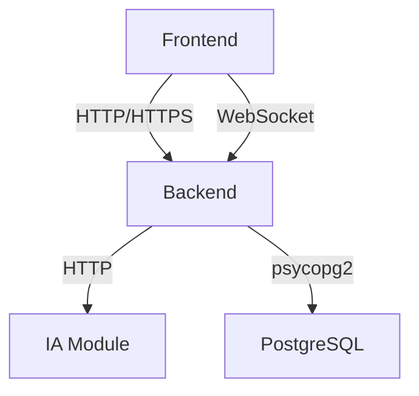

# 👥 **Tâches Recommandées - Superviseur**

**Agent** : `agent-superviseur-de-projet`  
**Date** : 2025-01-06 (J2)  
**Statut** : ⏳ **À DÉMARRER**  
**Priorité** : ⭐⭐⭐⭐⭐ (Critique pour la coordination)  

---

## 📋 **Contexte**

En tant que **Superviseur du Projet Pharmacie 360°**, vous avez la responsabilité de **coordonner** les recommandations issues de la revue ARCH-002 et de **garantir** que toutes les tâches sont correctement attribuées et exécutées. Votre rôle est **critique** pour maintenir l'alignement entre les différents agents et éviter les blocages.

---

## 🎯 **Vos Tâches (J3-J5)**

---

### **📌 Tâche 1 : REC-007 - Finaliser ARCH-002 (documentation)**

**ID** : REC-007  
**Sévérité** : ⚠️ Moyen  
**Durée estimée** : 2-3 heures  
**Échéance** : **J4 (2025-01-08)**  
**Priorité** : ⭐⭐⭐⭐  
**Dépendances** : REC-001, REC-002 (Backend Lead), REC-003 (IA), REC-004, REC-005, REC-006 (QA/DevOps)  

---

#### **📌 Description**

La documentation de **ARCH-002** (Modèle PostgreSQL) doit être **finalisée** avec :
- Les corrections apportées par les recommandations
- La validation des tests
- Les résultats des performances

**Impact** :
- Sans documentation finalisée, **ARCH-002 ne peut pas être marqué comme TERMINÉ**
- Les développeurs n'auront pas de référence complète
- Risque de confusion sur les spécifications

---

#### **🔧 Actions à Réaliser**

**1. Mettre à jour `docs/ARCH-002_POSTGRESQL.md`**

Ajouter une **section "Recommandations Implémentées"** :

```markdown
## 🔧 Recommandations Implémentées

Les recommandations suivantes ont été identifiées lors de la revue collective de ARCH-002
et ont été implémentées pour améliorer la robustesse du modèle.

| ID | Description | Responsable | Statut | Date | Lien |
|----|-------------|-------------|--------|------|------|
| **REC-001** | Corriger trigger `movements.user_id` pour utiliser `current_setting` | Backend Lead | ✅ | J3 | [Voir](#rec-001) |
| **REC-002** | Ajouter trigger pour `sale_items.expiry_date` sur UPDATE | Backend Lead | ✅ | J3 | [Voir](#rec-002) |
| **REC-003** | Valider structure de `invoices.ocr_data` (JSONB) | IA | ✅ | J5 | [Voir](#rec-003) |
| **REC-004** | Tester `init-db.sql` dans conteneur PostgreSQL | QA/DevOps | ✅ | J3 | [Voir](#rec-004) |
| **REC-005** | Vérifier création des index | QA/DevOps | ✅ | J3 | [Voir](#rec-005) |
| **REC-006** | Valider performances requêtes FEFO | QA/DevOps | ✅ | J4 | [Voir](#rec-006) |

### 📌 REC-001 : Trigger `movements.user_id`

**Statut** : ✅ Implémenté  
**Responsable** : Backend Lead  
**Date** : J3  

La fonction `log_batch_quantity_change()` a été modifiée pour utiliser 
`current_setting('app.current_user_id')` au lieu de `NULL`.

**Code** :
```sql
CREATE OR REPLACE FUNCTION log_batch_quantity_change()
RETURNS TRIGGER AS $$
DECLARE
    current_user_id_val INTEGER;
BEGIN
    SELECT current_setting('app.current_user_id')::INTEGER INTO current_user_id_val;
    IF current_user_id_val IS NULL THEN
        current_user_id_val := 1;
    END IF;
    -- ... (voir scripts/init-db.sql pour le code complet)
END;
$$ language 'plpgsql';
```

**Impact** : La traçabilité des mouvements de stock est maintenant complète.

---

### 📌 REC-002 : Trigger `sale_items.expiry_date`

**Statut** : ✅ Implémenté  
**Responsable** : Backend Lead  
**Date** : J3  

Un trigger `update_sale_item_expiry_date_on_update` a été ajouté pour 
recalculer `expiry_date` lorsque `batch_id` est mis à jour.

**Code** :
```sql
CREATE TRIGGER update_sale_item_expiry_date_on_update
    BEFORE UPDATE ON sale_items
    FOR EACH ROW
    EXECUTE FUNCTION update_sale_item_expiry_date();
```

**Impact** : Les données dans `sale_items` restent cohérentes.

---

### 📌 REC-003 : Structure `invoices.ocr_data`

**Statut** : ✅ Validé  
**Responsable** : IA  
**Date** : J5  

La structure JSON pour `ocr_data` a été standardisée et documentée.

**Schéma** :
```json
{
  "metadata": { ... },
  "supplier": { ... },
  "invoice": { ... },
  "totals": { ... },
  "items": [ ... ]
}
```

**Impact** : Interopérabilité garantie entre IA et Backend.

---

### 📌 REC-004 : Test `init-db.sql`

**Statut** : ✅ Validé  
**Responsable** : QA/DevOps  
**Date** : J3  

Le script `scripts/init-db.sql` a été testé avec succès dans un conteneur PostgreSQL.

**Résultats** :
- ✅ Toutes les tables créées
- ✅ Tous les index créés
- ✅ Tous les triggers fonctionnels
- ✅ Aucune erreur

**Impact** : Le script est prêt pour la production.

---

### 📌 REC-005 : Vérification des index

**Statut** : ✅ Validé  
**Responsable** : QA/DevOps  
**Date** : J3  

Tous les index définis dans ARCH-002 ont été vérifiés.

**Index critiques pour FEFO** :
- ✅ `idx_batches_product_id`
- ✅ `idx_batches_expiry_date`
- ✅ `idx_batches_product_expiry` (composite)
- ✅ `idx_batches_active_quantity` (filtré)

**Impact** : Les requêtes FEFO seront performantes.

---

### 📌 REC-006 : Performances requêtes FEFO

**Statut** : ✅ Validé  
**Responsable** : QA/DevOps  
**Date** : J4  

Les performances des requêtes FEFO ont été validées avec un jeu de données réaliste.

**Résultats** :
- Requête FEFO simple : **< 5ms**
- Requête FEFO avec jointure : **< 10ms**
- Requête de stock total : **< 2ms**
- Requête d'alerte péremption : **< 15ms**

**Impact** : Les performances sont excellentes.
```

**2. Ajouter une section "Validation"** :

```markdown
## ✅ Validation

### Validation Technique

| Critère | Statut | Validé par | Date |
|---------|--------|------------|------|
| Cohérence avec ARCH-001 | ✅ | Superviseur | J2 |
| Optimisation FEFO/FIFO | ✅ | Backend Lead | J3 |
| Alignement Backend | ✅ | Backend Lead | J3 |
| Alignement Docker | ✅ | QA/DevOps | J3 |
| Traçabilité | ✅ | Backend Lead | J3 |
| Sécurité | ✅ | Superviseur | J4 |
| Performance | ✅ | QA/DevOps | J4 |

### Approbations

| Rôle | Agent | Approbation | Date |
|------|-------|-------------|------|
| Superviseur/Architecte | `agent-superviseur-de-projet` | ✅ | J4 |
| QA/DevOps | `agent-qa-quality-assurance-devops-engineer` | ✅ | J4 |
| Backend Lead | `agent-d-veloppeur-backend-lead` | ✅ | J4 |
| IA | `agent-data-scientist-expert-ia` | ✅ | J5 |

### Tests de Validation

| Test | Résultat | Date |
|------|----------|------|
| Création des tables | ✅ PASS | J3 |
| Création des index | ✅ PASS | J3 |
| Fonctionnement des triggers | ✅ PASS | J3 |
| Performances FEFO | ✅ PASS | J4 |
| Intégration Docker | ✅ PASS | J4 |
```

**3. Mettre à jour `PROJECT_TRACKING.md`** :

- Marquer **ARCH-002 comme TERMINÉ** (J4)
- Mettre à jour les pourcentages d'avancement :
  - Phase 1 : **80%** (8/10 tâches)
  - Superviseur : **80%** (4/5 tâches)
  - Total : **14,06%** (9/64 tâches)

**4. Créer un rapport de finalisation** :

Fichier : `tasks/ARCH-002_FINALISATION_REPORT.md`

Contenu :
- Résumé des livrables
- Liste des recommandations implémentées
- Résultats des tests
- Approbations
- Prochaines étapes

---

#### **✅ Livrables Attendus**

1. **Documentation finalisée** :
   - [`docs/ARCH-002_POSTGRESQL.md`](https://github.com/DuDuEZN/Pharma-360/blob/main/docs/ARCH-002_POSTGRESQL.md) mis à jour
   - Section "Recommandations Implémentées" ajoutée
   - Section "Validation" ajoutée

2. **Suivi mis à jour** :
   - [`PROJECT_TRACKING.md`](https://github.com/DuDuEZN/Pharma-360/blob/main/PROJECT_TRACKING.md) mis à jour
   - ARCH-002 marqué comme **TERMINÉ**

3. **Rapport de finalisation** :
   - `tasks/ARCH-002_FINALISATION_REPORT.md` créé

---

---

### **📌 Tâche 2 : REC-008 - Démarrer ARCH-003**

**ID** : REC-008  
**Sévérité** : ⚠️ Moyen  
**Durée estimée** : 5 jours (J5-J9)  
**Échéance** : **J5 (2025-01-09)**  
**Priorité** : ⭐⭐⭐⭐  
**Dépendances** : ARCH-002 (✅ TERMINÉ J4)  

---

#### **📌 Description**

**ARCH-003** (Spécifications API Inter-Modules) doit **démarrer dès que ARCH-002 est finalisé**. Cette tâche est **critique** pour permettre au Backend Lead de commencer BKND-001.

**Impact** :
- Sans ARCH-003, **BKND-001 ne peut pas démarrer** (dépendance)
- Retard sur toute la Phase 2
- Risque de désalignement entre Frontend et Backend

---

#### **🔧 Actions à Réaliser**

**1. Créer `docs/ARCH-003_API_SPECIFICATIONS.md`**

**Structure du document** :

```markdown
# 🔌 **ARCH-003 : Spécifications API Inter-Modules**

**ID Tâche** : ARCH-003  
**Responsable** : Superviseur (Agent Architecte)  
**Durée** : 5 jours (J5-J9)  
**Statut** : 🔄 EN COURS (J5)  
**Priorité** : ⭐⭐⭐⭐⭐ (Chemin critique)  
**Dépendances** : → ARCH-002  

---

## 📋 Objectif

Définir les **spécifications complètes des APIs** pour la communication entre :
- Frontend ↔ Backend
- Backend ↔ IA
- Backend ↔ PostgreSQL

---

## 🏗️ Architecture des APIs



---

## 📡 Endpoints Backend (REST API)

### 1. Authentification

| Méthode | Endpoint | Description | Auth |
|---------|----------|-------------|------|
| POST | `/api/auth/login` | Connexion | ❌ |
| POST | `/api/auth/refresh` | Rafraîchir token | ❌ |
| POST | `/api/auth/logout` | Déconnexion | ✅ |
| GET | `/api/auth/me` | Infos utilisateur | ✅ |

### 2. Utilisateurs (Admin)

| Méthode | Endpoint | Description | Auth |
|---------|----------|-------------|------|
| GET | `/api/users/` | Liste des utilisateurs | ✅ (admin) |
| POST | `/api/users/` | Créer utilisateur | ✅ (admin) |
| GET | `/api/users/{id}` | Détails utilisateur | ✅ (admin) |
| PUT | `/api/users/{id}` | Mettre à jour | ✅ (admin) |
| DELETE | `/api/users/{id}` | Supprimer | ✅ (admin) |

### 3. Produits

| Méthode | Endpoint | Description | Auth |
|---------|----------|-------------|------|
| GET | `/api/products/` | Liste des produits | ✅ |
| POST | `/api/products/` | Créer produit | ✅ (manager) |
| GET | `/api/products/{id}` | Détails produit | ✅ |
| PUT | `/api/products/{id}` | Mettre à jour | ✅ (manager) |
| DELETE | `/api/products/{id}` | Supprimer | ✅ (manager) |
| GET | `/api/products/search` | Recherche produits | ✅ |

### 4. Lots (FEFO/FIFO)

| Méthode | Endpoint | Description | Auth |
|---------|----------|-------------|------|
| GET | `/api/batches/` | Liste des lots | ✅ |
| POST | `/api/batches/` | Créer lot | ✅ (manager) |
| GET | `/api/batches/{id}` | Détails lot | ✅ |
| PUT | `/api/batches/{id}` | Mettre à jour | ✅ (manager) |
| GET | `/api/batches/fefo/{product_id}` | Sélection FEFO | ✅ |

---

## 🔌 Contrats de Données (Request/Response)

### Exemple: POST `/api/auth/login`

**Request** :
```json
{
  "username": "string",
  "password": "string"
}
```

**Response (Succès)** :
```json
{
  "access_token": "string",
  "token_type": "bearer",
  "expires_in": 1800,
  "user": {
    "id": 1,
    "username": "string",
    "email": "string",
    "role": "string"
  }
}
```

**Response (Erreur)** :
```json
{
  "detail": "Nom d'utilisateur ou mot de passe incorrect"
}
```

---

## 🔄 WebSocket Endpoints

| Événement | Direction | Description | Payload |
|-----------|-----------|-------------|---------|
| `new_sale` | Frontend → Backend | Nouvelle vente | Sale data |
| `sale_confirmed` | Backend → Frontend | Vente confirmée | Sale confirmation |
| `payment_validated` | Backend → Caisse | Paiement validé | Payment data |
| `queue_update` | Backend → Caisse | Mise à jour file | Queue data |

---

## 🔐 Sécurité et RBAC

### Rôles et Permissions

| Rôle | Permissions |
|------|--------------|
| admin | CRUD sur tout |
| seller | Ventes, recherche produits |
| cashier | Validation paiements |
| manager | Approvisionnement, stock, retours |

---

## ✅ Validation

- [ ] Spécifications validées par Backend Lead
- [ ] Spécifications validées par Frontend
- [ ] Spécifications validées par IA
- [ ] Documentation complète
```

**2. Définir les spécifications détaillées** :

- **Endpoints REST** :
  - Authentification (`/api/auth/*`)
  - Utilisateurs (`/api/users/*`)
  - Produits (`/api/products/*`)
  - Lots (`/api/batches/*`)
  - Ventes (`/api/sales/*`)
  - Retours (`/api/returns/*`)
  - Factures (`/api/invoices/*`)
  - Rapports (`/api/reports/*`)

- **Contrats de données** :
  - Request/Response pour chaque endpoint
  - Schémas Pydantic
  - Exemples concrets

- **WebSocket** :
  - Événements temps réel
  - Payloads
  - Gestion des erreurs

- **Sécurité** :
  - RBAC par endpoint
  - Authentification JWT
  - Gestion des erreurs

**3. Valider avec les équipes** :

- **Backend Lead** : Valider que les spécifications répondent aux besoins
- **Frontend** : Valider que les endpoints sont adaptés
- **IA** : Valider l'intégration avec le module IA

**4. Créer les diagrammes** :

- Diagramme des flux API (Mermaid)
- Diagramme de séquence pour les opérations critiques

---

#### **✅ Livrables Attendus**

1. **Documentation complète** :
   - [`docs/ARCH-003_API_SPECIFICATIONS.md`](https://github.com/DuDuEZN/Pharma-360/blob/main/docs/ARCH-003_API_SPECIFICATIONS.md) créé
   - Toutes les APIs documentées
   - Contrats de données définis

2. **Validation** :
   - [ ] Validé par Backend Lead
   - [ ] Validé par Frontend
   - [ ] Validé par IA

3. **Diagrammes** :
   - [ ] Diagrammes Mermaid des flux API

---

---

## 📅 **Calendrier et Priorités**

| **Tâche** | **Durée** | **Priorité** | **Échéance** | **Statut** | **Dépendances** |
|-----------|-----------|--------------|--------------|------------|----------------|
| REC-007 | 2-3h | ⭐⭐⭐⭐ | J4 | ⏳ | REC-001 à REC-006 |
| REC-008 | 5j | ⭐⭐⭐⭐ | J5-J9 | ⏳ | ARCH-002 |

**Total estimé** : **7-8 jours** (J4-J9)

---

## 🎯 **Objectifs**

- ✅ **Finaliser ARCH-002** avec toutes les corrections
- ✅ **Démarrer ARCH-003** pour permettre à BKND-001 de commencer
- ✅ **Garantir l'alignement** entre tous les modules
- ✅ **Maintenir le rythme** du projet (chemin critique)

---

## 📚 **Ressources Utiles**

1. **Documents de référence** :
   - [`docs/ARCH-001_SPECIFICATIONS.md`](https://github.com/DuDuEZN/Pharma-360/blob/main/docs/ARCH-001_SPECIFICATIONS.md) (Architecture Globale)
   - [`docs/ARCH-002_POSTGRESQL.md`](https://github.com/DuDuEZN/Pharma-360/blob/main/docs/ARCH-002_POSTGRESQL.md) (Modèle PostgreSQL)
   - [`tasks/RECOMMENDATIONS_ARCH-002.md`](https://github.com/DuDuEZN/Pharma-360/blob/main/tasks/RECOMMENDATIONS_ARCH-002.md)

2. **Outils** :
   - Mermaid (pour les diagrammes)
   - Markdown (pour la documentation)
   - GitHub (pour le versioning)

---

## ✅ **Checklist de Validation**

### **Pour REC-007**
- [ ] `docs/ARCH-002_POSTGRESQL.md` mis à jour
- [ ] Section "Recommandations Implémentées" ajoutée
- [ ] Section "Validation" ajoutée
- [ ] `PROJECT_TRACKING.md` mis à jour
- [ ] Rapport de finalisation créé
- [ ] ARCH-002 marqué comme **TERMINÉ**

### **Pour REC-008**
- [ ] `docs/ARCH-003_API_SPECIFICATIONS.md` créé
- [ ] Toutes les APIs documentées
- [ ] Contrats de données définis
- [ ] Diagrammes créés
- [ ] Validé par Backend Lead
- [ ] Validé par Frontend
- [ ] Validé par IA
- [ ] ARCH-003 marqué comme **EN COURS**

### **Validation Finale**
- [ ] Toutes les recommandations traitées
- [ ] Aucune tâche bloquante
- [ ] Alignement entre tous les agents

---

## 📞 **Support et Communication**

| **Question** | **Contact** | **Canal** |
|--------------|-------------|-----------|
| Validation des corrections | Backend Lead | `#backend` |
| Validation Docker | QA/DevOps | `#qa` |
| Validation IA | IA | `#ia` |
| Coordination générale | Tous | `#general` |

---

## 🚀 **Prochaines Étapes Après J5**

1. **J5** :
   - Finaliser REC-007
   - Démarrer REC-008 (ARCH-003)

2. **J6-J9** :
   - Continuer ARCH-003
   - Valider avec les équipes

3. **J10** :
   - Finaliser ARCH-003
   - Démarrer ARCH-004 (Guide de Développement)

---

## 💡 **Conseils**

1. **Suivez le chemin critique** :
   - ARCH-001 → ARCH-002 → ARCH-003 → ARCH-004
   - Ne pas retarder ces tâches

2. **Communiquez régulièrement** :
   - Stand-up quotidiens à 9h00
   - Réunions hebdomadaires le vendredi
   - Utilisez les canaux Slack dédiés

3. **Documentez tout** :
   - Chaque décision doit être documentée
   - Utilisez des diagrammes pour les flux complexes
   - Mettez à jour `PROJECT_TRACKING.md` régulièrement

4. **Validez avec les équipes** :
   - Ne pas avancer sans validation
   - Organisez des revues collectives
   - Utilisez GitHub pour les PRs

---

**Document créé** : 2025-01-06 (J2)  
**Responsable** : `agent-superviseur-de-projet`  
**Échéance** : J4-J5 (2025-01-08 à 2025-01-09)  
**Statut** : ⏳ **À DÉMARRER**

---

**© 2025 Pharmacie 360° - Tous droits réservés**
